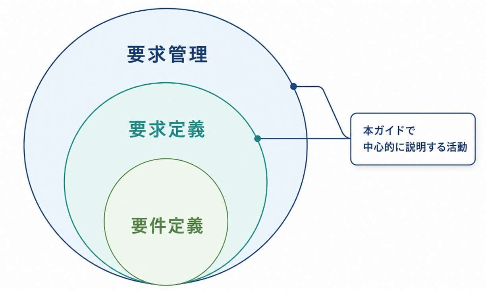
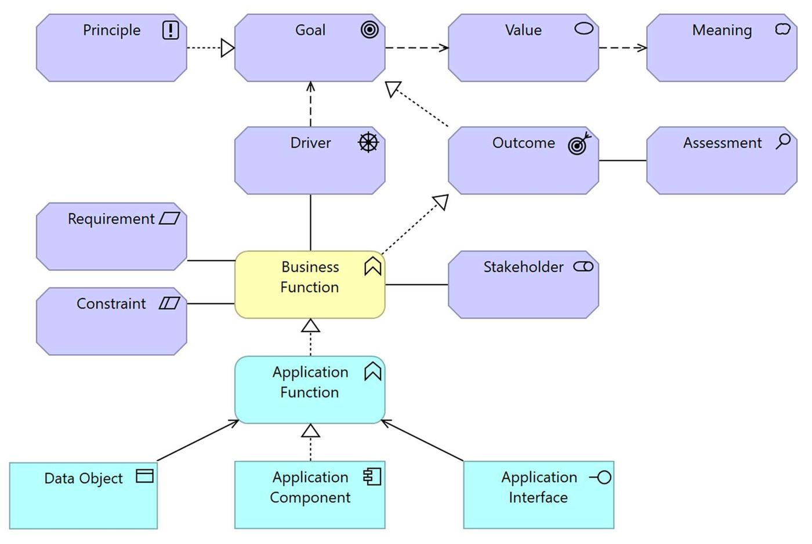
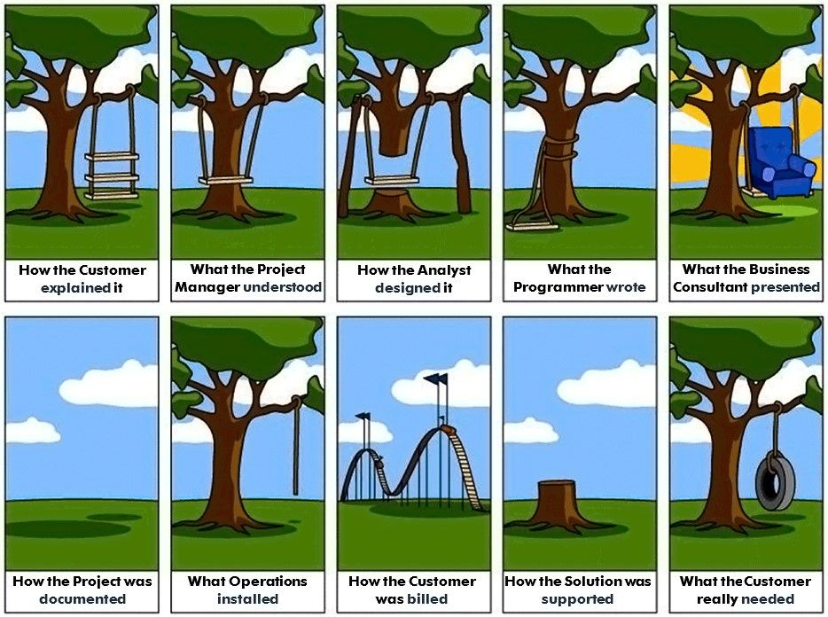
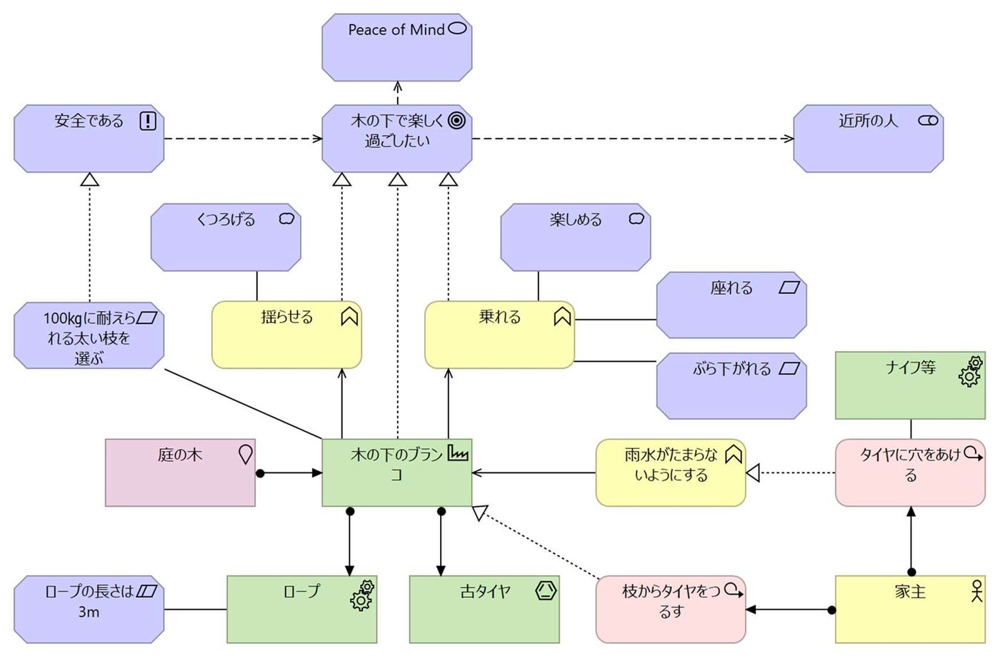
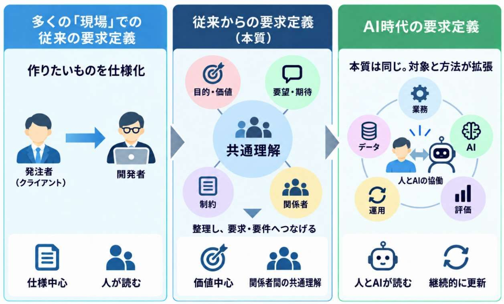
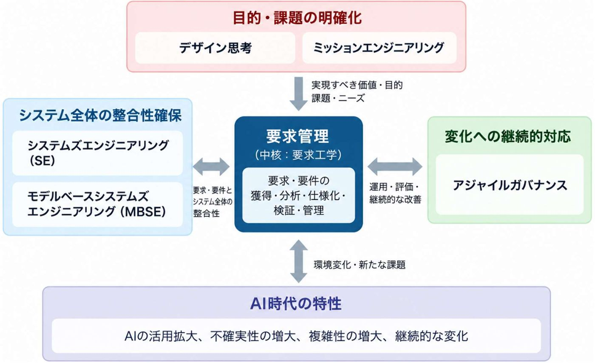
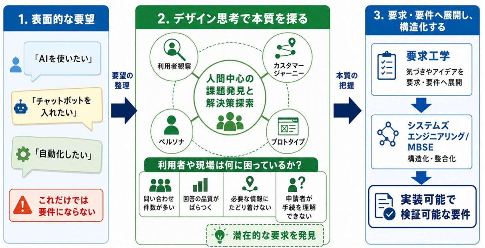
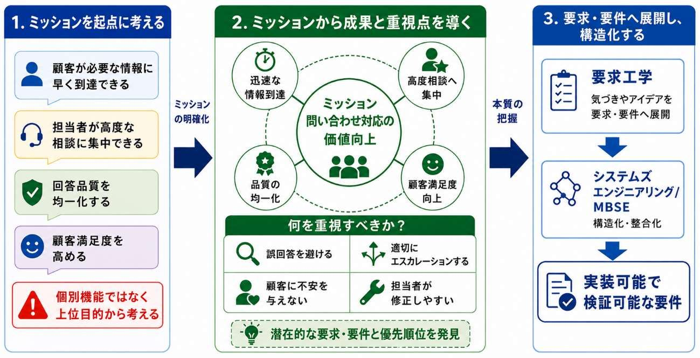

IPA（情報処理推進機構）が2026年11月に公開した[『AI時代の要求管理ハンドブック』](https://www.ipa.go.jp/digital/kaihatsu/youkyu-kanri.html)（Version 1.0.0、全129ページ）を、学習しやすいように教科書風に再構成した連載です。各章に途中の確認問題と、章末のまとめテストを付けています。

:::message
本連載は筆者が個人の学習目的で内容を要約・再構成したもので、IPAが作成・監修したものではありません。図は原典から引用しています。正確な記述は[原典PDF](https://www.ipa.go.jp/digital/kaihatsu/rqr7mi000000f5up-att/req-mgmt-hb.pdf)を参照してください。
:::

**連載一覧**

- **第1部 要求管理の基礎（第1〜4章）← この記事**
- [第2部 AI時代に要求管理はどう変わるか（第5〜8章）](https://zenn.dev/ryoooou/articles/ai-req-mgmt-handbook-part2)
- [第3部 モデリングとトレーサビリティ（第9〜11章）](https://zenn.dev/ryoooou/articles/ai-req-mgmt-handbook-part3)
- [第4部 ルール・制度・コンプライアンスと要求管理（第12〜14章）](https://zenn.dev/ryoooou/articles/ai-req-mgmt-handbook-part4)
- [第5部 AI時代の要求管理プロセスの組織への定着（第15〜16章）](https://zenn.dev/ryoooou/articles/ai-req-mgmt-handbook-part5)

### はじめに：2つのキーワード

:::message
**要求定義**：関係者の要望の背景にある目的を明らかにし、「何を実現したいか」を要求として整理したうえで、実装・評価できる要件へ具体化する活動。要件定義を内側に含む、より上位の概念です。

**要求管理**：狭い意味では、定義した要求の状態・優先度・版・変更履歴などをライフサイクルを通じて管理する活動。ハンドブックでは要求定義も含め、要求のライフサイクル全体を継続的に管理する広い意味で使われています。
:::

## 第1章　要望・要求・要件とは何か

要求定義のすべての出発点は、「要望」「要求」「要件」という3つの言葉を区別することにあります。この章では、その違いと、要求定義がなぜ組織にとって価値を生む「投資」なのかを学びます。

:::message
**この章で学ぶこと**

- 要望・要求・要件の違いを、具体例を使って説明できる
- 「所与の条件をシンプルにする」とはどういうことかを理解する
- 要求定義が生み出す8つの価値を挙げられる
- AI時代に特に重要になる4つの観点（可視化・構造化・トレーサビリティ・継続的更新）を説明できる

**キーワード**：要望、要求、要件、要求定義、要求管理、所与の条件、組織能力、トレーサビリティ
:::

### 1.1 要求定義の出発点

「作ったシステムが使われない」「AIの出力が現場の期待とずれている」「後から仕様変更が山ほど出る」――こうした失敗の多くは、実装の段階ではなく**要求定義の段階**に原因があります。

要求定義とは、必要な機能を並べたリストを作ることではありません。次のような問いに答えを出していく活動です。

- **何のために**そのシステムやAIを導入するのか
- **誰にとって**価値があるのか
- **どの業務**を変えるのか、**どのデータ**を使うのか
- **どの制約**を守るのか
- **何をもって成功**とするのか

ハンドブックでは「要求定義」を、関係者の要望の背景にある目的を明らかにし、「何を実現したいか」を要求として整理し、さらに実装・評価できる要件へ具体化する活動と定義しています。つまり**要件定義を内側に含む、より上位の概念**です。そして要求定義を含め、要求のライフサイクル全体を継続的に管理する活動を、広い意味で「要求管理」と呼びます。

*図1 ハンドブックにおける主要用語の概念イメージ（出典：IPA「AI時代の要求管理ハンドブック」）*

### 1.2 要望・要求・要件の違い

日常会話ではこの3語はほぼ同じ意味で使われますが、要求定義では明確に区別します。区別しないと、関係者の期待がずれたまま開発が進んでしまうからです。

#### 要望 ― 望み・期待・困りごと

利用者や関係者が口にする「こうなればいいのに」という声です。「もっと楽に仕事をしたい」「顧客対応を早くしたい」「安全にAIを使いたい」などがその例です。大切な声ですが、**漠然としていて、このままでは実装できません**。

#### 要求 ― 実現したいこと

要望をもとに「何を実現したいか」を明確にしたものです。たとえば「顧客対応を早くしたい」という要望は、「問い合わせを分類したい」「過去の回答例を検索したい」「担当部署へ自動で振り分けたい」といった要求に整理できます。

#### 要件 ― 実現しなければならない事項

要求をさらに具体化し、**実装・評価・受入・運用につながるレベル**で書いたものです。「問い合わせを分類したい」という要求なら、「受付時に苦情・質問・申請・障害報告・その他の5種類に分類すること」「分類結果を担当部署に通知すること」「担当者が分類を修正できること」「分類精度を月次で評価すること」といった要件になります。

| 段階 | 意味 | 例 |
|---|---|---|
| 要望 | 望み、期待、困りごと | 問い合わせ対応を早くしたい |
| 要求 | 実現したいこと | 問い合わせ内容を分類したい |
| 要件 | 実現しなければならない事項 | 問い合わせを5分類し、担当部署へ通知すること |

:::message
**ポイント：要望をそのまま実装しない**

要望の背景にある**目的**を確認し、要求として整理し、評価可能な要件に落とし込む――この順番を飛ばしてはいけません。また、すべての要求がシステムやAIの要件になるわけではありません。実現手段を検討したうえで、システムやAIが担う部分についてだけ要件を具体化します。
:::

:::message
**補足：国際標準との対応**

国際標準（ISO/IEC/IEEE 29148など）では、要求も要件もまとめて "Requirements" と呼び、"Stakeholder Requirements"、"System Requirements" のように修飾語で区別します。ハンドブックの「要望・要求・要件」は、おおむね Stakeholder Needs／Stakeholder Requirements／System Requirements に対応すると考えると理解しやすいでしょう（ただし一対一の翻訳ではありません）。英語で書くときは、単に "Requirements" とせず、対象を明示するのがポイントです。
:::

*図3 要件の構成要素例（ArchiMate3による記述）（出典：IPA「AI時代の要求管理ハンドブック」）*

図3はエンタープライズアーキテクチャを記述するモデリング言語 **ArchiMate** で要件の構成要素を表したものです。要望はゴール（Goal）であり、その下に機能、細かな要求条件や制約、多くの関係者がぶら下がっている――という全体像をつかむことが大切です。

#### ✅ 確認問題

**問1**　「顧客対応を早くしたい」という発言は、要望・要求・要件のどれに当たりますか。

- A. 要件
- B. 要求
- C. 要望

:::details 答えと解説
**正解：C**

「早くしたい」という期待・困りごとを表した、まだ漠然とした声なので「要望」です。これを「問い合わせを分類したい」などの要求に整理し、さらに要件へ具体化していきます。
:::

**問2**　次のうち「要件」として最も適切なものはどれですか。

- A. 問い合わせ対応を楽にしたい
- B. 問い合わせ内容を分類したい
- C. 受付時に問い合わせを5種類に分類し、結果を担当部署に通知すること

:::details 答えと解説
**正解：C**

要件は実装・評価できるレベルまで具体化された「実現しなければならない事項」です。分類数や通知先まで明確に定めたものが要件に当たります。
:::

### 1.3 木のブランコの例で考える

要求定義の説明でよく使われるのが、木にぶら下がったブランコの風刺画です。顧客の説明、各担当者の理解、実際にできたもの、そして「顧客が本当に必要だったもの」がすべて食い違っている様子が描かれています。

*図4 木のブランコの例にみる「顧客が本当に必要だったもの」（出典：IPA「AI時代の要求管理ハンドブック」）（図中の風刺画の出典：Smart Words "How IT-Projects really work"）*

この例を、要望→要求→制約→要件の流れで整理してみましょう。

| 段階 | 内容の例 |
|---|---|
| 要望 | 木の下で楽しく過ごしたい |
| 要求 | 枝にロープでぶら下がりたい／座って遊びたい／子どもが安全に使えるようにしたい |
| 制約条件 | ロープは3メートルしかない／庭にある部材しか使えない／大きな工事はできない／子どもが使うので安全第一 |
| 要件 | ロープは1本とする／座面には庭のタイヤを使う／結び目は荷重に耐える方法とする／座面の高さは子どもが安全に乗り降りできる高さとする |

*図5 木のブランコの要件の構成要素例（ArchiMateによる記述）（出典：IPA「AI時代の要求管理ハンドブック」）*

:::message
**ポイント：要望から要件へは「直接ジャンプ」できない**

要望を理解し → 要求を整理し → 制約条件を確認し → 実現方法を検討し → 評価可能な要件にする。AIでも同じで、「AIを使いたい」「自動化したい」だけでは不十分です。どの判断を支援するのか、どのデータを使うのか、人間はどこで関与するのか、誤ったときどうするのか、効果をどう測るのかを整理する必要があります。
:::

### 1.4 所与の条件をシンプルにする

要求定義では、既存の業務・規則・システムを「当然の前提」として、そのまま要件にしてしまいがちです。しかし大切なのは、**与えられた条件を目的に照らして疑うこと**です。手順は次のように考えます。

1. その判断そのものが、業務の目的からみて本当に必要かを確認する
2. 必要な判断なら、基準や例外条件を明確にして属人的な判断を減らせないか検討する
3. 既存の手順・承認・帳票・データ項目・社内規則が本当に必要かを確認し、できるだけ単純にする

:::message
**具体例：申請書のPDF化**

「紙の申請書をPDFで出せるようにしたい」という要求があったとします。そのままPDF提出機能を作ることもできますが、本当の目的が「申請者の負担を減らす」「審査を早くする」なら、オンラインフォーム、自動入力、既存データの参照、API連携などで**申請書そのものを簡素化**できるかもしれません。
:::

:::message
**具体例：承認プロセス**

「これまで部長承認が必要だったから」という理由だけで、新システムにも同じ承認を組み込むケースがあります。まず承認という判断自体が必要かを検討しましょう。低リスクの定型案件なら承認自体を不要にできる場合があります。必要な場合でも、金額やリスクで承認レベルを分け、低リスク案件は自動処理、高リスク案件だけ人間が確認する、という設計にできます。
:::

AIやソフトウェアは、複雑な業務をそのまま実装することもできてしまいます。しかし複雑なまま実装すると、運用・保守・監査がすべて難しくなります。シンプル化は単なる業務削減ではなく、**要求の本質を明確にし、AIにも人間にも扱いやすく、変更に強い仕組みにするための活動**です。

#### ✅ 確認問題

**問1**　「所与の条件をシンプルにする」の考え方として最も適切なものはどれですか。

- A. 既存の業務フローを正確にそのままシステム化することを最優先する
- B. まず判断や手順が目的に照らして本当に必要かを確認し、不要なものをなくし、必要なものは基準を明確にする
- C. 複雑な業務はすべてAIに任せることで単純化する

:::details 答えと解説
**正解：B**

既存業務を前提にせず、目的に照らして必要性を問い直すのがポイントです。複雑なものをそのままAIに渡すのではなく、要求定義の段階で構造を整理します。
:::

### 1.5 要求定義が生む8つの価値

要求定義は「文書作り」ではなく、組織に価値をもたらす活動です。代表的な価値は次の8つです。

| 価値 | 内容 |
|---|---|
| ① 共通理解の促進 | 経営・現場・IT・法務・ベンダーなど、異なる言葉と期待を持つ関係者の「共通言語」になる |
| ② 手戻り削減・リードタイム短縮 | 目的・範囲・制約・評価基準を先に明確にし、「思っていたのと違う」を防ぐ |
| ③ 実行可能性の向上 | 入力・出力・条件・例外・評価が明確なほど、実装や自動化がしやすい |
| ④ コンポーネント化・再利用 | 共通の機能・データ・ルール・プロセスが見つけやすくなり、部品化や標準化が進む |
| ⑤ 柔軟な改善 | 要件と実装・データ・テスト・ログがつながっていれば、どこを直せばよいかすぐ分かる |
| ⑥ 事前シミュレーション | 要件をモデル化すれば、作る前に影響やリスクを確認できる |
| ⑦ コンプライアンスと説明責任 | 「なぜこの機能があるのか」「どの規則に基づくのか」を説明しやすくなる |
| ⑧ 危機対応の容易化 | 障害やAIの誤判定が起きても、要求〜ログがつながっていれば原因究明が速い |

:::message
**ポイント：要求定義はコストではなく投資**

価値創出、品質向上、リスク低減、説明責任、継続的改善を支える「投資」として捉えましょう。
:::

### 1.6 職人芸から組織能力へ

多くの組織では、要求管理が特定の担当者の経験や暗黙知に頼っています。優秀な人がいればうまくいくが、異動すると品質が落ちる。部署ごとに書き方も粒度もばらばらで、どの要件がいつ・なぜ変わったのかも分からない――こうした**属人化**は以前からの課題でした。

AI時代には、AI・データ・クラウド・セキュリティ・法令・社内規則が複雑に絡み合い、変更の影響を把握・共有する必要性が一段と高まります。そこで必要なのが、要求管理を**組織能力**として整備することです。具体的には、標準プロセス、テンプレート、用語、モデル、レビュー方法、要求管理台帳、変更管理ルール、トレーサビリティ管理などを整え、誰が担当しても一定の品質を確保できるようにします。

標準化は柔軟性を奪うものではありません。記法やテンプレートは制約ではなく、**関係者が協働するための共通言語**です。

### 1.7 AI時代に一層重要となる4つの観点

| 観点 | ねらい |
|---|---|
| 可視化 | 業務フロー、データモデル、ユースケース、状態遷移などの図で、関係者が同じイメージを持てるようにする |
| 構造化 | 目的・要求・制約・例外・データ・評価基準・責任主体などを整理し、人が理解・合意でき、さらにAIやツールも扱える形にする（Human Readable → Machine Readable → Machine Understandable） |
| トレーサビリティ | 目的→要求→要件→設計→実装→検証を関連付ける。法令や社内規則由来の要求がどの機能・データに反映されたかも追えるようにする |
| 継続的な更新 | 環境・ニーズ・技術の変化に合わせて妥当性を確認し、影響を評価しながら更新する |

これらはAI時代に生まれた新しい考え方ではありません。しかしAIの活用で管理対象とその関係が複雑になり、変化への迅速な対応も求められるため、重要性が従来以上に高まっています。

*図2 従来の要求定義とAI時代の要求定義（出典：IPA「AI時代の要求管理ハンドブック」）*

#### ✅ 確認問題

**問1**　AI時代に一層重要になる観点としてハンドブックが挙げる4つに含まれないものはどれですか。

- A. 継続的な更新
- B. トレーサビリティ
- C. 可視化
- D. 要求の早期凍結（一度決めたら変えない）

:::details 答えと解説
**正解：D**

4つの観点は「可視化・構造化・トレーサビリティ・継続的な更新」です。むしろ要求は変化に応じて更新し続けることが求められます。
:::

### 第1章のまとめ

:::message
- **要望**は望み・困りごと、**要求**は実現したいこと、**要件**は実装・評価可能なレベルで定めた実現しなければならない事項。
- 要望から要件へは直接飛べない。目的の確認 → 要求の整理 → 制約の確認 → 実現方法の検討 → 評価可能な要件化、の順で進める。
- 既存の業務やルールは「所与」として鵜呑みにせず、目的に照らして必要性を問い直し、シンプルにする。
- 要求定義は共通理解、手戻り削減、再利用、説明責任、危機対応など8つの価値を生む**投資**である。
- 属人的な職人芸から、標準プロセスや台帳を備えた**組織能力**へ。
- AI時代には**可視化・構造化・トレーサビリティ・継続的更新**の重要性が一層高まる。
:::

### 第1章 まとめテスト

全8問。答えは「答えと解説」を開くと表示されます。

**問1**　要望・要求・要件の関係について正しい説明はどれですか。

- A. 要望の背景にある目的を確認して要求に整理し、それを実装・評価可能な要件へ具体化する
- B. 要件は要望をそのまま言い換えたものである
- C. 要求と要件は同じ意味なので区別しなくてよい
- D. 要件が決まった後に要望を確認する

:::details 答えと解説
**正解：A**

要望 → 要求 → 要件の順に、目的を確認しながら具体化していくのが基本です。
:::

**問2**　ハンドブックにおける「要求定義」の位置づけとして正しいものはどれですか。

- A. 開発完了後に行う活動である
- B. 要件定義の一部である
- C. 要件定義とは無関係の活動である
- D. 要件定義を内包する、より上位の活動である

:::details 答えと解説
**正解：D**

ハンドブックの要求定義は、目的を明らかにして要求を整理し、要件へ具体化するまでを含む、要件定義より上位の概念です。
:::

**問3**　木のブランコの例で「ロープは3メートルしかない」は何に当たりますか。

- A. 要望
- B. 制約条件
- C. 要求
- D. 要件

:::details 答えと解説
**正解：B**

実現方法に影響を与える前提・条件なので制約条件です。要件はこうした制約を踏まえて決まります。
:::

**問4**　「部長承認が今まで必要だったので新システムにも組み込む」ことへの適切な見方はどれですか。

- A. 既存ルールなので必ずそのまま実装すべきである
- B. 承認はすべて廃止すべきである
- C. 承認という判断自体が必要か確認し、必要ならリスクに応じて承認レベルを分けるなど簡素化を検討する
- D. AIに承認させれば問題は解決する

:::details 答えと解説
**正解：C**

所与の条件を目的に照らして見直すのがポイントです。低リスク案件は自動処理、高リスク案件のみ人が確認、といった設計が考えられます。
:::

**問5**　「システムは使いやすいこと」を要件として扱う際の問題点として最も適切なものはどれですか。

- A. 重要性が低い
- B. 機能が多すぎる
- C. 技術的に実現不可能である
- D. 「使いやすい」の意味が不明確で、検証できない

:::details 答えと解説
**正解：D**

曖昧な表現は解釈が分かれ、評価もできません。第2章で学ぶように、評価可能な形に具体化する必要があります。
:::

**問6**　要求定義が生む価値の説明として誤っているものはどれですか。

- A. 障害やAIの誤判定が起きたときの原因究明を速くする
- B. 作る前にモデルで影響やリスクを確認できるようにする
- C. 共通機能や共通ルールを見つけやすくし、再利用を促す
- D. 要求を一度文書化すれば、その後の変更管理は不要になる

:::details 答えと解説
**正解：D**

要求は環境の変化に合わせて継続的に更新・管理するものです。変更管理が不要になることはありません。
:::

**問7**　要求管理を「組織能力」にするために整備するものとして適切でないものはどれですか。

- A. 要求管理台帳と変更管理ルール
- B. 共通の用語とレビュー方法
- C. 特定の優秀な担当者だけが知っている暗黙のノウハウ
- D. 標準プロセスとテンプレート

:::details 答えと解説
**正解：C**

特定の人の暗黙知に依存する状態こそが「職人芸」であり、組織能力化で解消したい課題です。
:::

**問8**　「Human Readable から Machine Understandable へ」という流れが関係する観点はどれですか。

- A. 継続的更新
- B. 危機対応
- C. 可視化
- D. 構造化

:::details 答えと解説
**正解：D**

要求を人が理解・合意できるだけでなく、AIやツールが扱える形に構造化することを指しています。
:::

## 第2章　要求工学の基本プロセス

要求は「工学的に」扱うことができます。この章では、要求工学を構成する5つの活動――要求獲得・要求分析・要求仕様化・要求評価・要求管理――の基本を、AIの有無にかかわらず共通する土台として学びます。

:::message
**この章で学ぶこと**

- 要求工学の5つの活動と、それぞれの目的を説明できる
- 要求獲得の代表的な手法と、5W1Hによる確認の観点を理解する
- 要求の分類方法と、要求分析で確認すべき観点を挙げられる
- 「良い要件文」の条件を理解し、曖昧な要件文を書き換えられる
- 要求管理台帳に持たせる主な項目を説明できる

**キーワード**：要求工学、要求獲得、要求分析、要求仕様化、要求評価、要求管理、5W1H、V&V、トレーサビリティ、要求管理台帳
:::

### 2.1 要求工学とは何か

要求は**工学的に管理**されるべきものです。ここでいう「工学的に管理された状態」とは、**一意に表現でき、再現性があり、シミュレーションができる状態**を指します。要求工学とは、関係者のニーズを明らかにし、要求として整理・仕様化・評価し、その変更を工学的に管理するための方法論です。

要求工学は単に「要件定義書を書くための作業」ではありません。何を・なぜ実現すべきか、誰にとって価値があるか、どの制約を守るべきか、どう確認するかを明確にする活動です。

:::message
**補足：要求獲得の前に「上位の目的」を**

具体的な要求を集める前に、経営戦略や事業・ミッション上の問題や機会、達成目標、成功の尺度などを整理しておくことが重要です（国際標準 ISO/IEC/IEEE 15288 では「ビジネス又はミッション分析」と呼ばれます）。この分析も一度で確定するものではなく、要求獲得・分析で得た知見を踏まえて見直します。
:::

要求工学は、一般に次の5つの活動に整理できます（この5分類は REBOK の整理に近いものです）。

| 活動 | 英語 | 概要 |
|---|---|---|
| 要求獲得 | Requirement Elicitation | 関係者・文書・現場・データから要求候補を集める |
| 要求分析 | Requirement Analysis | 分類し、矛盾・重複・優先度・実現可能性を整理する |
| 要求仕様化 | Requirement Specification | 文書・モデル・受入条件として明確に記述する |
| 要求評価 | Requirement Validation | 正しく、必要で、実現・検証可能かを確認する |
| 要求管理 | Requirement Management | 変更・版・状態・トレーサビリティを管理する |

:::message
**ポイント：5つの活動は「一方通行」ではない**

獲得しながら分析が必要になり、分析結果から再びヒアリングし、評価の結果で要求を直す――と、実際には行き来しながら進みます。AI時代には運用後のデータやログ、利用者のフィードバックをもとに、要求管理から再び獲得・分析に戻ることも増えます。そして5つの活動すべてを通じて重要なのが、**関係者間のコミュニケーション・共通理解・合意形成**です。
:::

#### ✅ 確認問題

**問1**　ハンドブックでいう「工学的に管理された状態」の説明として正しいものはどれですか。

- A. 一意に表現でき、再現性があり、シミュレーションができる状態
- B. 担当者の経験に基づいて柔軟に解釈できる状態
- C. 要件定義書が承認され、以後変更されない状態

:::details 答えと解説
**正解：A**

誰が見ても同じ意味に解釈でき（一意）、同じ結果を再現でき、事前にシミュレーションできることが「工学的」な管理の条件です。
:::

### 2.2 要求獲得

要求獲得は、経営戦略や事業上の目的・課題を踏まえて、関係者や環境から**要求候補を集める**活動です。5つの活動の入口にあたり、ここで見落としがあると後工程がどれだけ丁寧でも重要な要求が欠けたままになります。

大切なのは、要望を集めるだけでなく、その**背景にある課題や目的を理解すること**です。また、一つの情報源・一つの手法では要求を十分に把握できません。経営層へのインタビューは上位目的の把握に向きますが、現場の暗黙知や例外業務の把握には現場観察が向いています。**複数の手法を組み合わせる**ことが重要です。

| 手法 | 内容 | 向いている場面 |
|---|---|---|
| インタビュー | 関係者に個別に聞く | 経営層・現場責任者・専門家の意見を深掘り |
| ワークショップ | 複数の関係者で議論する | 部門間の認識合わせ、業務改革 |
| 現場観察 | 実際の業務を見る | 暗黙知、例外処理、現場の工夫の把握 |
| アンケート | 多数の意見を集める | 利用者が多いときの傾向把握 |
| 既存文書調査 | 戦略・規程・マニュアル・仕様書等を確認 | 上位目的、既存業務、法令・標準、制約の確認 |
| 業務フロー確認 | 業務の流れを整理する | 手続、承認、責任分担の把握 |
| プロトタイプ提示 | 試作品を見せる | 利用者に完成イメージを持たせる |
| ユーザーストーリーマッピング | 利用者体験を時系列で整理 | サービス設計、アジャイル開発 |
| ブレーンストーミング | アイデアを多く出し、整理する | 多様な視点の収集、リスクや例外の発見 |

要求獲得で確認すべき基本の問いは**5W1H**で整理できます。

| 問い | 確認すること |
|---|---|
| When | いつ、どのタイミングで必要か |
| Where | どこで、どの状況で必要か |
| Who | 誰が関係するか、誰が責任を持つか |
| What | 何を実現したいか、何が問題か |
| Why | なぜ必要か、どの価値を実現するか |
| How | どのように実現するか、どの制約があるか |

:::message alert
**注意：AIが抽出した要求候補を鵜呑みにしない**

AI時代には、問い合わせ履歴、クレーム、事故報告、ログ、SNS、会議録、監査指摘なども要求の情報源になり、AIで大量に分析できます。ただしAIは**多数派の意見や一般的な方法を優先しがち**で、まだ普及していない新しい解決策、少数だが重要なリスク、専門家でなければ気づかない代替手段を見落とすことがあります。AIの分析と人間の専門的判断を組み合わせましょう（詳しくは第8章）。
:::

#### ✅ 確認問題

**問1**　現場の暗黙知や例外的な処理を把握するのに最も向いている要求獲得手法はどれですか。

- A. 現場観察
- B. 経営層へのインタビュー
- C. アンケート
- D. 既存文書調査

:::details 答えと解説
**正解：A**

暗黙知や例外処理は文書化されていないことが多く、本人も意識していない場合があるため、実際の業務を見る現場観察が向いています。
:::

### 2.3 要求分析

要求分析は、集めた要求候補を整理し、実現すべき要求として妥当かを分析する活動です。要求候補には、重複・矛盾・抽象度の違い・目的と手段の混在・法令や技術制約に合わないものなどが含まれるため、そのままでは使えません。

#### 要求を分類する

| 分類 | 内容 |
|---|---|
| ビジネス要求 | 経営・事業として達成したいこと |
| ステークホルダー要求 | 利用者、顧客、現場、管理者等の要求 |
| システム要求 | システム全体が満たすべき要求 |
| ソフトウェア要求 | ソフトウェアが実装すべき機能や制約 |
| データ要求 | データの項目、品質、出典、保存、利用条件 |
| ルール要求 | 法令、標準、契約、社内規則等に基づく要求 |
| 評価要求 | テスト、受入基準、監査、適合性評価 |
| 運用要求 | 保守、監視、障害対応、教育、問い合わせ対応 |

この分類は一例で、相互に排他的ではありません。システム要求を機能要求と非機能要求に分ける、セキュリティ要求を独立させるなど、プロジェクトに合わせて工夫します。

#### 要求間の関係と目的を確認する

要求同士は前提関係にあったり、矛盾したりします。たとえば「利用者登録を簡単にしたい」と「本人確認を厳格にしたい」は、どちらも重要ですが実現方法によっては衝突します。こうした**トレードオフ**を明らかにし、優先度や実現方法を検討します。

また、要求はしばしば**手段の形**で表現されます。「申請書をPDFで提出したい」の本当の目的は「申請者の負担軽減」かもしれません。さらに、実現手段はシステムやAIに限りません。人の判断、業務プロセスの変更、権限の見直し、データ整備、ルール変更で実現する場合もあります。そのうえで、**システムやAIに担わせる範囲を明確にする**ことが大切です。

:::message
**ポイント：要求分析で確認する主な観点**

- どの目的に対応しているか／本当に必要か
- 所与の条件を簡素化できないか
- ルールベース・既存システム・人・AIなど代替手段を比較したか
- システムやAIに担わせる範囲はどこか
- 既存業務・既存ルールをそのまま実装していないか
- AIなど特定の技術が目的化していないか
- 重複・矛盾はないか、優先度は明確か
- 実現可能か、検証可能か、技術的制約はあるか
- 法令・標準・社内規則と整合しているか
- データは取得・利用できるか、運用後に監視・改善できるか
:::

コストや期間も重要な判断材料です。特にAIを使う場合は、開発費だけでなく、データ整備・評価・監視・外部サービス利用・モデル更新・人による確認などの**運用後の費用も含めたライフサイクルコスト**で検討します。そのうえで要求に優先順位を付け、変化を見越した**要求見直しのロードマップ**を作ることが望まれます。

#### ✅ 確認問題

**問1**　「申請書をPDFで提出できるようにしたい」という要求に対する要求分析として、最も適切な対応はどれですか。

- A. そのままPDFアップロード機能を要件にする
- B. PDFの代わりに必ずAIを導入する
- C. 背景にある目的（負担軽減・審査の迅速化など）を確認し、オンラインフォームやデータ連携を含めて実現手段を比較する

:::details 答えと解説
**正解：C**

要求は手段の形で表現されがちです。目的を確認すれば、より適切な実現手段が見つかる場合があります。AIの導入自体を目的化してはいけません。
:::

### 2.4 要求仕様化

要求仕様化は、分析された要求を**関係者が理解でき、実装や評価に使える形で記述する**活動です。自然言語だけでは曖昧さが残りやすいため、図・表・モデル・データ定義・受入条件を組み合わせます。

| 成果物 | 内容 |
|---|---|
| 要件定義書 | 要求全体から要件を体系的に整理した文書 |
| ユースケース | 利用者とシステムのやり取り |
| 業務フロー | 手順、判断、承認、例外処理 |
| 機能要件一覧 | システムが提供すべき機能 |
| 非機能要件一覧 | 性能、可用性、セキュリティ、保守性等 |
| データ定義 | 項目、意味、形式、品質、保存条件 |
| API定義 | システム間連携の入出力仕様 |
| 受入条件 | 要求が満たされたと確認する条件 |

これらは一冊にまとめても、別々に管理しても構いません。別々に管理する場合は**要求IDなどで対応関係を明確に**します。ハンドブックでは、図やモデルなど自然言語以外も含めた「要求に関する情報セット」を便宜上「要求定義書」と呼びます。

#### 良い要件文の条件

良い要件文は、少なくとも次の条件を満たす必要があります（ISO/IEC/IEEE 29148に準拠）。

**必要性がある／一意に解釈できる／実現可能／検証可能／矛盾がない／適切な粒度／上位目的と下位実装へトレースできる**

:::message
**具体例：悪い要件文と良い要件文**

悪い例：「システムは使いやすいこと。」（「使いやすい」が何か不明で、検証できない）

良い例：
- 「利用者は、初回ログイン後、3分以内に申請入力画面に到達できること。」
- 「申請入力画面では、必須項目が未入力の場合、保存前に未入力項目名と入力方法を表示すること。」
:::

ただし、すべてを細かく書けばよいわけではありません。**安全性・コンプライアンス・監査・データ保護**に関わる部分は詳細に書く一方、新規サービスや探索的なAI活用では、目的と制約を明確にしつつ実装方法に柔軟性を残すことも必要です。

AIを使う場合は、利用目的、入出力、品質とその評価方法、人間による確認、想定外の出力への対応、監視・更新の条件なども仕様にします。**AIの出力は一定しない**ため、期待する出力を一意に決めるだけでなく、**許容範囲や評価基準**を定めることが重要です（詳しくは8.6節）。

#### ✅ 確認問題

**問1**　次のうち、良い要件文の条件に照らして最も適切なものはどれですか。

- A. 画面はできるだけ見やすくすること
- B. 利用者が満足する機能を備えること
- C. 処理は十分に高速であること
- D. 検索結果は、検索ボタン押下から2秒以内に表示されること

:::details 答えと解説
**正解：D**

時間という測定可能な基準があり、検証できるのが良い要件文の特徴です。他は「見やすい」「十分に」「満足」など解釈が分かれる表現を含んでいます。
:::

### 2.5 要求評価

要求評価は、定義した要求が**正しいか、必要か、実現可能か、検証可能か**を確認する活動です。評価しないと、誤った要求や曖昧な要求がそのまま開発に進んでしまいます。

:::message
**補足：Verification と Validation（V&V）**

要求工学では評価を V&V と表現します。平易に言えば、**Verification＝「要求を満たせているか」**、**Validation＝「要求を正しく定義できているか（意図した用途に合っているか）」**の確認です。要求定義の段階では、主に後者の**妥当性確認（Validation）**を行います。
:::

| 方法 | 内容 |
|---|---|
| レビュー | 関係者が要求文書を確認する |
| ウォークスルー | 業務シナリオに沿って確認する |
| プロトタイプ評価 | 試作品で妥当性を確認する |
| シナリオ検証 | 通常時・例外時・障害時の流れを確認する |
| ユーザーテスト | 利用者が実際に操作して評価する |
| 整合性チェック | 要求間、法令・標準、データとの矛盾を確認する |
| 受入基準確認 | 満たしたと判断する条件を確認する |

確認する問いは要求分析とほぼ同じですが、評価では特に**「関係者の理解は一致しているか、合意が取れているか」**と**「変更時に影響を追跡できるか」**が加わります。要求が形式的に承認されていても、意味の理解がずれていれば後工程で齟齬が表面化します。要求評価は、**共通理解と実現へのコミットメントを確認する機会**でもあります。また、最後に一度だけ行うのではなく、各段階で繰り返し行います。

AIを使うシステムでは、出力が確率的で常に同じとは限らないため、精度・再現率・公平性・説明可能性・安全性・頑健性・誤用可能性・運用時の監視方法なども確認します。さらに、AIが自動判断するのか、推奨だけか、人間が承認するのか、利用者が異議を申し立てられるのか――**人間の関与のあり方**によって必要な要求は変わります。これらは一律に適用せず、目的やリスクに応じて選びます。

#### ✅ 確認問題

**問1**　要求定義の段階で主に行う評価はどれですか。

- A. Validation（要求を正しく定義できているかの妥当性確認）
- B. Verification（要求を満たした実装になっているかの検証）
- C. 性能テスト

:::details 答えと解説
**正解：A**

要求定義段階では、要求そのものが意図した用途に合っていて正しいか（Validation）の確認が中心になります。
:::

### 2.6 要求管理（狭義）

この節だけは「要求管理」を**狭い意味**、つまり定義した要求をライフサイクルを通じて継続的に管理する活動として扱います。

要求は一度決めたら固定ではありません。事業環境、ニーズ、法令、データ、AIモデル、技術、リスクが変われば要求も変わります。要求管理では、状態・版・変更履歴・優先度・関連要件・実装状況・検証状況を管理します。

特に重要なのが**トレーサビリティ**です。要求とその発生源、上位目的、下位要件、設計、コード、テスト、運用ログ、変更要求をつなぐことで、「なぜこの要求があるのか」「どこに実装されたか」「どのテストで確認されるか」「変更時にどこへ影響するか」が分かります。さらに、上位目的から運用までのつながりを保つことで、各活動が目的と整合しているかを継続的に確認でき、齟齬が見つかれば早期に関係者へ共有し、必要なら目的や業務まで立ち戻って見直します。

:::message
**補足：BABOKの5つのタスク**

BABOKでは要求のライフサイクル管理として「トレース・維持・優先付け・変更評価・承認」の5タスクを挙げています。
:::

#### 要求管理台帳

| 項目 | 内容 |
|---|---|
| 要求ID | 一意の識別子 |
| 要求名／要求文 | 短い名称／明確に記述された要求 |
| 要求種別 | 業務、システム、AI、データ、ルール等 |
| 発生源 | 要望、法令、標準、会議、ログ等 |
| 根拠 | 背景、目的、法益、理由 |
| 優先度 | Must、Should、Could 等 |
| 状態 | 候補、承認、実装中、検証済等 |
| 関連要求 | 上位・下位・依存関係 |
| 検証方法 | テスト、レビュー、監査、シミュレーション |
| 作成履歴・担当者 | 作成者・作成日時、管理責任者 |
| 変更履歴・バージョン | 変更理由・日時・承認者、版 |

理想的には、**要求と要件は別々の台帳**で管理するのがよいとされます。承認者・確定時期・検証方法が異なることが多く、契約や調達の境界になることもあるためです。要件台帳には、実現対象（システム名・機能名など）の項目もあるとよいでしょう。一方、関係者が少ない、承認者がほぼ同じ、対象システムが単純、契約上の責任分解が複雑でない、といった条件なら同一管理も検討できます。

:::message alert
**注意：二重管理を避ける**

要求定義書を別に作る場合、同じ情報を複数箇所で管理しないようにします。項目ごとに**正本（マスター）**を決め、要求ID・参照・ツール連携で関連付けましょう。
:::

### 第2章のまとめ

:::message
- 要求工学は、要求を**一意・再現可能・シミュレーション可能**な状態で扱うための方法論。
- 5つの活動：**獲得 → 分析 → 仕様化 → 評価 → 管理**。行き来しながら進み、全体を通じて共通理解と合意形成が鍵。
- 獲得は複数手法の組み合わせと5W1Hで。AI抽出の候補は人の判断で補う。
- 分析では分類・トレードオフ・目的の確認・代替手段の比較を行い、ライフサイクルコストも考える。
- 仕様化では文章に図・モデル・受入条件を組み合わせ、**検証可能な要件文**を書く。AIは許容範囲と評価基準で規定。
- 評価は主に**Validation（妥当性確認）**。関係者の理解の一致とコミットメントも確認する。
- 狭義の要求管理では状態・版・履歴を管理し、**トレーサビリティ**を確保する。台帳は正本を決めて二重管理を避ける。
:::

### 第2章 まとめテスト

全9問。答えは「答えと解説」を開くと表示されます。

**問1**　要求工学の5つの活動の組み合わせとして正しいものはどれですか。

- A. 要求獲得・要求分析・要求仕様化・要求評価・要求管理
- B. 要望収集・要件定義・発注・検収・保守
- C. 要求獲得・設計・実装・テスト・運用
- D. 企画・要求分析・要求承認・契約・要求管理

:::details 答えと解説
**正解：A**

ハンドブックでは要求工学を「獲得・分析・仕様化・評価・管理」の5つの活動に整理しています。
:::

**問2**　5つの活動の進め方として正しいものはどれですか。

- A. 相互に行き来しながら繰り返し進め、運用後のフィードバックから獲得・分析に戻ることもある
- B. 要求評価は要求定義の最後に一度だけ行う
- C. 要求管理は開発が終わってから始める
- D. 必ず順番に一度ずつ実施し、前の工程には戻らない

:::details 答えと解説
**正解：A**

5つの活動は行き来しながら進みます。要求評価も各段階で繰り返し行います。
:::

**問3**　5W1Hのうち「Why」で確認する内容はどれですか。

- A. なぜ必要か、どの価値を実現するか
- B. 誰が責任を持つか
- C. どの制約があるか
- D. どの状況で必要か

:::details 答えと解説
**正解：A**

Whyは必要性と実現する価値を確認する問いです。要求の目的を明らかにするうえで特に重要です。
:::

**問4**　「利用者登録を簡単にしたい」と「本人確認を厳格にしたい」という2つの要求の関係として最も適切な説明はどれですか。

- A. 重複しているのでどちらかを削除する
- B. 無関係なので個別に実装すればよい
- C. 両方とも曖昧なのでどちらも要求として扱わない
- D. 実現方法によっては衝突するトレードオフ関係にあり、優先度や実現方法を検討する必要がある

:::details 答えと解説
**正解：D**

どちらも重要ですが、実現方法次第で衝突します。要求分析ではこうしたトレードオフを明らかにします。
:::

**問5**　AIを使う場合の要求分析でコストを検討する際の考え方として正しいものはどれですか。

- A. AIは安価なのでコストの検討は不要である
- B. 開発・導入時の費用だけを比較すればよい
- C. データ整備、評価、監視、モデル更新、人による確認など運用後の費用も含めたライフサイクルコストで検討する
- D. 運用費用はベンダーが負担するので考慮しない

:::details 答えと解説
**正解：C**

AIは運用後にも継続的な費用がかかります。期待効果に対して妥当なライフサイクルコストかを確認します。
:::

**問6**　AIの出力の要件を仕様化する際に特に重要な考え方はどれですか。

- A. AIの出力は仕様化できないので要件から除外する
- B. 出力の品質はベンダーに任せる
- C. 出力が一定しないことを踏まえ、許容範囲や評価基準を定める
- D. 期待する出力を一字一句固定する

:::details 答えと解説
**正解：C**

AIの出力は確率的に変動するため、一意の出力だけでなく許容範囲や評価基準で規定します。
:::

**問7**　要求評価における「Validation」の説明として正しいものはどれですか。

- A. 契約金額の妥当性を確認すること
- B. ソースコードの品質をレビューすること
- C. 実装が仕様どおりに動くかをテストすること
- D. 要求が意図した用途に照らして正しく定義されているかを確認すること

:::details 答えと解説
**正解：D**

Validationは「要求を正しく定義できているか」、Verificationは「要求を満たせているか」の確認です。
:::

**問8**　要求管理台帳の項目「根拠」に記録する内容として最も適切なものはどれですか。

- A. 要求の版番号
- B. 要求の実装担当者
- C. 要求の背景、目的、法益、理由
- D. 要求の作成日時

:::details 答えと解説
**正解：C**

根拠には「なぜその要求があるのか」を記録します。変更時の判断や説明責任に欠かせません。
:::

**問9**　要求と要件を同一の台帳で管理してもよいと考えられる条件として適切でないものはどれですか。

- A. 関係者が少ない
- B. 承認者がほぼ同じ
- C. 複数の事業者に分かれて調達し、契約上の責任分解が複雑である
- D. 対象システムが単純である

:::details 答えと解説
**正解：C**

契約や調達の境界がある場合は、要求と要件を別々の台帳で管理するのが望ましいとされています。
:::

## 第3章　要求管理を支える考え方

要求管理は単独で成り立つ方法論ではありません。デザイン思考、ミッションエンジニアリング、要求工学、システムズエンジニアリング、MBSE、アジャイルガバナンス――それぞれの役割と、要求管理との関係を整理します。

:::message
**この章で学ぶこと**

- 要求管理が他の方法論と組み合わせて機能する理由を説明できる
- 6つの方法論それぞれの「主な焦点」を区別できる
- 問い合わせ対応AIの例で、各方法論がどの場面で役立つかを説明できる

**キーワード**：デザイン思考、ミッションエンジニアリング、要求工学、システムズエンジニアリング、MBSE、アジャイルガバナンス、DevOps、ビジネス又はミッション分析
:::

### 3.1 要求管理は単独の方法論ではない

要求管理は要求工学を土台としつつ、組織や社会が実現したい価値を、要求・要件、実現手段、評価・改善と結び付けて継続的に管理する活動です。そのため、目的や課題の明確化、システム全体の整合性確保、運用後の改善などを扱う他の分野と密接に関係します。

この関係はAI時代に始まったものではありません。ただしAIの活用で、業務・データ・AI・ソフトウェア・人の役割分担を一体で考える必要が高まり、AIの不確実性や環境変化への対応も求められるため、連携の重要性が一層高まっています。本章は、ISO/IEC/IEEE 15288の「ビジネス又はミッション分析」を起点に、これを要求・要件、システム、実装、運用へつなげる方法論を整理したものです。

*図6 AI時代の要求管理（出典：IPA「AI時代の要求管理ハンドブック」）*

:::message
**ポイント：すべてを一律に適用しなくてよい**

対象の業務やシステムの特性、複雑さ、リスクに応じて、必要な考え方を選んで活用することが重要です。
:::

### 3.2 デザイン思考 ― 解くべき問題を見極める

デザイン思考は、**人間中心の課題発見と解決策の探索**を重視する考え方です。

AI導入の現場では「AIを使いたい」「チャットボットを入れたい」という要望が先に出がちです。しかし本当に重要なのは、利用者や担当者が**何に困っているか**です。問い合わせ件数が多いのか、回答品質がばらつくのか、情報にたどり着けないのか――困りごとによって必要な要求も要件も変わります。

利用者観察、カスタマージャーニー、ペルソナ、プロトタイプなどを使うと、表面的な要望の奥にある**潜在的な要求**が見つけやすくなります。

*図7 デザイン思考を用いた要求管理（出典：IPA「AI時代の要求管理ハンドブック」）*

:::message alert
**注意：デザイン思考だけでは要件にならない**

得られた気づきやアイデアは、要求工学で要求・要件に展開し、システムズエンジニアリングやMBSEで構造化する必要があります。
:::

### 3.3 ミッションエンジニアリング ― 上位目的と成果を明確にする

ミッションエンジニアリングは、個別システムではなく、**組織や社会が達成すべきミッション**からシステム全体を考える方法です。AIが人の判断や業務の一部を担う場面が増えるほど、AI単体の性能ではなく、**業務全体として達成すべき成果**を明確にし、そこからAIの適用範囲や人との役割分担、評価基準を決めることが重要になります。

:::message
**具体例：問い合わせ対応AIのミッション**

ミッションは「問い合わせ対応の自動化」ではないかもしれません。本当のミッションは「顧客が必要な情報に早く到達できること」「担当者が高度な相談に集中できること」「回答品質の均一化」「顧客満足度の向上」かもしれません。ミッションが明確になると、回答数を増やすことよりも、誤回答を避ける、適切にエスカレーションする、顧客に不安を与えない、担当者が修正しやすい、といった要求の優先度が上がる可能性があります。
:::

*図8 ミッションエンジニアリングを用いた要求管理（出典：IPA「AI時代の要求管理ハンドブック」）*

役割分担で整理すると、**ミッションエンジニアリングが上位目的と成果を明確にし、要求工学がそれを実現するために満たすべきことを具体化し、MBSEがそれらの関係をモデルで接続する**、という関係になります。

#### ✅ 確認問題

**問1**　「AIを入れたい」という要望が先に出ている場面で、デザイン思考が特に役立つのはどんなことですか。

- A. 要件定義書のフォーマットを統一すること
- B. AIモデルの精度を向上させること
- C. 利用者や現場が実際に何に困っているのか、問題の本質を明らかにすること

:::details 答えと解説
**正解：C**

デザイン思考は人間中心の課題発見に強みがあり、「AI導入ありき」ではなく解決すべき課題を見極めるのに役立ちます。
:::

### 3.4 要求工学 ― 要求管理の中核

要求工学は要求管理の**中核**となる方法論で、ニーズを集め、分析・仕様化・評価し、変更を管理します（第2章）。AI時代にはその対象が広がり、データ要求・AI要求・ルール要求・評価要求・運用要求も明確に扱います。法令や社内規則も単なる外部制約ではなく、**要求の源泉**として扱います。

また要求工学自体がAIの支援対象にもなります。要求候補の抽出、分類、要件文の作成、矛盾検出、過不足確認、モデル生成などをAIが支援できます。ただしAIの出力は常に正しいとは限らないため、目的・実装可能性・法令との整合性などを**人間が確認**する必要があります。

### 3.5 システムズエンジニアリング ― 全体を一体で捉える

システムズエンジニアリング（SE）は、複雑なシステムを**ライフサイクル全体**を通じて設計・統合・検証・運用する考え方です。業務、データ、ソフトウェア、クラウド、ネットワーク、セキュリティ、運用、法令、組織体制まで含めて全体を考えます。

AIシステムは、AIモデル単体では成立しません。入力データを集める仕組み、データ品質の確認、モデルの実行基盤、結果を表示する画面、人間が確認する業務プロセス、ログの保存、異常時の運用体制――これらすべてが必要です。だからこそ要求管理でも**システム全体**を見る必要があります。

SEの観点では、要求定義はコンセプト定義から廃棄までのライフサイクルの一部であり、要求・要件は**ライフサイクル全体を通じて管理**されます。複数のAIエージェントで要求を実現する場合は、各エージェントの機能やトレース性も考慮することが望まれます。

### 3.6 MBSE ― モデルでつなぐ

MBSE（Model-Based Systems Engineering）は、**文書中心ではなくモデル中心**にシステムを定義・分析・設計・検証する考え方です。AI・データ・ソフトウェア・業務・ルール・評価が複雑に絡むと、自然言語の文書だけでは整合性の管理が難しくなるため、重要性が増しています。

MBSEでは、要求・要件・機能・構造・振る舞い・インターフェース・検証項目をモデル上で接続できます。「この要件はどの機能で実現され、どのデータを使い、どのテストで検証されるか」を追跡できるのです。AIの場合は、モデル、入力データ、評価基準、監視、更新条件を含めることで、利用範囲とリスクを可視化できます。

:::message
**ポイント：小さく始めてよい**

最初から専門的なモデリング言語や専用ツールは必要ありません。重要業務の業務フロー、主要データ、AI利用箇所、評価項目を図や表で可視化し、要求との関係を整理することから始め、必要に応じて段階的に体系化していくのが現実的です。
:::

### 3.7 アジャイルガバナンス ― 変化に継続的に対応する

AI時代には制度・業務・技術・リスクが短い周期で変わるため、最初に決めたルールや要求だけで長期間運用するのは困難です。**アジャイルガバナンス**は、環境やリスクの変化を継続的に把握し、ゴール設定・設計・運用・評価・改善を繰り返す考え方です。

要求管理もこの一部と捉えます。要求を定義・実装・運用し、ログ、問い合わせ、インシデント、監査結果、利用者フィードバックを分析して要求を見直す――この循環で、システムやAIを変化に合わせて更新できます。この考え方は、開発と運用を分断せずフィードバックを改善に反映する**DevOps**とも接続します。

#### ✅ 確認問題

**問1**　MBSEの説明として正しいものはどれですか。

- A. 文書ではなくモデルを中心に、要求・機能・構造・振る舞い・検証を接続する考え方
- B. 運用データをもとにルールを見直すガバナンスの考え方
- C. 利用者の体験を中心に課題を発見する手法
- D. 組織のミッションから必要な能力を導く手法

:::details 答えと解説
**正解：A**

MBSEはモデル中心のシステムズエンジニアリングです。選択肢の他の説明は、それぞれデザイン思考、ミッションエンジニアリング、アジャイルガバナンスに当たります。
:::

### 3.8 各方法論の関係整理

| 方法論 | 主な焦点 | 要求管理との関係 | AI時代に特に重要な観点 |
|---|---|---|---|
| デザイン思考 | 利用者体験、人間中心の課題発見 | そもそも解くべき問題を明確にする | AI導入ありきではなく、解決すべき課題を見極める |
| ミッションエンジニアリング | 組織や社会が達成すべき目的 | 上位目的・成果と要求を結び付ける | AIを含む手段の役割を目的や成果から判断する |
| 要求工学 | 獲得・分析・仕様化・評価・管理 | 要望を要求・要件へ具体化し、変更管理する | AI固有の要求への対応と、AIによる要求管理支援 |
| システムズエンジニアリング | 複雑なシステム全体の統合 | 全体の整合性をライフサイクルにわたって確保 | AI、データ、人、業務、運用を一体で捉える |
| MBSE | モデル中心の設計・検証・一貫性管理 | 要求・構造・振る舞い・検証をモデルで接続 | 複雑な依存関係の可視化、変更影響分析、再検証 |
| アジャイルガバナンス | 変化への継続的対応 | 運用データやリスク変化を要求へ反映 | AIの性能・リスク・環境変化に応じた継続的評価・改善 |

:::message
**具体例：問い合わせ対応AIを導入する場合の活用例**

| 方法論 | 活用例 |
|---|---|
| デザイン思考 | 利用者や担当者へのヒアリングで、課題や潜在ニーズを明らかにする |
| ミッションエンジニアリング | 自己解決率の向上や回答品質の改善など、達成すべき成果を明確にする |
| 要求工学 | 回答品質、有人対応への引継ぎ条件、評価基準などを要件に展開する |
| システムズエンジニアリング | 業務フロー、人とAIの役割分担、データやシステム構成を検討し、AIの適用範囲を見極める |
| MBSE | 要求・要件と業務フロー、データ、構成、検証項目の関係をモデル化し、整合性や変更影響を確認する |
| アジャイルガバナンス | 運用後の問い合わせ履歴や評価をもとに達成状況を確認し、要求や実現方法を見直す |
:::

:::message
**ポイント：決められた順序ではなく「一貫性」が大事**

各方法論を決まった順番で適用することが重要なのではありません。必要な視点を組み合わせ、**目的・要求・要件・実現手段・評価結果の一貫性を維持すること**、そしてそれを組織能力として定着させることが、変化に強い組織の基盤になります。
:::

### 第3章のまとめ

:::message
- 要求管理は、要求工学を中核としつつ、複数の方法論と組み合わせて機能する。すべてを一律に適用する必要はない。
- **デザイン思考**：解くべき問題を見極める（ただしそれだけでは要件にならない）。
- **ミッションエンジニアリング**：達成すべき上位目的・成果を明確にし、AIの適用範囲を判断する。
- **要求工学**：要望を要求・要件へ具体化し、変更を管理する中核。
- **システムズエンジニアリング**：AIモデル単体ではなく、データ・人・運用を含むシステム全体を捉える。
- **MBSE**：モデルで要求・機能・検証をつなぐ。図や表から小さく始めてよい。
- **アジャイルガバナンス**：運用からのフィードバックで要求を見直し続ける（DevOpsとも接続）。
:::

### 第3章 まとめテスト

全7問。答えは「答えと解説」を開くと表示されます。

**問1**　「組織や社会が達成すべきミッションからシステム全体を考える」方法論はどれですか。

- A. デザイン思考
- B. アジャイルガバナンス
- C. ミッションエンジニアリング
- D. MBSE

:::details 答えと解説
**正解：C**

ミッションエンジニアリングは、上位目的と達成すべき成果を起点にシステムを考えます。
:::

**問2**　デザイン思考と要求管理の関係について正しい説明はどれですか。

- A. デザイン思考はAI時代には不要になった
- B. デザイン思考を使えば、そのまま検証可能な要件が得られる
- C. 潜在的な要求を見つけるのに役立つが、要求工学やSE・MBSEで要件化・構造化する必要がある
- D. デザイン思考は運用後の改善だけに使う

:::details 答えと解説
**正解：C**

デザイン思考の気づきやアイデアは、そのままでは実装・検証可能な要件にはなりません。
:::

**問3**　AIシステムについてシステムズエンジニアリングの観点から正しい説明はどれですか。

- A. AIシステムの要求は開発開始前に一度だけ定義すればよい
- B. データ収集・品質確認・実行基盤・画面・人による確認・ログ・運用体制を含めたシステム全体として捉える必要がある
- C. 人とAIの役割分担はシステムの成果に影響しない
- D. AIシステムはAIモデルさえ高性能なら成立する

:::details 答えと解説
**正解：B**

AIシステムはAIモデル単体では成立せず、全体を一体で捉える必要があります。
:::

**問4**　MBSEの導入の進め方としてハンドブックが勧めるものはどれですか。

- A. 最初から専門的なモデリング言語と専用ツールを全社導入する
- B. 重要業務の業務フローや主要データなどを図や表で可視化することから始め、段階的に発展させる
- C. モデルは作らず自然言語文書だけで管理する
- D. AIにすべてのモデルを自動生成させ、人は確認しない

:::details 答えと解説
**正解：B**

小さく始めて、複雑さや必要性に応じて体系的な管理へ発展させるのが現実的です。
:::

**問5**　アジャイルガバナンスと要求管理の関係として正しいものはどれですか。

- A. ログ・問い合わせ・インシデント・監査結果などを分析し、必要に応じて要求を見直す循環の一部として要求管理を捉える
- B. ガバナンスは法務部門だけの問題であり要求管理とは関係ない
- C. 開発と運用を明確に分断する
- D. 最初に決めた要求を長期間変更しないことを重視する

:::details 答えと解説
**正解：A**

環境やリスクの変化を継続的に把握し、要求を見直し続ける循環として捉えます。DevOpsとも接続する考え方です。
:::

**問6**　問い合わせ対応AIの例で、「有人対応への引継ぎ条件」や「評価基準」を具体的な要件に展開するのは主にどの方法論の役割ですか。

- A. デザイン思考
- B. ミッションエンジニアリング
- C. 要求工学
- D. アジャイルガバナンス

:::details 答えと解説
**正解：C**

実現すべき要求を明確にし、具体的な要件へ展開するのは要求工学の役割です。
:::

**問7**　各方法論を実務に適用する際に最も重要とされることはどれですか。

- A. 決められた順序どおりに全方法論を適用すること
- B. 一つの方法論だけを徹底して使うこと
- C. 必要な視点を組み合わせ、目的・要求・要件・実現手段・評価結果の一貫性を維持すること
- D. AIを使う方法論だけを選ぶこと

:::details 答えと解説
**正解：C**

順序ではなく、組み合わせによって一貫性を保つことが重要です。
:::

## 第4章　グローバル経営時代の要求管理

国・企業・文化をまたぐ場面では、要求管理は「システム開発の準備」を超えて、経営戦略を実行につなげる活動になります。取引、サプライチェーン、M&A、文化・言語の違いを例に、その役割を学びます。

:::message
**この章で学ぶこと**

- 経営・事業変革で要求管理が重要になる理由を説明できる
- グローバル経営における要求定義の4つの意義を挙げられる
- 共通要件とローカル要件を分けて管理する考え方を理解する
- 言語の違いによる誤解を減らす工夫を説明できる

**キーワード**：ビジネス分析、BPR、共通理解、サプライチェーン、M&A、デューデリジェンス、グローバル共通要件、ローカル要件、用語集
:::

### 4.1 経営・事業変革で要求管理が重要になる理由

変革を進めるには、経営戦略や政策目的を掲げるだけでは足りません。その目的を、業務・組織・データ・AI・ソフトウェア・ルール・取引関係が満たすべき事項へ具体化し、共有し、実現状況を確認し続ける必要があります。要求管理は、**実現したい価値と具体的な実行を接続する**役割を持ちます。

このとき、既存業務やシステムをそのまま要求に置き換えてはいけません。課題や価値を分析し、必要なら業務そのものを見直すために、**ビジネス分析**（ニーズ・課題・価値・ステークホルダーを明らかにする活動）や**BPR**（業務プロセスの抜本的見直し）も活用できます。これらと要求管理は行き来しながら進めます。

複数の組織・企業・国が関わると、目的・責任・業務・データ・ルールの前提が異なるため、この役割はさらに重要になります。その典型がグローバル経営です。製造業の調達・生産・物流・保守、サービス業の顧客接点やデータ処理、AI企業の開発拠点・データ保管場所・モデル提供者――どれも国境を越えてつながっています。

:::message alert
**注意：「一見分かりやすい」表現の落とし穴**

「品質を確保する」「適切に管理する」「迅速に対応する」「安全に利用する」は、国や組織によって解釈が変わります。実装可能・評価可能で、**責任範囲が明確な形**に落とし込む必要があります。
:::

そのため要求管理をシステム担当者に任せきりにせず、**経営層や事業責任者が**、事業価値や優先順位、許容するリスク、組織間の役割分担の判断に主体的に関わることが重要です。

#### グローバル経営における要求定義の4つの意義

| 意義 | 内容 |
|---|---|
| ① 共通理解の醸成 | 異なる国・言語・部門・企業の間で、目的・範囲・責任・制約・成果物を明確にする共通基盤になる |
| ② 迅速なサプライチェーン構築 | インターフェース、品質基準、データ形式、セキュリティ、監査要件を事前に明確にし合意できる |
| ③ M&Aや業務統合の基準 | 統合すべき点・残すべき点・変更すべき点を判断しやすくする |
| ④ 文化・制度の違いの吸収 | 違いを可視化し、共通化する部分とローカルに適応する部分を分ける手段になる |

### 4.2 グローバルな取引での共通理解

契約書、仕様書、SLA、品質基準、セキュリティ要件、データ利用条件――取引では多くの文書が作られますが、相互に整合していなければ混乱します。契約に「高品質なサービスを提供する」とあっても、品質指標・測定方法・報告方法・改善手順が決まっていなければ、トラブル時に解釈が分かれます。

| 項目 | 明確にすべき内容 |
|---|---|
| 目的 | 何のために取引・連携・開発を行うのか |
| 対象範囲 | どの業務、拠点、システム、データが対象か |
| 役割分担 | 誰が何を担当し、誰が責任を持つか |
| 品質基準 | 何をもって品質を満たしたと判断するか |
| データ要求 | 項目、定義、形式、品質、利用条件 |
| セキュリティ要件 | アクセス制御、ログ、暗号化、事故対応 |
| インターフェース | API、データ連携、ファイル形式、更新頻度 |
| 評価方法 | テスト、受入条件、監査、報告方法 |
| 変更管理 | 仕様変更、法令変更、障害時の対応 |
| ローカル差異 | 国・地域ごとの例外や追加要求 |

特にAIやデータを扱う場合は、データの意味、利用条件、保存場所、再利用可否、説明責任を明確にしておかないと後で大きな問題になります。重要な要求は、自然言語に加えて**表・定義・モデル・受入条件・測定指標**を併用して表現するのが望ましいとされます。

### 4.3 迅速なサプライチェーン構築

サプライチェーンを素早く構築し、必要に応じて組み替える能力は競争力になります。新しい海外サプライヤーを追加するなら、価格や納期だけでなく、品質管理、トレーサビリティ、セキュリティ、データ連携、監査対応、環境・人権対応などの要件を確認します。これらが評価可能な形で文書化されていれば、候補比較から監査準備までが速くなります。

| 観点 | 要求管理上の意味 |
|---|---|
| 品質 | 製品・サービスが満たすべき基準を明確にする |
| 納期 | リードタイム、遅延時対応、報告義務を定義する |
| データ連携 | 注文、在庫、出荷、品質情報の形式と頻度を定義する |
| トレーサビリティ | 部品、材料、工程、出荷履歴を追跡可能にする |
| セキュリティ | 情報管理、アクセス権、委託先管理を定義する |
| レジリエンス | 災害、紛争、規制変更時の代替手段を定義する |
| コンプライアンス | 輸出管理、個人情報、環境、人権等への対応を定義する |
| 変更管理 | 仕様変更、供給停止、代替品利用時の手順を定義する |

需要予測や異常検知などにAIを使う場合は、AIが使うデータの品質・出典・更新頻度・利用条件・説明可能性も要件にします。そして毎回一から要件を作るのではなく、**共通テンプレート、標準データ項目、共通API、評価基準、チェックリスト**を整備しておくことが迅速化の鍵です。

#### ✅ 確認問題

**問1**　サプライチェーンを迅速に構築・組み替えるために特に有効な取り組みはどれですか。

- A. 取引先ごとに毎回ゼロから要件を作成する
- B. 価格と納期だけで取引先を選ぶ
- C. 共通テンプレート、標準データ項目、共通API、評価基準などを整備しておく

:::details 答えと解説
**正解：C**

要件が標準化されていれば、新しい取引先の比較・審査・接続・監査を迅速に行えます。
:::

### 4.4 M&Aにおける要求定義の役割

M&Aでは財務・法務・人事・技術など多面的な確認が行われますが、AI時代にはAI利用状況、データ品質、モデル管理、外部サービス依存、サイバーリスク、社内ルールの整備状況も重要になります。要求定義はM&Aで2つの役割を果たします。

1. **デューデリジェンスの基準**：自社が求める要件（顧客データ管理、アクセス制御、ログ保存、AI利用ルールなど）が明確なら、買収対象企業との差分を把握しやすい。
2. **統合計画の基準**：業務・システム・データ・規則・AI方針を統合する際、どこを共通化し、どこを残すかを判断する。

| 領域 | 確認すべき要求の例 |
|---|---|
| 業務 | 主要業務プロセス、承認、例外処理、責任分担 |
| システム | 基幹システム、外部サービス、API、運用体制 |
| データ | データ定義、品質、正本、アクセス権、保存期間 |
| AI | 利用目的、モデル管理、入力データ、評価、監視 |
| セキュリティ | 認証、権限、ログ、脆弱性管理、事故対応 |
| コンプライアンス | 法令、規制、契約、業界標準、監査証跡 |
| 社内ルール | 規程、ガイドライン、マニュアル、教育、改定履歴 |
| 変更管理 | システム・ルール・データの変更管理方法 |
| ベンダー管理 | 委託先、SLA、契約、再委託、データ利用条件 |

:::message
**ポイント：自社のやり方を押し付けることが目的ではない**

統合後に実現したい経営目的を明確にし、**共通化すべき要件・ローカルに残す要件・段階的に移行する要件**を整理することが目的です。各国の制度や文化を無視した一律統合は、現場の反発や業務停滞を招きます。
:::

### 4.5 文化的背景や制度の違いへの対応

国や地域によって、意思決定の方法、責任の考え方、契約への期待、リスク許容度、個人情報保護、労働慣行、顧客対応、監査文化は異なります。詳細な手順の遵守を重視する国もあれば、現場の裁量を重視する国もあります。即時回答を好む文化もあれば、慎重で正式な回答を好む文化もあります。

単一の要件をすべてに適用すれば現場に合わず、すべてをローカル任せにすれば統制・品質・データ連携が難しくなります。そこで要件を区分します。

| 区分 | 内容 |
|---|---|
| グローバル共通要件 | グループ全体で統一すべき目的、品質、セキュリティ、データ、監査、倫理 |
| リージョン要件 | 地域の規制、商習慣、言語、顧客対応に応じた要件 |
| ローカル要件 | 国・拠点・事業固有の運用、例外、手順 |
| 例外要件 | 一時的・限定的に認める例外とその管理方法 |

:::message
**ポイント：差異は「曖昧な例外」にしない**

ローカル差異は、**理由・適用範囲・責任者・見直し時期**を明確にした要件として管理します。
:::

#### ✅ 確認問題

**問1**　ローカル差異の管理方法として最も適切なものはどれですか。

- A. ローカル差異は認めず、すべてグローバル共通要件に統一する
- B. 各拠点の判断に任せ、本社では把握しない
- C. 理由・適用範囲・責任者・見直し時期を明確にした要件として管理する

:::details 答えと解説
**正解：C**

差異を曖昧な「例外」として放置せず、管理された要件として扱うことで、統一と適応を両立できます。
:::

### 4.6 言語の違いを吸収する要求定義

要求は英語・日本語・現地語の間で翻訳されることが多く、意味のずれは実装・契約・監査・運用に影響します。特に「速やかに」「必要に応じて」「適切に」「合理的な範囲で」「原則として」といった表現は、訳すと責任範囲や期限が不明確になりがちです。

| 工夫 | 内容 |
|---|---|
| 用語集を作る | 顧客、利用者、承認者、個人情報、AI出力、インシデントなど、ずれやすい重要用語の対応と定義を整理する |
| 要求文を短く一意に書く | 1文に複数の条件や例外を詰め込まず、主語・動詞・対象・条件・評価方法を明確にする |
| 自然言語のみに頼らない | 表、業務フロー、データモデル、ルール表、受入条件、テストケースを併用する |
| AI翻訳にも専門家レビュー | 法令・契約・業務用語の微妙な差異は誤りやすい。現地の法務・業務・技術担当が確認する |

### 4.7 グローバル要求定義で追加すべき観点

| 観点 | 確認すべき内容 |
|---|---|
| 法制度 | 各国・地域の法令、規制、許認可、報告義務 |
| データ越境 | 保存場所、移転、アクセス、再利用条件 |
| 言語 | 用語定義、翻訳、現地語対応、表示言語 |
| 文化 | 顧客対応、承認、責任、リスク許容度 |
| 契約 | 責任分担、SLA、知財、再委託、データ利用 |
| セキュリティ | 各国基準、グループ基準、委託先管理 |
| 監査 | 証跡、報告形式、内部統制、外部監査対応 |
| サプライチェーン | 取引先、再委託、代替手段、地政学リスク |
| 標準化 | 共通API、共通データモデル、共通評価基準 |
| ローカル適応 | 地域差、例外、段階的移行 |

初期段階から確認しておけば、「この国では使えない」「データを移転できない」「現地語対応が必要だった」といった手戻りを減らせます。

### 4.8 グローバル要求管理の進め方

1. **グローバル共通の目的と原則を定義する**：経営層・事業責任者が、実現すべき価値、優先順位、共通化する範囲、現地に委ねる範囲を示す（例：顧客データを安全に扱う、AI利用時は人間の関与を明確にする）。
2. **共通化すべき要件を定義する**：データ定義、セキュリティ、認証、ログ、API、品質基準、AI利用ルールなど。
3. **ローカル要件を収集する**：各国の法令、商習慣、言語、労働慣行、現地システムの制約。
4. **差分を管理する**：理由・適用範囲・責任者・見直し時期を明確にし、統制に影響する差分は経営層が判断する。
5. **モデルやテンプレートで共有する**：業務フロー、データモデル、ルール表、トレーサビリティ表を使い、国や言語を越えて確認できる形にする。
6. **運用後のフィードバックを取り込む**：問い合わせ、監査指摘、事故、法令変更、顧客反応から共通要件とローカル要件を見直す。

グローバル要求管理は**標準化と多様性の調整**です。すべてを一律にそろえることでも、現地任せにすることでもありません。この考え方はグローバル取引やM&Aに限らず、新規事業、業務改革、AI導入、制度変更にも共通します（実務の進め方は第7章へ）。

### 第4章のまとめ

:::message
- 要求管理は、経営戦略・事業方針という**価値**と、業務・システムでの**実行**をつなぐ活動。経営層が主体的に関与する。
- グローバル経営での意義は、①共通理解、②迅速なサプライチェーン構築、③M&A・統合の基準、④文化・制度の違いの吸収。
- 「適切に」「速やかに」などの曖昧語は、評価可能で責任範囲の明確な形に落とし込む。
- 要件を**グローバル共通／リージョン／ローカル／例外**に区分し、差異は理由・範囲・責任者・見直し時期とともに管理する。
- 言語の違いには、用語集、短く一意な要求文、図表の併用、AI翻訳への専門家レビューで対応する。
:::

### 第4章 まとめテスト

全7問。答えは「答えと解説」を開くと表示されます。

**問1**　経営・事業変革における要求管理の役割として最も適切なものはどれですか。

- A. 契約書を作成する法務の活動
- B. 実現したい価値と、業務・データ・システムなどの具体的な実行を接続する活動
- C. システム部門だけで完結する開発準備作業
- D. 既存業務をそのままシステムに置き換える活動

:::details 答えと解説
**正解：B**

要求管理は経営戦略や目的を具体的な要求・要件へつなげ、実現状況を確認し続ける活動です。
:::

**問2**　契約に「高品質なサービスを提供する」とだけ書かれている場合の問題点はどれですか。

- A. 品質指標・測定方法・報告方法・改善手順が不明確で、トラブル時に解釈が分かれる
- B. 高品質を求めること自体が不適切である
- C. 英語に翻訳できない
- D. 文章が短すぎる

:::details 答えと解説
**正解：A**

品質を何で測り、どう報告し、どう改善するかを要求として明確にする必要があります。
:::

**問3**　M&Aにおける要求定義の2つの役割の組み合わせとして正しいものはどれですか。

- A. 人事評価と組織図の作成
- B. 広報資料の作成と顧客への告知
- C. デューデリジェンスの基準と統合計画の基準
- D. 買収価格の算定と株主への説明

:::details 答えと解説
**正解：C**

自社の要件と対象企業との差分把握（デューデリジェンス）、そして統合時に共通化・存続を判断する基準（統合計画）の2つです。
:::

**問4**　「グループ全体で統一すべき目的、品質、セキュリティ、データ、監査、倫理」に関する要件区分はどれですか。

- A. 例外要件
- B. リージョン要件
- C. ローカル要件
- D. グローバル共通要件

:::details 答えと解説
**正解：D**

グループ全体で統一すべき事項はグローバル共通要件として定義します。
:::

**問5**　言語の違いによる誤解を減らす工夫として適切でないものはどれですか。

- A. AI翻訳は精度が高いので、法務や現地担当者のレビューは省略する
- B. 重要用語の多言語対応と定義を用語集にまとめる
- C. 表やデータモデル、受入条件などを併用する
- D. 要求文を短く、主語・対象・条件・評価方法を明確にして書く

:::details 答えと解説
**正解：A**

AI翻訳は便利ですが、法令・契約・業務用語の微妙な差異を誤ることがあります。重要な要求は専門家が確認します。
:::

**問6**　グローバル要求管理の進め方で、最初に行うべきこととしてハンドブックが挙げるものはどれですか。

- A. 各拠点のローカル要件をすべて収集する
- B. グローバル共通の目的と原則を定義する
- C. 共通APIを実装する
- D. 運用後のフィードバックを分析する

:::details 答えと解説
**正解：B**

まず経営層・事業責任者が、グローバルで実現すべき価値や原則、共通化と現地委任の範囲を明確にします。
:::

**問7**　グローバル経営時代の要求管理を一言で表したハンドブックの表現として最も近いものはどれですか。

- A. 現地への全面委任
- B. 標準化と多様性の調整
- C. 本社基準への完全統一
- D. 翻訳業務の効率化

:::details 答えと解説
**正解：B**

すべてを一律にそろえることでも現地任せにすることでもなく、共通化と地域適応のバランスを取ることです。
:::

---

**参考文献**
独立行政法人情報処理推進機構（IPA）デジタル＆AIシステムズ・デザインセンター『AI時代の要求管理ハンドブック ～経営・現場・開発がともに描く、問いから実現への道筋～』Version 1.0.0, 2026. https://www.ipa.go.jp/digital/kaihatsu/youkyu-kanri.html
