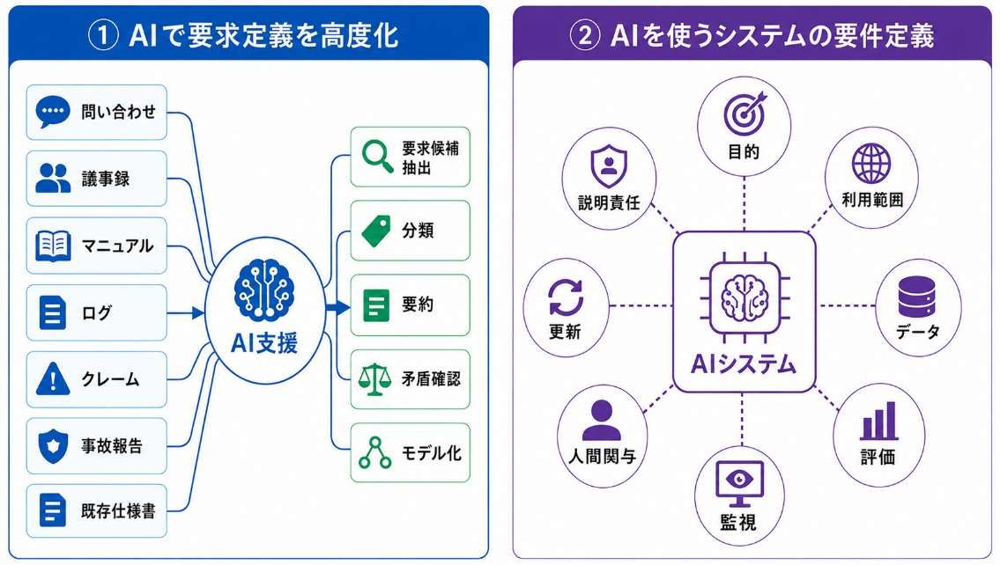
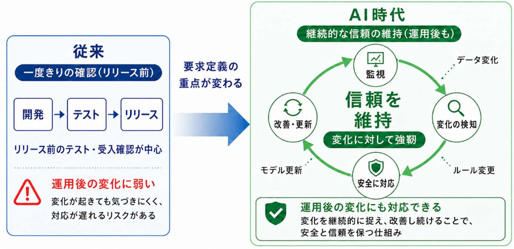
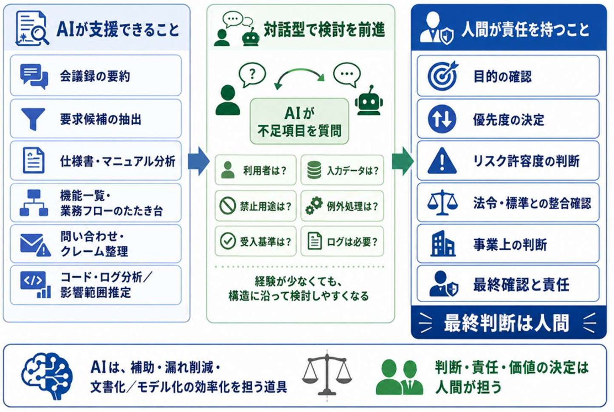
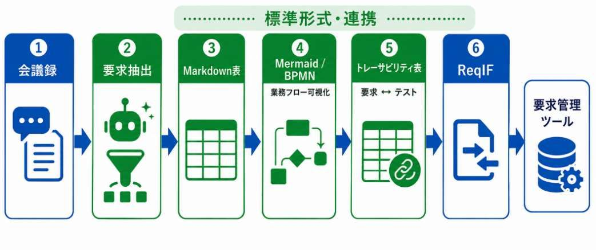
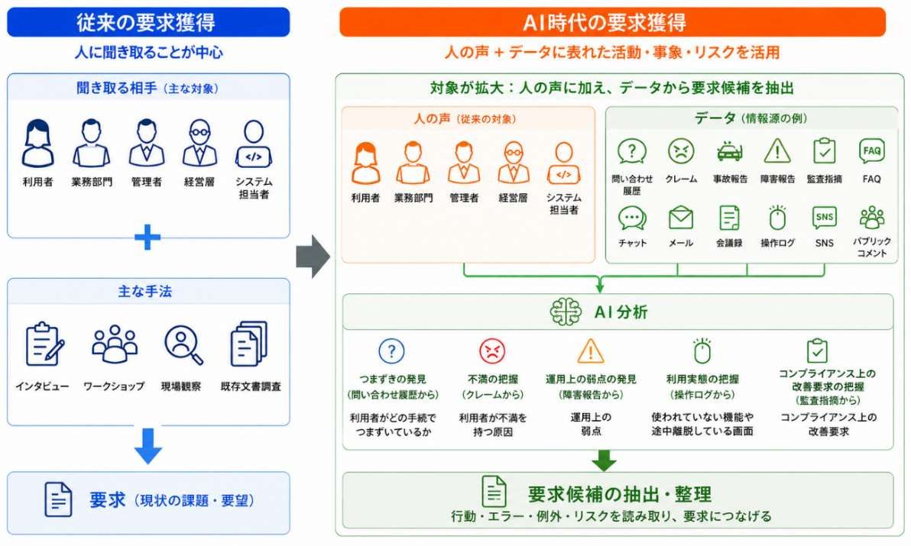
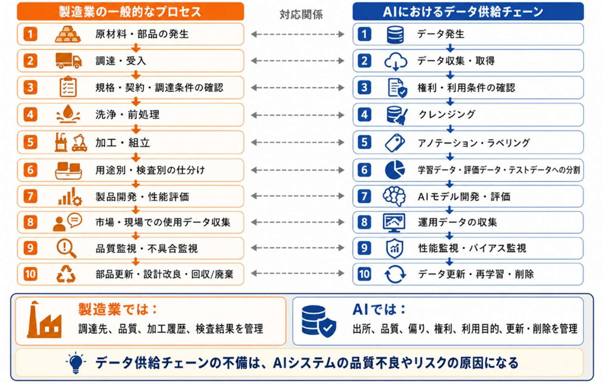
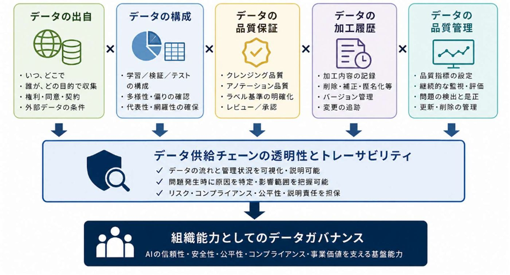

IPA（情報処理推進機構）が2026年11月に公開した[『AI時代の要求管理ハンドブック』](https://www.ipa.go.jp/digital/kaihatsu/youkyu-kanri.html)（Version 1.0.0、全129ページ）を、学習しやすいように教科書風に再構成した連載です。各章に途中の確認問題と、章末のまとめテストを付けています。

:::message
本連載は筆者が個人の学習目的で内容を要約・再構成したもので、IPAが作成・監修したものではありません。図は原典から引用しています。正確な記述は[原典PDF](https://www.ipa.go.jp/digital/kaihatsu/rqr7mi000000f5up-att/req-mgmt-hb.pdf)を参照してください。
:::

**連載一覧**

- [第1部 要求管理の基礎（第1〜4章）](https://zenn.dev/ryoooou/articles/ai-req-mgmt-handbook-part1)
- **第2部 AI時代に要求管理はどう変わるか（第5〜8章）← この記事**
- [第3部 モデリングとトレーサビリティ（第9〜11章）](https://zenn.dev/ryoooou/articles/ai-req-mgmt-handbook-part3)
- [第4部 ルール・制度・コンプライアンスと要求管理（第12〜14章）](https://zenn.dev/ryoooou/articles/ai-req-mgmt-handbook-part4)
- [第5部 AI時代の要求管理プロセスの組織への定着（第15〜16章）](https://zenn.dev/ryoooou/articles/ai-req-mgmt-handbook-part5)

## 第5章　AIが変える要求管理の前提

AI時代には変化のスピードが上がり、AIシステム自体も運用中に変わり続けます。この章では、AIの不確実性・プロンプト・社会的影響・レジリエンスを「要件」としてどう扱うかを学びます。第2部の中で最も重要な章のひとつです。

:::message
**この章で学ぶこと**

- AI時代の要求管理の「2つの側面」を説明できる
- 「要件を最初にすべて決める」から「継続的に検証・更新できる状態にする」への転換を理解する
- AI要求で定義すべき項目と、不確実性（確信度・OOD・ハルシネーション等）の要件化を説明できる
- 「AIが迷ったときの振る舞い」を要件として書ける
- プロンプトを要求仕様の一部として管理する理由を説明できる
- 社会的インパクト評価、レジリエンス、継続的アシュアランスの考え方を理解する

**キーワード**：変化速度、AI要求、不確実性、確信度、OOD、ハルシネーション、フェイルセーフ、プロンプトエンジニアリング、コンテキストエンジニアリング、社会的受容性、レジリエンス、継続的アシュアランス、アシュアランス・ケース、更新トリガー

**優先して読む人**（原典「表1」より）　◎ 優先：経営層、事業部門、業務改革担当、DX推進部門、IT・情報システム部門、開発者、AI開発・利用部門、データ部門、セキュリティ部門、行政機関の制度設計担当者／〇 次点：法務・コンプライアンス部門、監査部門、利用者・現場代表者
:::

### 5.0 第2部の見取り図：AI時代の要求管理の2つの側面

AI時代の要求管理には2つの側面があります。

1. **AIを使って要求定義を高度化する**：問い合わせ、議事録、マニュアル、ログ、クレームなどをAIで分析し、要求候補の抽出・分類・要約・矛盾確認・モデル化を支援する（→第6章）。
2. **AIを使うシステムそのものの要件を適切に定義する**：AIは確率的に振る舞い、データや環境の影響を受け、運用後も変化する。だから通常のソフトウェア以上に、目的・利用範囲・データ・評価・監視・人間の関与・更新・説明責任を明確にする（→本章と第8章）。

*図9 AI時代の要求管理の2つの側面（出典：IPA「AI時代の要求管理ハンドブック」）*

### 5.1 変化速度が上がる時代の要求管理

AI時代の最大の特徴は**変化の速さ**です。従来は年単位で見直していた制度・業務・システムが、四半期単位やそれ以下の周期で見直しを迫られます。AIモデルは更新され、データも利用者の行動も法令も変わります。

そのため、「正しい要件を最初にすべて決める」ことよりも、**「要件を継続的に検証し、必要に応じて更新できる状態にする」**ことが重要になります。

:::message alert
**注意：「後から直せばいい」ではない**

最初の要求定義が不要になるわけではありません。業務の目的、評価基準、法令・社内規則、例外処理など**事前に明確にできることは十分に整理して定義する**必要があります。一方、新サービスや探索的なAI活用など、実際に使ってみないと妥当性が分からない事項は、**目的・仮説・評価基準・見直し条件**をあらかじめ定め、運用の知見で要求を発展させます。
:::

継続的に見直すときの**判断軸は上位の目的・ゴール**です。目的が曖昧だと目的と手段が混在し、個々の改善がどの価値につながるか分からなくなります。そして目的そのものの見直しが必要になったら、個別要件を直し続けるのではなく、**最上流に戻って**価値・成功基準・業務モデル・データ・評価方法を整理し直し、要求を導出し直します。

| 従来によく見られた固定的な考え方 | AI時代に求められるライフサイクルを通じた考え方 |
|---|---|
| 要件は開発前に確定する | 目的との整合を保ちながら運用後も更新される（ただし開発前に必要な水準までは定義・合意する） |
| 文書化して引き渡す | モデル化し、共有し、更新する |
| 機能を定義する | 目的から機能・データ・評価・運用まで一貫して定義する |
| 開発完了が最終目標 | 価値実現と継続改善を行う |
| 変更は例外 | 変更を前提に目的との整合を確認しながら管理する |
| 人間がすべて読んで理解する | 人間とAI・ツールが利用できる形にする |

要求を「静的な文書」ではなく**「生きた管理対象」**として扱います。ただし人が全変更を手作業で追うのではなく、要求をモデルや構造化情報で管理し、整合性確認・変更影響分析・関連テストの特定などを**AIやツールで支援・自動化**することが重要です。

#### ✅ 確認問題

**問1**　AI時代の要求定義についての説明として最も適切なものはどれですか。

- A. 事前に明確化できる事項は十分に定義し、使ってみないと分からない事項は目的・仮説・評価基準・見直し条件を定めて発展させる
- B. 要件は開発前に完全に確定させ、運用後は変更しない
- C. 変化が速いので、最初の要求定義は簡単に済ませて後から直せばよい

:::details 答えと解説
**正解：A**

「最初に全部決める」でも「後から直せばいい」でもなく、両者を使い分けるのがポイントです。判断軸は上位の目的・ゴールです。
:::

### 5.2 AIシステムは変化し続ける

従来のソフトウェアは仕様どおり比較的安定して動きますが、AIを含むシステムは、データ・モデル・利用環境・利用者行動・外部サービスの変化によって**性能やリスクが変わります**。導入時には精度十分だった問い合わせ対応AIも、新商品や制度改正で妥当性が下がることがあります。モデル更新で、以前は正しく答えていた質問への回答が変わることもあります。生成AIなら、出力の揺らぎ、ハルシネーション、機密情報の混入、著作権の懸念、誤用のリスクもあります。

そのため「A機能を実装すること」だけでは不十分で、次のような**AI要求**を定義します。

| 項目 | 内容 |
|---|---|
| AI利用目的 | AIを何のために使うのか |
| 利用範囲／禁止範囲 | どの業務・場面で使ってよいか／使ってはいけないか |
| 入力データ | どのデータを使うか、品質をどう確保するか |
| 出力要件 | どんな形式・根拠・制約で出力するか |
| 人間の関与 | 誰が確認・承認・差戻しを行うか |
| 評価指標 | 精度、安全性、公平性、説明可能性をどう測るか |
| 監視要件 | 運用後の性能劣化や異常をどう検知するか |
| 更新要件 | モデルやデータをいつ、どう更新するか |
| 証跡要件 | ログ、根拠、判断履歴をどう残すか |
| インシデント対応 | 誤判定や事故が起きたときにどう対応するか |

これらの要求を**構造化・パラメータ化**しておくと、変更時に該当部分だけを直せばよくなり、迅速に対応できます。

### 5.3 AIの不確実性を要件として定義する

従来のソフトウェアは**決定論的**（同じ入力→同じ出力）でした。AI、とくに機械学習や生成AIは**確率的**に振る舞います。似た入力でも出力が変わり、事実と異なることをもっともらしく出力する**ハルシネーション**や、学習時に想定していない入力（**OOD：Out-of-Distribution**）に対する不安定な出力も起こります。

したがって「AIは正しく分類すること」「精度90%以上で回答すること」だけでは不十分です。**どの程度の確率で、どの範囲・条件で、どう振る舞うか**、そして**自信がないとき・誤りが疑われるとき・想定外の入力のときに、どう安全側に倒すか**を定義します。

| 観点 | 確認すべき内容 |
|---|---|
| 精度 | どの評価データで、どの指標を、どの水準以上にするか |
| 信頼区間 | 評価結果のばらつきや不確かさをどう扱うか |
| 確信度 | AIが自分の出力にどの程度自信を持っているかをどう扱うか |
| 誤分類 | どの種類の誤りを特に避けるべきか |
| ハルシネーション | どう検知・抑制・対応するか |
| OOD対応 | 想定外の入力や分布外データにどう振る舞うか |
| フェイルセーフ | AIが迷った場合、安全側に倒す仕組みがあるか |
| 人間へのエスカレーション | 人間に確認させる条件は何か |
| 継続的評価／再評価条件 | 運用後の劣化をどう確認するか、何が変わったら再評価するか |

:::message
**具体例：問い合わせ分類AIの要件化**

ルールベースなら「件名に『請求書』を含めば経理へ」と書けますが、AIでは表現の揺れで誤分類が起こり得ます。そこで次のように要件化します。
- 評価用データセットで、**主要分類ごとの再現率90%以上**を月次で評価すること
- **確信度が一定値未満**なら自動分類せず、担当者確認に回すこと
- 苦情・障害報告・法的問い合わせなど**高リスク分類は人間の確認を必須**とすること
- 分類不能なものは「その他」に入れず**未分類として管理**し、改善対象とすること
- 新しい問い合わせ傾向が増えたら分類体系を見直すこと
:::

#### AIが迷ったときの振る舞いを決める

人間なら自信がないとき、上司に確認したり、保留したり、追加情報を求めたりできます。AIにも同様の**安全な動作**を要件として与えます。

| 状況 | 要件化の例 |
|---|---|
| 確信度が低い | 自動処理せず、人間の確認に回す |
| 入力が不十分 | 追加情報を求める |
| 入力が想定外 | 処理を停止し、例外として記録する |
| 高リスク業務 | AI出力は参考情報に限定し、最終判断は人間が行う |
| 根拠が不明 | 回答を生成せず、参照資料不足を表示する |
| 複数の解釈がある | 候補と前提条件を提示し、人間に選択させる |
| ハルシネーションの可能性 | 原資料との照合を必須にする |
| セキュリティ上の疑義 | 応答を拒否し、ログを記録する |

:::message
**具体例：生成AIを使った社内問い合わせシステムの要件例**

- 承認済み文書に根拠を確認できない場合、**推測で回答しない**
- 回答根拠となる規則・マニュアル・FAQの名称と該当箇所を表示する
- 法務判断、人事評価、懲戒、契約解除、個人情報開示などは一般的な案内にとどめ、専門部署への確認を促す
- 質問が曖昧なら、回答前に追加質問する
- 確信度が低ければその旨を表示し、人間の確認を求める
:::

#### 評価の不確かさとOOD

評価データが少なければ、ある時点の高精度が実運用でも出るとは限りません。全体精度だけでなく、**カテゴリ別の精度・再現率・誤分類率**、評価データの件数・期間・偏り、**信頼区間やばらつき**を併記し、環境・データ・ルール・モデル・プロンプトを変えたら再評価し、実績が基準を下回れば改善要求を起票します。

OODについては、想定する入力範囲、想定外入力の検知方法、回答を控える条件、エスカレーション方法、想定外入力のログ保存と改善、新しい傾向が増えたときの見直しを要件にします。

:::message
**ポイント：不確実性の仕様化は「弱点の告白」ではない**

AIが常に正しいと仮定せず、**誤る・迷う・想定外に遭遇する場合**を要件として定義することで、AIを安全に実務へ組み込めます。「AIに何ができるか」に加えて、**「できないとき・迷ったとき・誤ったときにどう振る舞うか」**を明確にしましょう。
:::

#### ✅ 確認問題

**問1**　生成AIを使った社内問い合わせシステムで、承認済み文書に回答の根拠が見つからなかった場合の要件として最も適切なものはどれですか。

- A. 推測で回答せず、参照資料不足を表示するなどして人間の確認につなげる
- B. インターネット上の情報から自由に回答する
- C. もっともらしい回答を生成して利用者を待たせないようにする

:::details 答えと解説
**正解：A**

根拠が確認できないときに推測で答えるとハルシネーションのリスクがあります。安全側に倒す振る舞いを要件として定義します。
:::

**問2**　OODの説明として正しいものはどれですか。

- A. AIモデルの更新頻度のこと
- B. AIの出力の確信度のこと
- C. 学習時や評価時に想定していない、分布外の入力のこと

:::details 答えと解説
**正解：C**

OOD（Out-of-Distribution）は想定外の入力です。AIは自信ありげに不適切な回答をすることがあるため、検知と回答抑制の要件が必要です。
:::

### 5.4 プロンプトエンジニアリングも要求工学の一部

プロンプトとは、AIに対する指示です。何をしてほしいか、どの情報を使うか、どの形式で出力するか、何を禁止するか――つまり**AIへの要求を記述したもの**なので、プロンプトエンジニアリングは要求工学の一部と考えられます。

「議事録を要約して」だけでは、意思決定事項を知りたいのか、未決事項か、担当者別ToDoか、リスクかが分かりません。

| 要素 | 内容 |
|---|---|
| 目的 | 何のためにAIを使うのか |
| 役割 | AIにどの立場で作業させるのか |
| 入力 | どの情報を参照させるのか |
| 制約 | 何をしてはいけないのか |
| 出力形式 | 表、箇条書き、文章、JSON等 |
| 評価基準 | 何を満たせばよい出力とするのか |
| 確認事項 | 不明点、前提、リスクを明示させる |
| 根拠 | 出典や判断理由を示させる |

さらに、AIが参照する情報や文脈を設計・管理する**コンテキストエンジニアリング**も重要です。要求候補をAIで抽出するなら、会議録だけでなく、プロジェクトの目的、共有したコンセプト、制約、既存の要求なども参照させると効果的です。ただし情報は多ければよいわけではなく、正確性・最新性・関連性に配慮します。

:::message
**ポイント：プロンプトは管理対象**

- 繰り返し使うプロンプトは、業務手順やテンプレートと同様に**組織で共有・評価・更新**する。プロンプト、参照データ、出力形式、レビュー手順、利用制限、ログ、評価基準を**セットで**管理する。
- 出力品質やリスクに影響する変更は、**変更履歴・承認・評価結果**を残す。
- ただしプロンプトが要件のすべてを代替するわけではない。目的、役割分担、データ、セキュリティ、法令、評価、責任分界などはシステム全体の要件として管理する。
:::

:::message
**補足：開発用プロンプトとの違い**

コード生成用など開発で使うプロンプトは設計情報として構成管理されるもので、要求定義の時点ではまだ「プロンプト」としては現れません。要求定義で整理された要求が、設計工程でプロンプトになります。
:::

### 5.5 社会的受容性と倫理的影響を要件として扱う

AIシステムは、利用者、顧客、従業員、取引先、地域社会、将来の利用者まで広く影響します。従来は理念やスローガンで済まされがちだった**公平性、透明性、説明可能性、頑健性、安全性、人間の尊厳、異議申立ての機会、社会的受容性**を、具体的な要件にする必要があります。

採用、与信、保険、教育、医療、行政サービス、従業員評価などでは、AIの判断が特定の属性・地域・年齢層・言語能力・障害の有無・経済状況に不利に働く恐れがあります。AIが直接判断しなくても、提示する候補やスコアが人の判断に強く影響します。だから「問題が起きたら対応する」ではなく、**要求定義の段階で検討**します。

| 観点 | 確認すべき内容 |
|---|---|
| 影響を受ける人 | 誰に影響するか |
| 不利益の可能性／差別・排除 | 特定の集団に不利な結果や不当な排除が生じないか |
| バイアス | 学習データ・入力データ・評価指標に偏りがないか |
| 説明可能性 | 判断や推奨の理由を説明できるか |
| 異議申立て | 結果に疑義があるとき確認・修正・再審査できるか |
| 心理的・経済的影響 | 不安や萎縮を与えないか、収入や取引機会に影響しないか |
| 人間の関与 | 重要な判断に人間が関与する仕組みがあるか |
| 継続的監視 | 運用後に影響を測定し改善できるか |

:::message
**ポイント：公平性・頑健性は「技術指標」だけではない**

**公平性**は統計的な偏りが少ないことだけでなく、利用者や社会から見て不当に扱われていないと**納得できる**ことも含みます。全体精度が高くても特定の属性で誤判定が多ければ受け入れられません。**頑健性**も、社会状況・言語・文化・制度が変わっても過度な不利益を生まないことが求められます。
:::

要求文にすると、たとえば「特定属性への不利な結果を定期的に評価する」「重要な判断では最終判断者・確認手順・異議申立て手順を明確にする」「AIが生成・推奨したものであることを明示する」「権利や利益に影響する場合は根拠または確認方法を説明できる」「苦情や異議申立てを記録し改善要求として管理する」「モデルやデータを変えたら特定集団への影響を再評価する」などです。

評価は法務やAI部門だけでなく、業務部門、利用者代表、顧客対応、データ、セキュリティ、監査、必要に応じて外部有識者を含めた**複数の視点**で行います。影響を受ける人々が議論に入っていないと、重要なリスクを見落とします。

#### ✅ 確認問題

**問1**　AIの「公平性」を要件として扱う際の考え方として最も適切なものはどれですか。

- A. 公平性は理念なので要件にはしない
- B. 統計的な偏りの少なさに加え、利用者や社会から見て不当に扱われていないと納得できることも含めて考える
- C. 全体の精度が十分高ければ公平性も確保されている

:::details 答えと解説
**正解：B**

全体精度が高くても特定属性での誤判定が多ければ社会的に受け入れられません。具体的な要件として定義し、定期的に評価します。
:::

### 5.6 レジリエンスと継続的アシュアランス

**レジリエンス**とは、障害や変化が起きても重要な機能や安全性を維持し、必要に応じて**縮退運転・代替手段・復旧・改善**を行える能力です。障害対応手順だけでは実現できません。なぜなら、

- AIの性能劣化やリスク変化は、停止やエラーのような明確な障害ではなく、**正常に動いているように見えながら徐々に進行する**ことがある
- データ分布、法令、業務ルール、利用者行動の変化は、従来の障害対応手順の**検知対象にならない**ことがある

からです。そこで要求定義の段階で、**何を監視し、どの条件で警告し、どの条件で安全モードに切り替え、誰が確認し、どう改善するか**を定めます。

*図10 AI時代に求められるレジリエンス・継続的アシュアランス要求（出典：IPA「AI時代の要求管理ハンドブック」）*

#### 継続的アシュアランス

**アシュアランス**とは、システムが安全で信頼できることを**根拠に基づいて説明・論証する**考え方です。従来の品質保証はリリース前のテストが中心でしたが、AIはリリース後に変化するため、**運用中も継続的に監視・評価し、根拠を更新し続け**、「現時点でも要求を満たしている」と説明できる状態を保ちます。

| 観点 | 確認すべき内容 |
|---|---|
| 性能監視 | 精度、再現率、誤分類率、回答品質が維持されているか |
| 安全性 | 誤判断、危険な出力、不適切な自動処理が起きていないか |
| 公平性 | 特定の属性・地域・言語・利用者層に不利益がないか |
| 頑健性 | 想定外入力、データ欠損、環境変化に耐えられるか |
| セキュリティ | プロンプトインジェクション、データ漏えい、不正利用に対応できるか |
| 説明責任 | 判断根拠、参照データ、ログ、承認履歴を説明できるか |
| データ品質／モデル更新 | データ品質の維持、モデル変更時の再評価・承認・影響分析 |
| 運用体制／改善サイクル | 異常時の責任者と手順、監視結果の要求更新への反映 |

#### アシュアランス・ケース

「安全です」と宣言するだけでは不十分です。**主張・根拠・証拠・前提条件**を構造化して示すのがアシュアランス・ケースです。

:::message
**具体例：AI問い合わせ支援システムのアシュアランス・ケース**

**主張**：このシステムは社内規則に基づく回答案を安全に提示できる。

**根拠**：承認済み文書のみを参照する／根拠文書を表示する／回答は直接送信されず担当者が確認する／高リスク質問は専門部署へエスカレーションする／回答品質と誤回答件数を月次で監視する

**証拠**：参照文書（要求・設計など）、テスト結果、回答ログ、担当者レビュー記録、改善履歴
:::

アシュアランス・ケースは一度作って終わりではなく、モデル更新、データ更新、法令変更、事故対応のたびに見直す管理対象です。

#### フェイルセーフとデジタルツイン

AIが期待どおり動かないとき、危険な状態に進むのではなく**安全側に倒れる**設計（フェイルセーフ）を要件にします。例：回答品質が基準を下回ったら自動回答を停止して担当者確認モードへ／外部AIサービス障害時の代替手段を用意する／高リスク分類の誤判定が一定件数を超えたら機能を停止して原因分析する／データ分布の変化を検知したら再評価する。

また、**デジタルツイン**で業務やシステムのモデルを作り、通常時・例外時・障害時・データ変化・法令変更・アクセス集中・攻撃時の振る舞いを運用前にシミュレーションすることも有効です。重要インフラ、行政、金融、医療、製造、交通など、実環境で試しにくい分野で特に重要です。

#### 更新のトリガー条件

監視項目を集めても、**どの条件で対応を始めるか**の基準がなければ対応が遅れます。監視指標、しきい値、対応責任者、手順、再評価条件をあらかじめ決めておきます。

| トリガー | 要件化の例 |
|---|---|
| 性能劣化 | 精度・再現率・誤回答率などが基準値を下回ったら再評価する |
| データ分布変化 | 入力傾向が評価時と大きく異なればモデルへの影響を確認する |
| 苦情・異議申立て | 一定数を超えたら原因分析を行う |
| インシデント | 誤判断・情報漏えい・不適切出力が起きたら利用停止や制限を検討する |
| 法令・標準変更 | 関連法令や社内規則が変わったら要求と運用手順を見直す |
| モデル更新 | モデル・プロンプト・参照文書を変えるなら再テストと承認を行う |
| 外部サービス変更 | API仕様・SLA・データ利用条件の変更時に影響分析を行う |
| 監査指摘 | 不備が指摘されたら改善要求として管理する |

:::message
**補足：人手に頼りすぎない／組織で取り組む**

継続的アシュアランスを現実的な負担で行うため、運用ログや評価結果をAIやツールで分析し、基準からの逸脱や再評価が必要な要求を提示させ、**人間は承認と判断**に集中します。またISO/IEC 42001（AIマネジメントシステム）の考え方を踏まえると、これはAI開発チームだけの作業ではなく、経営・業務・データ・セキュリティ・法務・監査・運用が連携する**組織的活動**です。
:::

### 第5章のまとめ

:::message
- AI時代の要求管理には「AIで要求定義を高度化する」と「AIシステムの要件を定義する」の**2つの側面**がある。
- 変化が速い時代は、要件を**継続的に検証・更新できる状態**にすることが重要。ただし事前に決められることは十分に定義し、判断軸として**上位の目的**を明確にする。
- AI要求として、利用目的・利用/禁止範囲・データ・出力・人間の関与・評価・監視・更新・証跡・インシデント対応を定義する。
- AIの**不確実性**（確信度、ハルシネーション、OOD）を前提に、**迷ったときに安全側に倒す振る舞い**を要件化する。
- **プロンプトはAIへの要求**。参照データや評価基準とセットで組織的に管理する。
- 公平性や説明可能性など**社会的受容性**を、要求定義の段階で具体的な要件にする。
- **レジリエンス**と**継続的アシュアランス**（アシュアランス・ケース、フェイルセーフ、トリガー条件）で、運用中も「要求を満たしている」と説明できる状態を保つ。
:::

### 第5章 まとめテスト

全9問。答えは「答えと解説」を開くと表示されます。

**問1**　AI時代の要求管理の「2つの側面」の組み合わせとして正しいものはどれですか。

- A. AIを使って要求定義を高度化すること／AIを使うシステムの要件を適切に定義すること
- B. 要求定義をAIに完全に任せること／人間の関与をなくすこと
- C. AIでコードを生成すること／AIでテストを自動化すること
- D. AIの導入コストを下げること／AIの精度を上げること

:::details 答えと解説
**正解：A**

AIによる要求定義の支援と、AIシステム自体の要件定義という2つの側面があります。
:::

**問2**　変化の速い時代に要件を継続的に見直す際、判断軸として明確にしておくべきものはどれですか。

- A. 前回のプロジェクトの要件定義書
- B. 開発ベンダーの提案内容
- C. 上位の目的・ゴール
- D. 最新のAI技術の動向

:::details 答えと解説
**正解：C**

何を実現するための要求なのかが不明確だと、目的と手段が混在し、改善がどの価値につながるか分からなくなります。
:::

**問3**　「問い合わせ分類AIは正しく分類すること」という要件の問題点として最も適切なものはどれですか。

- A. 正しく分類することは要件ではなく要望である
- B. 分類というタスクにAIは向いていない
- C. 文章が長すぎる
- D. AIの不確実性を前提にした評価指標、確信度が低い場合の扱い、高リスク分類への人間の関与などが定義されていない

:::details 答えと解説
**正解：D**

AIは確率的に誤るため、分類ごとの評価指標、確信度が低いときの扱い、高リスク時の人間の確認、改善の仕組みまで定義する必要があります。
:::

**問4**　AIが「複数の解釈がある」入力を受けたときの振る舞いとして、要件化の例に最も近いものはどれですか。

- A. 最も可能性の高い解釈で回答を確定する
- B. 処理を停止して何も表示しない
- C. 候補と前提条件を提示し、人間に選択させる
- D. ランダムに一つを選ぶ

:::details 答えと解説
**正解：C**

解釈が複数あるときは、無理に一つに決めず、候補と前提を示して人間に選ばせるのが安全な振る舞いです。
:::

**問5**　プロンプトの扱いとしてハンドブックの考え方に合わないものはどれですか。

- A. 良いプロンプトを書けば、データやセキュリティ、責任分界などの要件は不要になる
- B. プロンプトはAIへの要求を記述したものであり、要求工学の一部と考えられる
- C. 出力品質に影響するプロンプト変更は、変更履歴・承認・評価結果を残す
- D. 繰り返し使うプロンプトは組織で共有・評価・更新できる状態にする

:::details 答えと解説
**正解：A**

プロンプトは要件のうちAIに実行させる内容を表す手段の一つにすぎず、目的・データ・セキュリティ・責任分界などはシステム全体の要件として管理します。
:::

**問6**　レジリエンスを実現するうえで、障害対応手順だけでは不十分な理由として正しいものはどれですか。

- A. 障害対応手順は作成コストが高いから
- B. 障害対応はベンダーの責任だから
- C. AIの性能劣化は正常に動いているように見えながら徐々に進行することがあり、データ分布や法令の変化は従来の手順の検知対象にならないことがあるから
- D. AIシステムでは障害が発生しないから

:::details 答えと解説
**正解：C**

だからこそ、何を監視し、どの条件で警告・安全モード移行するかを要求定義段階で定めます。
:::

**問7**　アシュアランス・ケースの構成要素として正しい組み合わせはどれですか。

- A. 要望・要求・要件・仕様
- B. 計画・実行・評価・改善
- C. 主張・根拠・証拠・前提条件
- D. 予算・体制・スケジュール・成果物

:::details 答えと解説
**正解：C**

アシュアランス・ケースは、安全・信頼できるという主張を、根拠・証拠・前提条件で構造化して示します。
:::

**問8**　継続的モニタリングで「更新のトリガー条件」を定める理由として最も適切なものはどれですか。

- A. 監視項目の数を減らすため
- B. AIモデルを毎日更新するため
- C. 監査を不要にするため
- D. 基準がないと異常を検知しても対応開始が遅れるため、しきい値・責任者・手順を事前に決めておく必要があるから

:::details 答えと解説
**正解：D**

監視指標だけでなく、どの条件で誰がどう対応するかを要件として定めておくことが重要です。
:::

**問9**　継続的アシュアランスの担い手としてハンドブックの考え方に最も近いものはどれですか。

- A. 監査部門のみ
- B. 経営、業務、AI、データ、セキュリティ、法務、監査、運用が連携した組織的活動
- C. 外部の認証機関のみ
- D. AI開発チームのみ

:::details 答えと解説
**正解：B**

ISO/IEC 42001などのAIマネジメントシステムの考え方を踏まえ、組織的活動として行います。
:::

## 第6章　AIによる要求管理支援

AIはヒアリング、文書化、過不足チェック、モデル出力、変更影響分析まで、要求管理の多くの作業を支援できます。一方で、最終的な判断と責任は人間に残ります。「AIに何を任せ、何を人が確かめるか」を学びます。

:::message
**この章で学ぶこと**

- AIが支援できる要求管理の作業を具体的に挙げられる
- AIの出力を「要求候補」として扱い、人間が確認すべき点を説明できる
- AIによるモデル出力で標準形式を使う理由を理解する
- 変更影響分析・再検証・継続的アシュアランスでのAI支援の3パターンを説明できる
- 複数AIエージェント連携における人間の役割を理解する

**キーワード**：ヒアリング支援、ドキュメンテーション支援、レビューの前処理、モデル出力、Mermaid、BPMN、ReqIF、変更影響分析、再検証、AIエージェント、MCP

**優先して読む人**（原典「表1」より）　◎ 優先：業務改革担当、DX推進部門、IT・情報システム部門、開発者、AI開発・利用部門／〇 次点：事業部門、データ部門、セキュリティ部門、行政機関の制度設計担当者、利用者・現場代表者
:::

### 6.1 AIは要求管理の作業を支援する

AIは要求管理の多くの作業を支援できます。会議録を要約して発言から要求候補を抽出する、既存の仕様書やマニュアルから機能一覧や業務フローのたたき台を作る、問い合わせやクレームを分類して利用者の困りごとを整理する、既存システムのコードやログから構造や影響範囲を推定する――などです。

特に重要なのは、**対話型で**要求定義を支援できる点です。人間が要求を十分に整理できていなくても、AIは「利用者は誰か」「入力データは何か」「禁止すべき用途は何か」「例外処理はあるか」「受入基準は何か」と不足項目を問いかけられます。経験の浅い担当者でも、一定の構造に沿って検討しやすくなります。

:::message
**ポイント：AIは判断を置き換えない**

AIは検討漏れを減らし、文書化やモデル化を効率化する**道具**です。最終的な目的、優先度、リスク許容度、法令との整合、事業上の判断は、**人間が責任を持って**確認します。
:::

*図11 AIによる要求定義支援と人間の責務（出典：IPA「AI時代の要求管理ハンドブック」）*

### 6.2 AIによるヒアリング支援

熟練した要求定義担当者が経験から投げかけていた質問を、AIがある程度支援できます。たとえば「問い合わせ対応をAIで効率化したい」という相談に、AIは次のような質問を提示できます。

- 問い合わせの種類は何か／対象となる利用者は誰か
- AIは回答を直接返すのか、担当者向けの回答案を作るのか
- 参照する文書やFAQは何か／個人情報や機密情報を含むか
- 回答できない場合はどうするか／人間が確認すべき条件は何か
- 誤回答が起きたときの対応は何か／回答品質をどう評価するか
- ログは何を保存するか／社内規則やマニュアルとの関係は何か
- 外部に回答する前に承認は必要か

ヒアリングの場では、AIを議事録係や要約係としてだけでなく、**「まだ確認していない事項」を提示する補助者**として使えます。効果を高めるには、業務・データ・AI・法令・運用・評価・セキュリティ・監査といった**質問の観点を事前にプロンプトに組み込んで**おくとよいでしょう。

### 6.3 AIによるドキュメンテーション支援

要求定義の文書化は担当者にとって大きな負担でした。AIはヒアリング結果、会議録、既存文書、チャットログから、要求一覧、要求定義書、業務フロー、データ項目一覧、受入条件などの**たたき台**を作れます。既存の規程から義務・禁止・承認・記録・例外処理を抽出することもできます。

:::message alert
**注意：AIが作った文書をそのまま正式採用しない**

AIは文脈の誤解、重要事項の省略、過度な一般化、根拠不明な補完をすることがあります。関係者レビューの対象とし、**発生源・根拠・優先度・検証方法**を確認します。
:::

| AIが支援できること | 人間が確認すべきこと |
|---|---|
| 会議録から要求候補を抽出する | 重要な発言や意図が落ちていないか |
| 要求を分類する | 分類が業務実態と合っているか |
| 要求定義書案を作る | 実装可能・評価可能か |
| 業務フロー案を作る | 現場の例外処理を反映しているか |
| データ項目案を作る | データの意味、品質、利用条件が正しいか |
| 受入条件案を作る | 本当に確認可能か |
| 社内規則との対応を示す | 根拠規則や条項が正しいか |

#### ✅ 確認問題

**問1**　AIが会議録から作成した要求一覧の扱いとして最も適切なものはどれですか。

- A. AIは網羅的なので、そのまま正式な要求定義書として採用する
- B. たたき台として関係者レビューにかけ、発生源・根拠・優先度・検証方法を確認する
- C. AIの出力は信頼できないので使わない

:::details 答えと解説
**正解：B**

AIは文脈の誤解や重要事項の省略をすることがあります。効率化の道具として使い、内容は人が確認します。
:::

### 6.4 AIによる過不足・矛盾の確認

AIは、要件に過不足・矛盾・曖昧な表現がないかの確認にも使えます。主語、実現内容、入出力、制約条件、例外処理、受入基準、ログや証跡、上位目的との対応、法令との矛盾、データ要求とAI要求の整合、人間の関与、変更時の追跡可能性などの観点でチェックできます。

:::message
**ポイント：AIチェックは「レビューの前処理」**

AIのチェックはレビューの**代替ではなく前処理**です。AIで抜け漏れ候補・矛盾候補を抽出し、人間が確認することでレビューの効率と品質を高めます。AIシステムでは特に、入力データ、利用制限、説明責任、ログ、監視、モデル更新、人間の関与、インシデント対応が抜けやすいので、これらの有無をAIで確認するのは有効です。
:::

### 6.5 AIによる要求のモデル出力

AIが作る要求は、文章ではなく、人が理解・確認しやすい**モデル形式**で出力するのが望ましいとされます。

| 形式 | 用途 |
|---|---|
| Markdown | 要求定義書、議事録、要求一覧の軽量な文書化 |
| 表形式 | 要求一覧、データ項目一覧、受入条件、リスク一覧 |
| Mermaid | 簡易なフロー図、シーケンス図、状態遷移図 |
| BPMN | 業務プロセスの標準的な表現 |
| UML | ユースケース、クラス、シーケンス等 |
| SysML | 要求、構造、振る舞い、検証の接続 |
| ArchiMate | 業務、アプリ、データ、技術基盤の関係 |
| JSON/XML | ツール連携、構造化データとしての利用 |
| ReqIF | 要求管理ツール間の要求情報交換 |

**標準的な形式**を使えば、人間の確認が容易になり、要求管理・モデリング・テストツールとの連携もしやすくなります。たとえば、会議録から抽出した要求をMarkdownの表にし、重要な業務の流れをMermaidやBPMNで描き、要求とテストの対応をトレーサビリティ表にし、ツール連携にはReqIFを使う――という流れです。

*図12 AIでのモデル出力による要求定義支援の例（出典：IPA「AI時代の要求管理ハンドブック」）*

モデル化の目的は見やすさだけではありません。要求と業務・データ・設計・テスト・運用の関係を**機械的に扱える形**で表すことで、変更時の整合性確認や影響分析、再検証をAIやツールで支援・自動化する**基盤**になります。

#### ✅ 確認問題

**問1**　AIに要求をモデル出力させる際、標準的な形式（BPMN、UML、ReqIFなど）を使うことの利点として最も適切なものはどれですか。

- A. 人間の確認が容易になり、要求管理・モデリング・テストツールとの連携もしやすくなる
- B. 出力の見た目が華やかになる
- C. AIの学習コストが下がる

:::details 答えと解説
**正解：A**

標準形式は人にも機械にも扱いやすく、影響分析や再検証の自動化の基盤にもなります。
:::

### 6.6 AIによる変更影響分析と再検証支援

要求を変更するたびに影響を人手ですべて確認するのは大きな負担です。要求と業務・データ・設計・実装・テスト・ルール・運用情報の関係を整理しておけば、AIやツールで支援できます。支援のパターンは大きく3つです。

#### ① 変更の影響範囲分析

要求の変更は、関連する業務プロセス、データ、機能、AIモデル、プロンプト、法令、テストケース、運用手順に及ぶ可能性があります。関係がトレーサビリティでつながっていれば、AIが影響を受けそうな要素を探索し、確認対象の候補を示せます。

- 法令の変更 → 影響を受ける要求・業務・機能・テストケースを抽出
- 要求の変更 → 修正が必要な設計や実装を特定
- データ項目の変更 → そのデータを使うAIモデル・業務・インターフェース・評価項目を抽出
- AIモデルやプロンプトの変更 → 再確認すべき要求・評価指標・利用場面・リスクを特定
- 変更による他の要求や制約との矛盾を確認

AIが変更範囲を自動で確定できるとは限りません。重要なのは、**人間が確認すべき対象を効率よく絞り込める**ことです。

#### ② 変更後の再検証・再評価

変更後も要求が満たされているかを再確認します。AIは回帰テストの抽出、新しいテストケースの候補生成、評価指標や受入条件との整合性確認、シミュレーションによる影響確認などを支援できます。ただし、変更によって利用者の目的・業務上の価値・安全性・公平性・説明可能性が損なわれていないかという**妥当性の判断**には人の判断が必要です。AIは論点を提示し分析を支援し、**最終判断と承認は関係者**が行います。

#### ③ 継続的アシュアランスの支援

データや環境は常に変わるため、運用中も要求が満たされているかを確認し続けます。要求に評価基準・監視指標・しきい値・テスト・運用ログを関連付けておけば、指標が基準を外れたときに関連する要求を特定し、再評価や変更の必要性を提示する仕組みが作れます。

:::message
**ポイント：鍵は「関係の明示」**

要求を単独の文書として管理するのではなく、業務・データ・モデル・設計・実装・テスト・ログとの**関係を明示**しておくこと。モデルとトレーサビリティは、人の理解と説明責任を支えるだけでなく、**AIが影響分析と再検証を支援するための基盤**です（第9章・第11章）。
:::

### 6.7 AI活用時の注意点

- AIの出力は**要求候補**として扱い、そのまま採用しない
- 出典、根拠、前提条件を確認する
- 専門家、現場、利用者によるレビューを行う
- 少数意見や例外処理を確認する
- 法令、標準、社内規則との整合性を確認する
- 実装可能性と評価可能性を確認する
- AIが見落としやすい新しい選択肢を人間が補う
- AIが作ったモデルや文書も**版管理**する
- AIに**入力してよい情報・いけない情報**を明確にする
- AIによる要件案の**責任主体**を明確にする

AI時代に要求管理の能力が不要になるのではありません。AIの出力を評価し、修正し、使いこなすために、**要求工学や業務分析の基礎がより重要になる**のです。

#### ✅ 確認問題

**問1**　AIを要求管理に活用する際の注意点として適切でないものはどれですか。

- A. AIによる要件案の責任主体を明確にする
- B. AIが作成したモデルや文書にも版管理を行う
- C. AIは多数の意見を学習しているので、少数意見や例外処理の確認は省略できる
- D. AIに入力してよい情報と入力してはいけない情報を明確にする

:::details 答えと解説
**正解：C**

AIは多数派の意見を優先しがちなので、少数意見や例外処理こそ人間が確認する必要があります。
:::

### 6.8 複数のAIエージェントの連携

複数のAIエージェントが役割を分担し、要求の獲得・分析・仕様化・検証・変更管理を協調して行うこともできます。専門的な役割分担や成果物の相互確認ができるのが利点です。

| 連携形態 | 用途 |
|---|---|
| 組織内連携 | 要求候補の抽出、分析、仕様化、レビュー等の専門エージェントが互いに連携する |
| 組織・システム間連携 | 発注者、供給者、法務、検証など異なる組織のエージェント基盤が作業を委任し、成果物を交換する |

ただしハンドブック執筆時点（2026年10月）では、AIだけで要求の妥当性判断や正式承認まで完結させる実践は確立していません。たとえば「模擬ステークホルダーエージェント」と「要求ヒアリングエージェント」を連携させても、その成果物は**実際の関係者の意思や合意の代わりにはならず**、確認すべき論点や質問を増やすためのもの（6.2節の補強）にとどまります。

:::message
**ポイント：エージェント連携の原則**

- エージェント間は自然言語の会話ではなく、**構造化された要求成果物**を中心に連携する（台帳には「作成・レビューに使ったAIエージェントやモデル」も記録するとなおよい）
- AIの役割：要求候補の抽出、重複・矛盾・曖昧性の検出、モデル化、受入基準の生成、影響分析、差分作成
- 人間の役割：要求の**正式採用、優先順位、リスク受容、法的判断、ベースライン化、変更承認**
- 同一モデルの検査だけに頼らず、ルール検査、スキーマ検証、異なる知識源、人間レビューを組み合わせる
- AIエージェントが**承認済み要求を直接上書きしない**構成にし、変更根拠と承認履歴を追跡できるようにする
:::

:::message
**補足：MCPを使っても本質は同じ**

MCP（Model Context Protocol）は、AIエージェントが要求管理ツール、文書、法令、設計モデル、テスト結果などの外部資源を参照・操作するための接続層として使えます。しかし**MCPサーバーをつなぐだけで要求管理が成立するわけではありません**。要求の背景にある目的、判断根拠、制約条件もAIが参照できるようにし、情報の品質やコンテキストの適切さは別途確保する必要があります。
:::

### 第6章のまとめ

:::message
- AIはヒアリング、文書化、過不足・矛盾チェック、モデル出力、変更影響分析など多くの作業を支援できるが、**判断と責任は人間**に残る。
- ヒアリングでは「まだ確認していない事項」を示す補助者として使い、観点を事前にプロンプトへ組み込む。
- AIが作った文書は**たたき台**。AIによるチェックは**レビューの前処理**。
- モデル出力は**標準形式**で。モデルとトレーサビリティは影響分析・再検証を自動化する基盤になる。
- 変更時の支援は、①影響範囲分析、②再検証・再評価、③継続的アシュアランスの3パターン。
- 複数AIエージェントは構造化成果物を介して連携し、正式採用・優先順位・承認は人間が行う。MCPは接続手段にすぎない。
:::

### 第6章 まとめテスト

全8問。答えは「答えと解説」を開くと表示されます。

**問1**　AIによるヒアリング支援の活用方法として最も適切なものはどれですか。

- A. AIに関係者へのヒアリングをすべて代行させ、人間は結果だけを見る
- B. 議事録や要約に加え、要求定義の観点から「まだ確認していない事項」を提示する補助者として使う
- C. AIが生成した模擬ステークホルダーの回答を、実際の関係者の合意として扱う
- D. ヒアリングにはAIを使わない

:::details 答えと解説
**正解：B**

AIは不足項目を動的に提示する補助者として有効です。観点を事前にプロンプトに組み込むと体系的に確認できます。
:::

**問2**　AIによる要件の過不足・矛盾チェックの位置づけとして正しいものはどれですか。

- A. 法務部門のみが使うもの
- B. 要件が確定した後にだけ行う最終確認
- C. 人間のレビューを完全に置き換えるもの
- D. 抜け漏れ・矛盾の候補を抽出し、人間のレビューの効率と品質を高める前処理

:::details 答えと解説
**正解：D**

AIチェックはレビューの代替ではなく前処理です。
:::

**問3**　「データ要求とAI要求が整合しているか」「人間の関与が必要な場面が定義されているか」といった観点は、どの作業で特に役立ちますか。

- A. AIによる要件の過不足・矛盾の確認
- B. 会議の日程調整
- C. 予算の見積り
- D. 開発ベンダーの選定

:::details 答えと解説
**正解：A**

AIシステムでは入力データ、利用制限、人間の関与、監視などが抜けやすいため、これらの観点で過不足をチェックします。
:::

**問4**　AIで要求をモデル出力する目的として、ハンドブックが「見やすさ」以外に挙げているものはどれですか。

- A. 要求と業務・データ・設計・テストなどの関係を機械的に扱える形にし、整合性確認や影響分析を自動化する基盤にするため
- B. AIの学習データを増やすため
- C. 要求定義書のページ数を減らすため
- D. 契約書を自動作成するため

:::details 答えと解説
**正解：A**

モデル化は、変更時の整合性確認・影響分析・再検証をAIやツールで支援するための基盤になります。
:::

**問5**　AIによる変更影響分析について正しい説明はどれですか。

- A. AIは確認すべき対象の候補を効率よく絞り込むもので、人間が確認・判断する
- B. AIが変更範囲を常に自動で確定してくれるので、人の確認は不要
- C. 影響分析は法令変更のときだけ必要である
- D. 影響分析はトレーサビリティがなくてもAIだけで正確にできる

:::details 答えと解説
**正解：A**

AIは変更範囲を確定できるとは限りません。トレーサビリティを基盤に候補を絞り込み、人が確認します。
:::

**問6**　変更後の再評価で、AIではなく最終的に人間（関係者）が担うべきものはどれですか。

- A. 受入条件との整合性チェックの実行
- B. 回帰テスト候補の抽出
- C. 変更が利用者の目的や業務価値、公平性などを損なっていないかの妥当性判断と承認
- D. 新しいテストケース候補の生成

:::details 答えと解説
**正解：C**

妥当性の判断には事業目的や社会的影響など人の判断が必要な要素が含まれるため、最終判断と承認は関係者が行います。
:::

**問7**　複数AIエージェントを連携させる場合の原則として適切でないものはどれですか。

- A. 同一モデルの検査だけに頼らず、ルール検査や人間レビューを組み合わせる
- B. 要求の正式採用や変更承認は人間の責任者が行う
- C. エージェント間は構造化された要求成果物を中心に連携する
- D. 効率化のため、AIエージェントが承認済み要求を直接上書きできる構成にする

:::details 答えと解説
**正解：D**

AIエージェントが承認済み要求を直接上書きしない構成とし、変更根拠と承認履歴を追跡できるようにします。
:::

**問8**　MCP（Model Context Protocol）についてのハンドブックの考え方として正しいものはどれですか。

- A. MCPサーバーを接続すれば要求管理は自動的に成立する
- B. MCPは要求管理には利用できない
- C. MCPを使うとAIの判断に人間の承認が不要になる
- D. 外部資源への接続手段の一つであり、目的・判断根拠・制約などの情報の品質やコンテキストの適切さは別途確保する必要がある

:::details 答えと解説
**正解：D**

MCPはあくまで接続層です。AIが参照する情報そのものの品質と適切さが重要です。
:::

## 第7章　AI時代の要求管理プロセス

ここまでの内容を、実務で進めるための「12の工程」として一本の流れにまとめます。各工程で何を考え、ハンドブックのどの章を参照すればよいかを整理する、いわば全体の地図となる章です。

:::message
**この章で学ぶこと**

- AI時代の要求管理プロセスの12工程を順に挙げられる
- プロセスが一方向ではなく循環的である理由を説明できる
- 各工程の要点と、参照すべき章を対応づけられる
- 要求ベースラインと変更管理の関係を理解する

**キーワード**：要求管理プロセス、目的・ミッション、ステークホルダー、コンセプト、モデリング、要求ベースライン、実現手段への接続、運用・監視、フィードバック、変更管理、廃止・移行

**優先して読む人**（原典「表1」より）　◎ 優先：事業部門、業務改革担当、DX推進部門、IT・情報システム部門、開発者、AI開発・利用部門、行政機関の制度設計担当者／〇 次点：データ部門、セキュリティ部門、法務・コンプライアンス部門、監査部門、調達部門、利用者・現場代表者
:::

### 7.1 プロセスの全体像

AI時代の要求管理は、要求定義書を作って終わりではありません。**目的の確認から運用、フィードバック、変更管理、廃止まで**を含む循環的な活動です。INCOSEのシステムライフサイクルやREBOKのプロセスを参考にすると、標準的な流れは次の12工程に整理できます。

| 工程 | 要点 | 参考になる章 |
|---|---|---|
| 1. 目的・ミッションの確認 | 「何を作るか」ではなく「何を実現したいか」 | 第3章 |
| 2. ステークホルダーの特定 | 関係者とその背景を理解し、コンセプトを共有 | ― |
| 3. 要求獲得 | 多様な手法・情報源から要求候補を集める | 第6・8・12・13章 |
| 4. 要求分析 | 分類・整理し、実現手段を比較する | 第8章 |
| 5. 要求仕様化 | 理解でき、実装・評価に使える形で記述 | 第8章 |
| 6. モデリング | 業務・データ・AI・ルールなどの関係を可視化 | 第9・14章 |
| 7. 要求評価・妥当性確認 | 必要性、実現性、検証性、理解の一致を確認 | 第2・6章 |
| 8. 要求ベースライン化 | 合意した要求を基準として固定・管理 | 第2章 |
| 9. 実現手段への接続 | 設計・開発・調達・契約・テストへ引き継ぐ | 第11章 |
| 10. 運用・監視 | 期待どおりに機能しているかを確認 | 第5章 |
| 11. フィードバック・変更管理 | 変化に応じて要求を見直し、新ベースラインへ | 第11章 |
| 12. 廃止・移行 | データ移行、ログ保存、契約終了、利用者通知など | ― |

:::message
**ポイント：一方向ではなく「繰り返し」が前提**

分析の結果さらに獲得が必要になる、モデリングで業務やデータの不整合が見つかる、運用後のログや利用者の声から新しい要求が生まれる――と、工程は行き来します。AI時代は要求の発生や更新がより高頻度になるため、この繰り返しを前提とします。重要なのは、最初から全部を完全に決めることではなく、**要求を管理し、変化に応じて更新できる状態にしておくこと**です。
:::

#### ✅ 確認問題

**問1**　AI時代の要求管理プロセスの最初の工程としてハンドブックが挙げるものはどれですか。

- A. ステークホルダーの特定
- B. 要求獲得
- C. モデリング
- D. 目的・ミッションの確認

:::details 答えと解説
**正解：D**

まず「何を作るか」ではなく「何を実現したいか」を確認するところから始めます。
:::

### 7.2 各工程の考え方

#### 1. 目的・ミッションの確認

最初に問うのは「何を作るか」ではなく**「何を実現したいか」**です。「AIを使いたい」「システムを刷新したい」という要望の前に、事業上・業務上・社会上の目的を明確にします。何の価値を実現したいのか、誰の課題を解決するのか、どの業務やサービスを変えるのか、**何を成功とみなすのか**、どのリスクを避けるべきかを確認します。ただし、この段階の目的は確定ではなく、ステークホルダーとの対話を通じて具体化・見直しされるものです。

#### 2. ステークホルダーの特定

経営層、事業部門、利用者、現場、IT、AI担当、データ担当、法務、セキュリティ、監査、調達、外部ベンダーなど、関係者は多岐にわたります。AIを使う場合は、**AIの出力を利用する人、AIの判断を確認する人、データを管理する人、事故時に対応する人**も明確にします。

関係者を特定するだけでなく、それぞれの状況・課題・問題意識・制約といった**背景（コンテキスト）を相互に理解**し、目的について認識を擦り合わせ、プロジェクトが目指す方向性（**コンセプト**）を共有します。これが不十分だと、個々の要件が正確に書かれていても、全体として期待する価値を実現できないおそれがあります。

#### 3. 要求獲得

インタビュー、ワークショップ、現場観察、既存文書調査、問い合わせ・ログ・クレーム分析などで要求候補を集めます。AIで大量の文書から抽出できますが、出力は**候補**として扱い、人が確認します。

#### 4. 要求分析

分類し、重複・矛盾・優先度・実現可能性・リスクを整理します。機能要求に加え、データ要求、AI要求、ルール要求、評価要求、運用要求も明確にします。さらに各要求について、システム、AI、人、業務プロセス、データ整備、組織・権限、ルール・制度などの**実現手段を比較・組み合わせ**、システムやAIに担わせる範囲を明確にします。

#### 5. 要求仕様化

文章に加え、表、図、業務フロー、データモデル、受入条件などを組み合わせて、理解でき実装・評価に使える形で記述します。

#### 6. モデリング

業務、データ、AI利用、ルール、システム構成、評価の関係を可視化します。すべてを詳細にモデル化する必要はなく、**重要業務、高リスク業務、AI利用部分、法令・標準に関係する部分**を優先します。

#### 7. 要求評価・妥当性確認

本当に必要か、実現可能か、検証可能か、関係者の理解が一致しているかを確認します。AIを使う場合は、入力データ、出力、人間の関与、評価指標、監視方法、ログ、更新条件も確認します。

#### ✅ 確認問題

**問1**　モデリングの工程で優先的に可視化すべき対象としてハンドブックが挙げていないものはどれですか。

- A. AI利用部分
- B. 高リスク業務
- C. 重要業務
- D. 変更頻度が低く影響の小さい定型帳票のレイアウト

:::details 答えと解説
**正解：D**

すべてを詳細にモデル化する必要はありません。重要業務、高リスク業務、AI利用部分、法令・標準に関係する部分を優先します。
:::

#### 8. 要求ベースライン化

関係者が合意した要求を**要求ベースライン**として管理します。ベースラインを設定することで、どの要求を前提に設計・開発・調達・評価を行うのかが明確になります。

#### 9. 実現手段への接続

整理した要求を、分析で検討した実現手段へ確実につなぎます。実現手段はシステム開発に限りませんが、システムやAIで実現する要求は、設計、開発、AIモデル選定、データ整備、調達仕様、契約、テスト計画へ引き継ぎます。**要求定義書を作るだけで終わらせない**ことが大切です。

#### 10. 運用・監視

運用開始後は、利用状況、エラー、問い合わせ、ログ、AI出力の品質、監査結果を確認し、期待どおり機能しているかを見て改善につなげます。

#### 11. フィードバック・変更管理

運用データ、利用者の声、法令・標準の変更、業務変更、AIモデル更新に応じて要求を見直します。変更要求を受け付け、**影響分析**を行い、承認後に新しいベースラインへ反映します。影響は要求間だけでなく、モデル、設計、実装、テスト、評価基準、運用手順まで追跡し、必要な再検証につなげます（AIやツールによる支援も有効）。

:::message alert
**注意：目的そのものが変わるとき**

変更が**上位の目的・ゴールそのもの**に及ぶ場合は、個別の要求変更として処理せず、**ビジネス又はミッション分析まで戻り**、業務・機能・データを再整理したうえで新たなベースラインを設定します。
:::

#### 12. 廃止・移行

システムやAIサービスを廃止・移行するときにも要求定義が必要です。データ移行、ログ保存、契約終了、利用者通知、代替手段、リスク対応を整理します。

### 第7章のまとめ

:::message
- AI時代の要求管理は、**目的確認から廃止・移行まで**の12工程からなる循環的な活動。
- 工程は行き来するのが前提。最初に全部を決めるより、**更新できる状態**を保つことが重要。
- 起点は「何を作るか」ではなく**「何を実現したいか」**。ステークホルダーの背景を理解し、コンセプトを共有する。
- モデリングは重要・高リスク・AI利用・法令関連の部分を優先する。
- 合意した要求は**ベースライン**として管理し、変更は影響分析と承認を経て新ベースラインへ。目的自体が変わるなら最上流へ戻る。
- 要求定義書で終わらせず、設計・調達・契約・テストへ確実に接続する。廃止・移行にも要求定義が必要。
:::

### 第7章 まとめテスト

全7問。答えは「答えと解説」を開くと表示されます。

**問1**　12工程のうち、「関係者が合意した要求を、設計・開発・調達・評価の前提として明確にする」工程はどれですか。

- A. 運用・監視
- B. 要求ベースライン化
- C. モデリング
- D. 要求仕様化

:::details 答えと解説
**正解：B**

合意した要求をベースラインとして管理することで、何を前提に後工程を進めるかが明確になります。
:::

**問2**　ステークホルダーの特定の工程で、AIを使う場合に追加で明確にすべき関係者としてハンドブックが挙げていないものはどれですか。

- A. 事故時に対応する人
- B. AIモデルを開発した海外研究者の個人名
- C. AIの出力を利用する人
- D. AIの判断を確認する人

:::details 答えと解説
**正解：B**

AIの出力を利用する人、判断を確認する人、データを管理する人、事故時に対応する人を明確にします。
:::

**問3**　ステークホルダーの特定に関する説明として最も適切なものはどれですか。

- A. 関係者の一覧を作れば十分である
- B. 発注者以外の関係者は要求定義に関与させない
- C. 関係者の特定はシステム稼働後に行う
- D. 関係者の状況・課題・制約などの背景を相互に理解し、目的について認識を擦り合わせてコンセプトを共有する

:::details 答えと解説
**正解：D**

背景の理解とコンセプトの共有が不十分だと、個々の要件が正確でも全体として価値を実現できないおそれがあります。
:::

**問4**　要求分析の工程で行うこととして適切なものはどれですか。

- A. システム、AI、人、業務プロセス、ルール・制度などの実現手段を比較・組み合わせ、システムやAIに担わせる範囲を明確にする
- B. AIを使うことを前提に、AIに担わせる機能だけを洗い出す
- C. 本番環境での運用ログを分析する
- D. 要求文を清書し、要件定義書の体裁を整える

:::details 答えと解説
**正解：A**

要求分析では実現手段を比較し、システムやAIの担当範囲を明確にします。
:::

**問5**　運用中に、要求変更が上位の目的・ゴールそのものに及ぶことが分かった場合の対応として正しいものはどれですか。

- A. 開発ベンダーに判断を任せる
- B. ビジネス又はミッション分析まで戻り、業務・機能・データを再整理したうえで新たな要求ベースラインを設定する
- C. 変更を見送り、現行のベースラインを維持する
- D. 該当する要件だけを個別に修正する

:::details 答えと解説
**正解：B**

目的自体が変わる場合は、個別の要求変更ではなく最上流に戻って再構成します。
:::

**問6**　「実現手段への接続」の工程の説明として正しいものはどれですか。

- A. 要求定義書を完成させれば工程は完了する
- B. 実現手段は必ずシステム開発である
- C. システムやAIで実現する要求を、設計・開発・データ整備・調達仕様・契約・テスト計画へ確実に引き継ぐ
- D. AIモデルの精度を測定する工程である

:::details 答えと解説
**正解：C**

要求定義書を作るだけで終わらせず、実際の実現手段へ確実につなげることが大切です。
:::

**問7**　システムやAIサービスの廃止・移行について正しい説明はどれですか。

- A. 廃止は開発ベンダーの責任なので発注者は関与しない
- B. 廃止時には要求定義は不要である
- C. データ移行、ログ保存、契約終了、利用者通知、代替手段、リスク対応を整理する要求定義が必要である
- D. 廃止時は全データを即時削除すればよい

:::details 答えと解説
**正解：C**

廃止・移行もライフサイクルの一部であり、要求定義が必要です。
:::

## 第8章　AI時代の要求獲得・分析・仕様化

要求工学の3つの中心活動――獲得・分析・仕様化――は、AI時代にどう変わるのでしょうか。データからの要求獲得、「光る原石」の発見、データ供給チェーン、そして「そもそもAIを使うべきか」の見極めまでを学びます。

:::message
**この章で学ぶこと**

- AI時代に要求獲得の情報源がどう広がるかを説明できる
- 「マスの意見」と「光る原石」を区別し、それぞれの扱い方を説明できる
- 潜在要求を探るための問いを使える
- データ供給チェーンとデータセット構成要件の考え方を理解する
- AIを使うかどうかを業務・機能ごとに見極める考え方を説明できる
- AIに関する要求仕様を、人間の関与・証跡・評価を含めて書ける

**キーワード**：要求獲得の対象拡大、マスの意見、光る原石、潜在要求、データ供給チェーン、Data Provenance、データセット構成要件、アノテーション、AI適用の見極め、要求仕様の観点

**優先して読む人**（原典「表1」より）　◎ 優先：事業部門、業務改革担当、DX推進部門、IT・情報システム部門、開発者、AI開発・利用部門、データ部門、行政機関の制度設計担当者、利用者・現場代表者／〇 次点：経営層、セキュリティ部門、法務・コンプライアンス部門、監査部門
:::

### 8.1 要求獲得の対象の拡大

従来の要求獲得は、利用者・業務部門・経営層などから**人に聞く**のが中心でした。AI時代には、組織や社会に蓄積された**データから**も要求候補を抽出できるようになります。

| 情報源 | 読み取れること |
|---|---|
| 問い合わせ履歴 | 利用者がどの手続でつまずいているか |
| クレーム | 利用者の不満の原因 |
| 障害報告 | 運用上の弱点 |
| 操作ログ | 使われていない機能、途中で離脱される画面 |
| 監査指摘 | コンプライアンス上の改善要求 |

ほかにも事故報告、FAQ、チャット、メール、会議録、SNS、パブリックコメントなどが情報源になります。関係者の声に加え、**データに表れた行動・エラー・例外・リスク**を読み取ることが重要です。

*図13 要求獲得の対象の拡大（出典：IPA「AI時代の要求管理ハンドブック」）*

### 8.2 マスの意見と「光る原石」

AIは大量の情報の整理が得意で、多くの人に共通する困りごとや頻出の問い合わせを見つけられます。これは**マスの意見**の把握に有効です。

しかし要求定義では多数意見だけを見ればよいわけではありません。少数の意見の中に、まだ誰も気づいていない新しいニーズ、重大事故につながる小さな兆候、専門家だけが指摘する本質的な課題、将来のビジネスチャンスが含まれていることがあります。ハンドブックはこれを**「光る原石」**と呼びます。

| 種類 | 意味 | 対応 |
|---|---|---|
| マスの意見 | 多くの利用者に共通する要望や不満 | AIで分類・集計し、優先度を検討する |
| 光る原石 | 少数だが重要な兆候や新しい要求 | 専門家が深掘りし、価値やリスクを評価する |

:::message
**具体例：1%の問い合わせ**

ある問い合わせが全体の1%しかなくても、高リスクな顧客、重要な制度変更、重大事故の兆候、新しい市場ニーズに関係していれば無視してはいけません。逆に、多数の要望でも、事業目的・法令・リスク管理の観点から採用すべきでない場合もあります。
:::

:::message alert
**注意：AIに全面的に委ねると「平均」に寄る**

AIは光る原石を見つける支援はできますが、何が本当に重要かを判断するには、人間の専門性・現場知・経営判断が必要です。
:::

#### ✅ 確認問題

**問1**　「光る原石」の扱いとして最も適切なものはどれですか。

- A. 件数が少ないので優先度を下げ、対応を見送る
- B. 専門家が深掘りし、価値やリスクを評価する
- C. AIで集計し、件数順に優先度を決める

:::details 答えと解説
**正解：B**

光る原石は少数でも重要な兆候や新しい要求です。件数ではなく、専門家が価値とリスクを評価します。
:::

### 8.3 潜在要求を見つけるための問い

**潜在要求**とは、利用者自身がまだ言葉にできていない要求です。利用者は自分が知っている手段を前提に要望を表現しがちですが、本当に実現したい価値は別のところにあることがあります。

「紙の申請書をPDFで提出したい」の背後には、「窓口に行きたくない」「入力を簡単にしたい」「審査を早くしてほしい」「手続状況を知りたい」があるかもしれません。深掘りしなければ、PDF化するだけで根本的な改善にはなりません。

AIは発言から要求候補を抽出できますが、潜在要求を見つけるには**人間が問いを立てる**必要があります。

:::message
**ポイント：潜在要求を探る問い**

- 利用者は、なぜそれを求めているのか／背景にある困りごとは何か
- 本当に必要なのはその手段か、それとも別の価値か
- 現在の制度や業務を前提にしすぎていないか
- もっと簡単・安い・安全な方法はないか／データ連携や既存サービスで代替できないか
- 法令や標準の目的は何か／その目的を別の技術で実現できないか
- 少数意見の中に将来重要になる兆候はないか
- AIが一般的な回答に寄りすぎていないか
:::

良い問いを持たない組織は、AIを使っても表面的な要求の整理にとどまります。良い問いを持つ組織は、AIを使って潜在要求を掘り起こし、新しい価値を発見できます。

### 8.4 データ供給チェーンの透明性とトレーサビリティ

AIの性能、リスク、公平性、説明可能性は、使うデータに大きく左右されます。出所が不明で、品質が低く、偏りがあり、権利処理が不十分なデータでは、どんなに高度なモデルでも信頼できるAIにはなりません。

そこで、データがどこから来て、どう収集・加工され、誰が確認し、何の目的で使われ、どう更新・削除されるのかを**データ供給チェーン**として管理します。製造業で部品や材料の調達先・品質・加工履歴・検査結果を管理するのと同じで、**AIにとってデータは製品の材料**です。

*図14 製造業の一般的なプロセスとAI時代のデータ供給チェーンの比較（出典：IPA「AI時代の要求管理ハンドブック」）*

#### データの出自（Data Provenance）

どのデータが、いつ、どこで、どの目的で、誰によって収集されたかを明確にします。個人情報なら当初の収集目的、同意、利用条件、第三者提供、越境移転を、外部データならライセンス、契約、著作権、商用利用可否、二次利用の制約を確認します。

#### データセットの構成要件

モデルの性能は、どのデータで学習し、どのデータで評価したかに依存します。特定の地域・年齢層・言語・業務パターン・例外ケースが不足していれば、その状況でAIは誤りやすくなります。

| 観点 | 確認すべき内容 |
|---|---|
| 出典 | 取得元、取得方法、取得時期は明確か |
| 利用目的 | 当初の収集目的とAI利用目的は整合しているか |
| 権利処理 | 著作権、ライセンス、契約、同意は確認されているか |
| 多様性 | 利用者、地域、言語、業務パターンが適切に含まれているか |
| 代表性 | 実運用で想定されるデータ分布を反映しているか |
| 完全性 | 必要な項目やケースが欠落していないか |
| 正確性 | 誤記、重複、古い情報が含まれていないか |
| バイアス | 特定の属性や集団に偏っていないか |
| 分割方法 | 学習・検証・テストの分割が適切か |
| 更新頻度／保存・削除 | 更新の頻度、保存期間、削除・利用停止の条件 |

#### アノテーションと加工履歴

ラベル付けの基準が曖昧だと、ある担当者は「苦情」、別の担当者は「質問」と分類するようなばらつきが生まれ、AIは一貫した判断を学べません。そこで、**アノテーション基準の文書化**、複数アノテーター間の基準共有とサンプルレビュー、高リスク分類の専門家確認、ばらつきの定期確認、ラベル定義変更時の影響確認、作業履歴（担当者・確認者・変更理由）の記録を要件にします。

また、元データがどう加工・補正・匿名化されたかの**加工履歴**も追跡できる必要があります。不明だと、問題発生時に原因を特定できず、後から法令や契約上の問題が判明しても影響を受けるモデルを把握できません。

| 管理する関係 | 目的 |
|---|---|
| データソース ⇔ 利用目的 | 目的外利用を防ぐ |
| データソース ⇔ ライセンス | 権利処理や再利用条件を確認する |
| 元データ ⇔ 加工データ | 加工内容や品質変化を追跡する |
| 加工データ ⇔ 学習データ | モデルが何を学習したかを確認する |
| 学習データ ⇔ AIモデル | 性能やバイアスの原因を追跡する |
| 評価データ ⇔ 評価結果 | 評価の妥当性を確認する |
| 運用データ ⇔ 改善要求 | 実運用での劣化や新しい要求を把握する |
| データ変更 ⇔ モデル更新 | データ更新がAI出力に与える影響を管理する |

*図15 データ供給チェーンの透明性とトレーサビリティ（出典：IPA「AI時代の要求管理ハンドブック」）*

:::message
**ポイント：データ品質は組織の必須能力**

データ品質は、AIの安全性・信頼性・公平性・コンプライアンス・事業価値に直結します。一部のデータ担当者の作業ではなく、**組織の中核的な能力**です。欧州AI法のような規制では、高リスクAIについて学習・検証・テストデータの品質、出典、バイアス管理、データガバナンスを説明できることが重要になります。外部AIサービスを使う場合も、提供者のデータ管理、自社データが学習に使われるか、ログの保存場所、削除対応を確認します。
:::

:::message
**補足：さらに学ぶなら**

本節はデータマネジメントの主な観点を取り上げたもので、すべてではありません。データガバナンス、データアーキテクチャ、メタデータ管理、データセキュリティなどの詳細は、DAMA-DMBOKなどの知識体系や関連する国際標準を参照するとよいでしょう。
:::

#### ✅ 確認問題

**問1**　問い合わせ分類AIの学習データで、担当者によってラベル付けがばらついている場合の対策として最も適切なものはどれですか。

- A. データ件数を増やせばばらつきは問題にならない
- B. アノテーション基準を文書化し、基準の共有とサンプルレビューを行い、ばらつきを定期的に確認する
- C. ラベル付けをやめ、AIに自由に分類させる

:::details 答えと解説
**正解：B**

基準が曖昧だとAIは一貫した判断を学習できません。基準の文書化と品質確認の仕組みを要件にします。
:::

### 8.5 AI時代の要求分析 ― まず「AIを前提にしない」

AI時代の要求分析で最も重要なのは、**最初からAIの利用を前提にしない**ことです。「生成AIを導入したい」という要望があっても、まず目的や課題を確認し、何を実現すべきかを明確にします。そのうえで、ルールベースの処理、従来型ソフトウェア、既存システム、SaaS、人による業務、またはそれらとAIの組み合わせと比較して、AIが適切かを分析します。

| AIが不要な場合がある業務 | AIが効果的な領域 |
|---|---|
| 処理条件や判断基準を明確なルールで定義でき、同じ入力に同じ結果を求める業務 | 大量の非構造データを扱う、判断ルールを事前に定義しきれない、画像・音声・自然言語の認識や生成を行う |

ルールで書ける業務をAIで実現すると、データ整備、評価、監視、モデルやプロンプトの更新、人の確認が追加で必要になり、**ライフサイクルコストが高くなる**可能性があります。AIを使うかどうかは**システム全体で一律に決めず、業務や機能ごとに**、要求の性質、代替手段、効果、リスク、コストを比較して見極めます。

AIを使う部分では、**データ要求・AIへの要求・ルール要求・評価要求・運用要求**を明確に区別して関係を分析します（これらは従来のシステムにも存在しますが、AIの性能やリスクが強く依存するため、より明示的に扱います）。特に次の4点を重点的に確認します。

1. **AIに任せる範囲と人間が担う範囲**：自動処理か、候補提示か、人の承認が必要か。誤りの影響が大きい場合はエスカレーション条件と責任分担を分析する。
2. **データ要求**：必要なデータを取得できるか、品質や代表性は十分か、権利上の問題はないか、継続して取得・更新できるか。確保できなければ**AIを使う判断自体を見直す**。
3. **評価要求**：精度、再現率、公平性、安全性、満足度、誤回答率など目的に応じた指標と許容水準を設定し、**AIを使わない方法と比べて価値が出るか**を確認する。
4. **運用後の監視と変更管理**：何を監視し、どの条件で再評価し、どんな場合にAIの利用方法を変更・停止するか。

:::message alert
**注意：引き返す勇気**

分析の結果、データが確保できない、品質を達成できない、リスク対策が困難、コストが効果に見合わない、と分かることがあります。その場合は、AIの適用範囲を縮小したり、ルールベースや人の判断などの**別の実現方法に戻って検討**します。
:::

#### ✅ 確認問題

**問1**　「交通費精算で、規程の上限額を超える申請を差し戻す」業務の実現手段として、ハンドブックの考え方に最も合う判断はどれですか。

- A. 必ず人が目視で全件確認する
- B. 最新技術なので生成AIで判定する
- C. 判断基準を明確なルールで定義でき同じ入力に同じ結果を求める業務なので、ルールベースの処理を優先して検討する

:::details 答えと解説
**正解：C**

明確なルールで書ける業務をAIで実現すると、評価・監視・更新などのコストが増えることがあります。代替手段と比較して見極めます。
:::

### 8.6 AI時代の要求仕様化

要求仕様は、自然言語の要件文に加え、モデル、表、データ定義、評価基準、ログ要件、運用ルールなどを組み合わせて書きます。一般的に含めるべき観点は次のとおりです。

| 観点 | 内容 |
|---|---|
| 目的 | 何を実現するための要求か |
| 対象 | どの業務、利用者、システムが対象か |
| 入力／処理／出力 | 何を入力し、どう処理し、何を出力するか |
| 制約 | 何をしてはいけないか |
| 例外 | 通常と異なる場合の扱い |
| 評価 | どう確認するか |
| 監視 | 運用後に何を観測するか |
| 変更 | いつ、どう見直すか |
| 証跡 | 何を記録するか |

AIでは「正しい出力」の定義が難しいことがあります。そのため単純な合否に加え、**許容範囲、レビュー方法、再評価条件、人間の判断との関係**を明確にします。

:::message
**具体例：生成AIによる回答案作成の要求仕様**

- AIは問い合わせ内容、FAQ、過去回答例を参照し、**担当者向けの回答案**を作成すること
- AIの回答案は**利用者に直接送信しない**こと
- 担当者は回答案を確認し、必要に応じて修正したうえで送信すること
- AIが参照した文書、生成時刻、担当者の修正有無を**ログとして保存**すること
- 月次で、回答案の**採用率・修正率・誤回答件数**を確認し、FAQ・プロンプト・参照文書を見直すこと

→ 目的、対象、人間の関与、禁止事項、証跡、評価、改善がすべて明確になっています。
:::

### 第8章のまとめ

:::message
- AI時代は、人に聞くだけでなく、問い合わせ・クレーム・ログ・監査指摘などの**データからも要求を獲得**する。
- **マスの意見**はAIで集計し、少数でも重要な**光る原石**は専門家が深掘りする。
- **潜在要求**を見つけるには人間が良い問いを立てる。
- データは「AIの材料」。出自・権利・品質・加工・アノテーション・評価・更新・削除を**データ供給チェーン**として要件化する。
- 要求分析では**AIを前提にせず**、業務・機能ごとに代替手段とライフサイクルコストを比較する。AIを使うなら、役割分担・データ・評価・運用監視の4点を重点確認し、必要なら引き返す。
- 仕様化では、AIの出力について許容範囲、レビュー方法、人の関与、証跡、評価と改善まで明確にする。
:::

### 第8章 まとめテスト

全9問。答えは「答えと解説」を開くと表示されます。

**問1**　AI時代に要求獲得の対象が広がる理由として最も適切なものはどれですか。

- A. 関係者へのインタビューが不要になったから
- B. 問い合わせ履歴やログなど、組織や社会に蓄積されたデータから要求候補を抽出できるようになったから
- C. 要求はすべてAIが自動生成するようになったから
- D. 法令で義務付けられたから

:::details 答えと解説
**正解：B**

人に聞くことに加え、データに表れた行動・エラー・例外・リスクから要求を読み取れるようになりました。
:::

**問2**　操作ログの分析から読み取れることとして最も適切なものはどれですか。

- A. 経営層の事業戦略
- B. 法令の改正予定
- C. 実際には使われていない機能や、途中で離脱されている画面
- D. 開発ベンダーの見積り根拠

:::details 答えと解説
**正解：C**

操作ログからは、利用者の実際の行動が見えます。
:::

**問3**　「AIに全面的に委ねた場合」に起こりやすい問題としてハンドブックが指摘しているものはどれですか。

- A. 要求の件数が少なくなりすぎる
- B. 平均的な要求に寄りやすく、少数だが重要な兆候を見逃す
- C. 要求がすべて矛盾する
- D. 要求の分類ができなくなる

:::details 答えと解説
**正解：B**

AIは多数派に寄りがちです。マスの意見を把握しつつ、光る原石を見逃さない仕組みが必要です。
:::

**問4**　「データ供給チェーン」をたとえるハンドブックの比喩として正しいものはどれですか。

- A. AIにとってデータは製品の「材料」であり、製造業で部品や材料の調達・加工・検査履歴を管理するのに似ている
- B. データは製品の「梱包材」である
- C. AIにとってデータは製品の「設計図」である
- D. データは製品の「広告」である

:::details 答えと解説
**正解：A**

データ供給チェーンの不備は、AIシステムの品質不良やリスクの原因になります。
:::

**問5**　データセット構成要件の「代表性」で確認する内容はどれですか。

- A. 誤記や重複が含まれていないか
- B. データの保存期間が明確か
- C. 著作権やライセンスが確認されているか
- D. 実運用で想定されるデータ分布を反映しているか

:::details 答えと解説
**正解：D**

代表性は、学習・評価データが実際の運用時のデータ分布を反映しているかを確認する観点です。
:::

**問6**　外部のAIサービスを利用する場合に確認すべきこととしてハンドブックが挙げていないものはどれですか。

- A. ログがどこに保存されるか
- B. データ削除に対応できるか
- C. サービス提供企業の社員数
- D. 自社の入力データが学習に使われるか

:::details 答えと解説
**正解：C**

サービス提供者のデータ管理、学習利用の有無、ログの保存場所、削除対応などを確認します。
:::

**問7**　AIを使う部分の要求分析で重点的に確認する4点に含まれないものはどれですか。

- A. AIに任せる範囲と人間が担う範囲
- B. AIベンダーのブランド力
- C. データ要求
- D. 評価要求

:::details 答えと解説
**正解：B**

重点4点は、役割分担、データ要求、評価要求、運用後の監視と変更管理です。
:::

**問8**　分析の結果、AIに必要なデータを適切に確保できないと判明した場合の対応として正しいものはどれですか。

- A. 不足データはAIに生成させて補えばよい
- B. 計画どおりAIの導入を進める
- C. AIの適用範囲を縮小する、あるいはルールベースや人による判断など別の実現方法に戻って検討する
- D. 要求自体を取り下げる

:::details 答えと解説
**正解：C**

AIの利用を前提とせず、条件が整わなければ引き返して別の実現手段を検討します。
:::

**問9**　生成AIで担当者向けの回答案を作る仕様として、人間の関与を明確にした記述はどれですか。

- A. AIは回答案を作成しないこと
- B. AIは最も確信度の高い回答を利用者に自動送信すること
- C. 担当者はAIの回答を修正してはならないこと
- D. AIの回答案は利用者に直接送信せず、担当者が確認・修正したうえで送信すること

:::details 答えと解説
**正解：D**

回答案は担当者が確認してから送信し、修正有無などもログとして保存します。
:::

---

**参考文献**
独立行政法人情報処理推進機構（IPA）デジタル＆AIシステムズ・デザインセンター『AI時代の要求管理ハンドブック ～経営・現場・開発がともに描く、問いから実現への道筋～』Version 1.0.0, 2026. https://www.ipa.go.jp/digital/kaihatsu/youkyu-kanri.html
