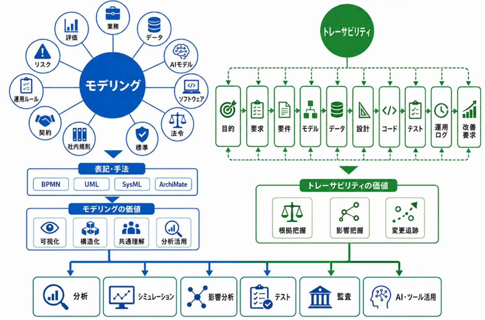
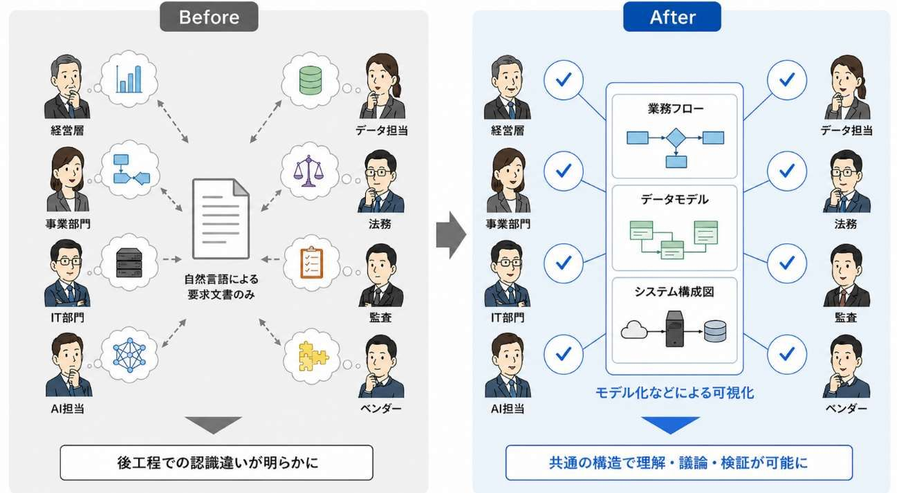
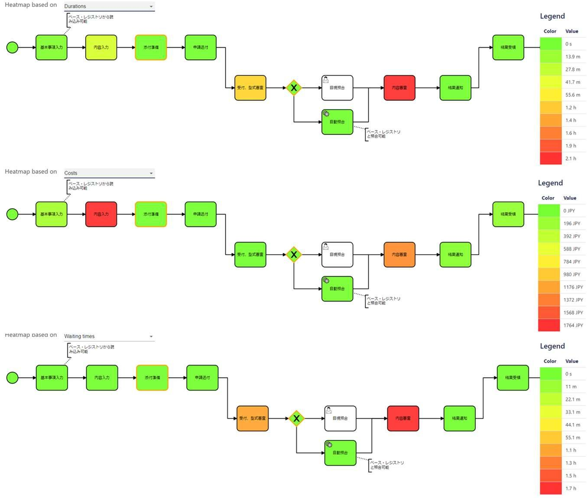
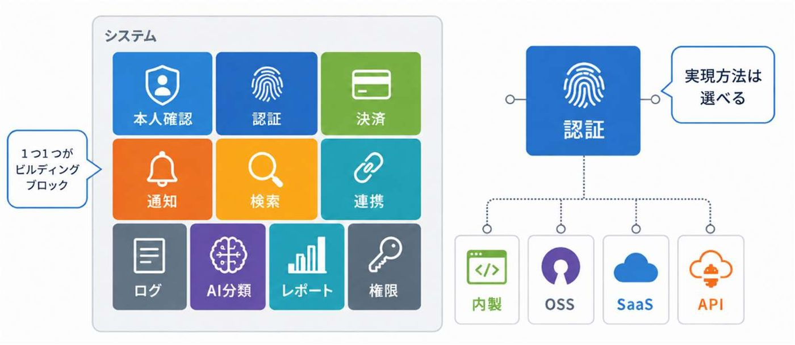
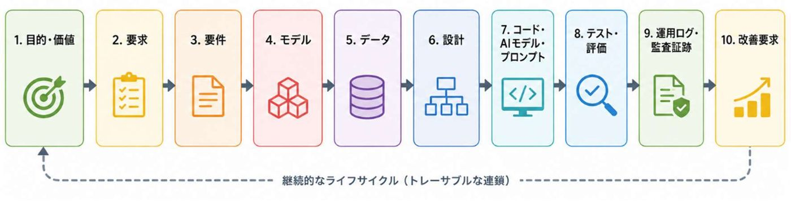
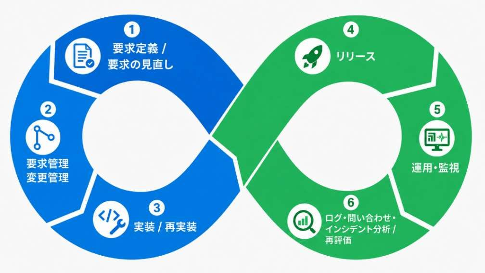
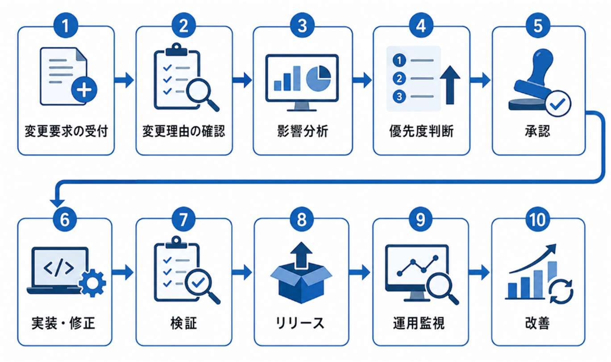
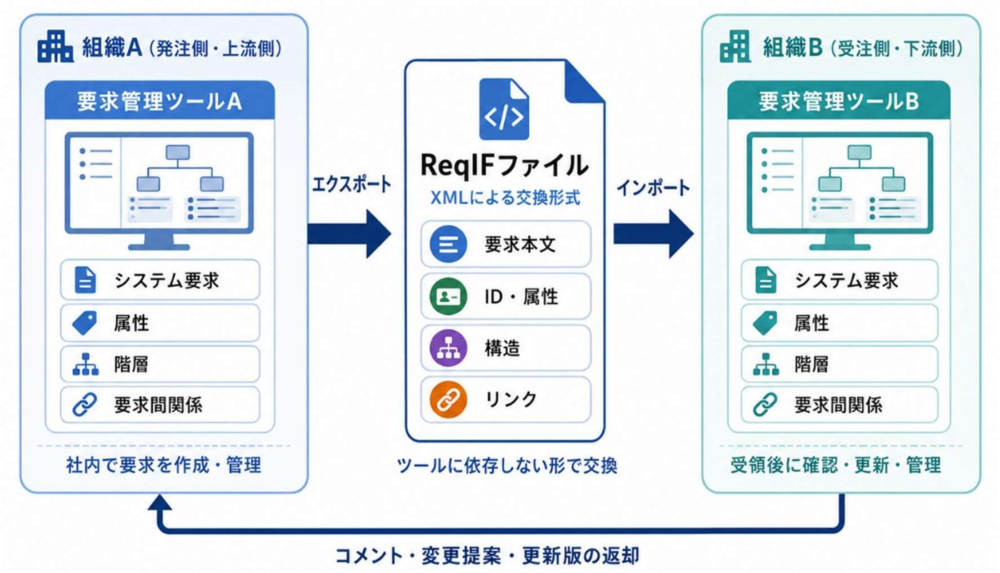
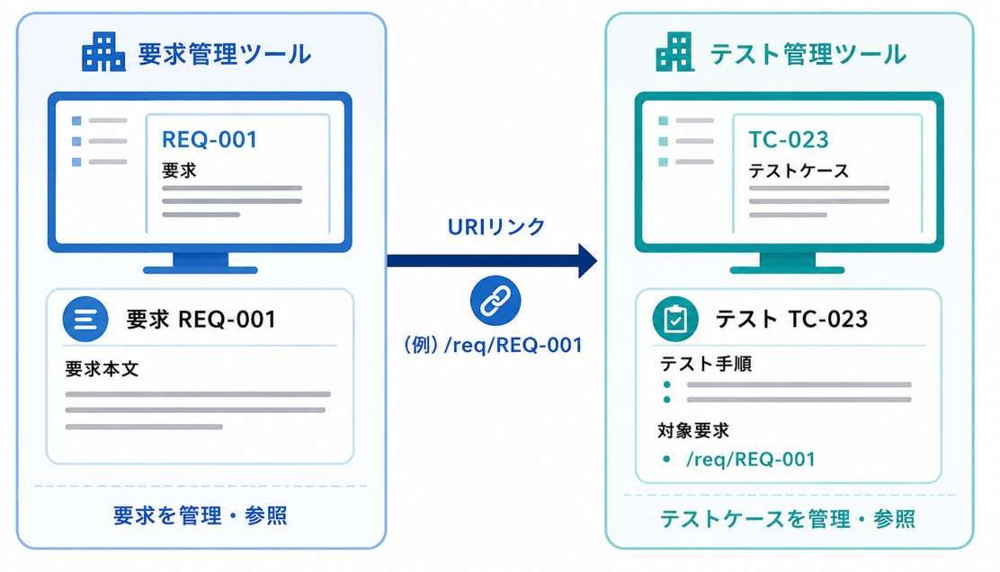
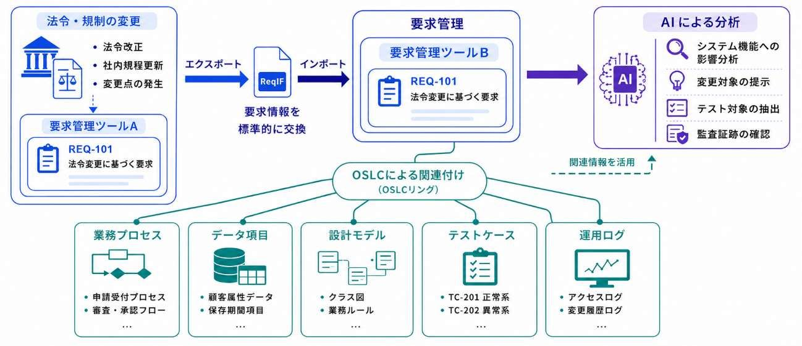

IPA（情報処理推進機構）が2026年11月に公開した[『AI時代の要求管理ハンドブック』](https://www.ipa.go.jp/digital/kaihatsu/youkyu-kanri.html)（Version 1.0.0、全129ページ）を、学習しやすいように教科書風に再構成した連載です。各章に途中の確認問題と、章末のまとめテストを付けています。

:::message
本連載は筆者が個人の学習目的で内容を要約・再構成したもので、IPAが作成・監修したものではありません。図は原典から引用しています。正確な記述は[原典PDF](https://www.ipa.go.jp/digital/kaihatsu/rqr7mi000000f5up-att/req-mgmt-hb.pdf)を参照してください。
:::

**連載一覧**

- [第1部 要求管理の基礎（第1〜4章）](https://zenn.dev/ryoooou/articles/ai-req-mgmt-handbook-part1)
- [第2部 AI時代に要求管理はどう変わるか（第5〜8章）](https://zenn.dev/ryoooou/articles/ai-req-mgmt-handbook-part2)
- **第3部 モデリングとトレーサビリティ（第9〜11章）← この記事**
- [第4部 ルール・制度・コンプライアンスと要求管理（第12〜14章）](https://zenn.dev/ryoooou/articles/ai-req-mgmt-handbook-part4)
- [第5部 AI時代の要求管理プロセスの組織への定着（第15〜16章）](https://zenn.dev/ryoooou/articles/ai-req-mgmt-handbook-part5)

## 第9章　要求を可視化する

文章だけで要求を共有すると、読み手ごとに解釈がずれます。この章では、要求を図やモデルで可視化し、さらに機械も扱える形へ構造化する考え方と、重要な要求を厳密に検証する「形式手法」を学びます。

:::message
**この章で学ぶこと**

- モデリングとトレーサビリティが第3部の中心テーマである理由を説明できる
- 可視化の目的が「きれいな図」ではないことを理解する
- Human Readable から Machine Understandable までの4段階を説明できる
- 代表的なモデリング手法の用途を使い分けられる
- モデリングを段階的に導入する進め方を説明できる
- 形式手法が有効な領域と、軽量な形式手法の始め方を理解する

**キーワード**：モデリング、可視化、Human Readable、Machine Understandable、オントロジー、BPMN、UML、SysML、ArchiMate、ER図、ルール表、形式手法、状態遷移、決定表

**優先して読む人**（原典「表1」より）　◎ 優先：事業部門、業務改革担当、DX推進部門、IT・情報システム部門、開発者、AI開発・利用部門、データ部門、利用者・現場代表者／〇 次点：経営層、セキュリティ部門、法務・コンプライアンス部門、監査部門、調達部門、行政機関の制度設計担当者
:::

### 9.0 第3部の見取り図：モデリングとトレーサビリティ

社会や組織の活動は、業務プロセス、データ、AIモデル、ソフトウェア、法令、社内規則、契約などが複雑に絡み合っています。これを自然言語の文書だけで管理すると、解釈がずれ、変更の影響が見えにくく、AIやツールも活用しにくくなります。そこで第3部の中心となるのが次の2つです。

- **モデリング**：業務、システム、データ、ルール、リスク、評価などを図・表・構造化された形式で表すこと。機械可読になれば、AIやツールでの分析・シミュレーション・影響分析・テスト・監査にも使える。
- **トレーサビリティ**：目的、要求、要件、モデル、データ、設計、コード、テスト、運用ログ、改善要求の関係を追跡できるようにすること。

*図16 AI時代の要求管理におけるモデリングとトレーサビリティ（出典：IPA「AI時代の要求管理ハンドブック」）*

本章（第9章）で可視化、第10章でモデルを実現手段につなぐビルディングブロック、第11章でトレーサビリティを扱います。

### 9.1 なぜ要求を可視化するのか

経営層、業務部門、IT、AI担当、データ担当、法務、監査、ベンダー――関係者は同じ言葉を使っていても、異なる意味で理解していることがよくあります。

:::message
**具体例：「顧客情報を適切に管理したい」**

顧客情報とはどのデータ項目か。誰が閲覧できるのか。どのシステムで保管するのか。AIに入力してよいのか。保存期間は。削除条件は。アクセスログは必要か。法令や契約上の制約は――これらを明らかにしなければ、実装も評価もできません。
:::

可視化の目的は**見やすい図を作ること自体ではなく、関係者が同じ対象を同じ構造で理解し、議論し、検証できるようにすること**です。

| 描くもの | 見えるようになること |
|---|---|
| 業務フロー | 誰が、いつ、何を判断し、どのデータを使い、どんな例外処理があるか |
| データモデル | データ項目の意味、関係、重複、欠落 |
| システム構成図 | AI、アプリ、DB、外部API、認証基盤、ログ基盤の接続関係 |
| リスクモデル | どの脅威がどの業務やデータに影響するか |

*図17 要求の可視化の重要性（出典：IPA「AI時代の要求管理ハンドブック」）*

AIの出力はデータ、モデル、プロンプト、参照文書、運用環境に依存します。AIをどこで使い、何を入力・出力し、人間がどこで確認し、どのログを残し、どう評価するのかを可視化しておかないと、誤出力や事故が起きたときに原因究明が難しくなります。

### 9.2 Human Readable から Machine Understandable へ

人が「読める」ことと、複雑な要求やその関係を「十分に理解できる」ことは同じではありません。まずはモデル化して関係者の共通理解と合意を作り、そのうえで必要に応じて**機械可読な形に構造化**します。

| レベル | 意味 | 例 |
|---|---|---|
| Human Readable | 人間が読める | 自然言語の要求定義書 |
| Human Understandable | 人間が理解しやすい | 図、表、業務フロー、用語集 |
| Machine Readable | 機械が読み取れる | 構造化データ、タグ、ID、メタデータ |
| Machine Understandable | 機械が意味を扱える | データモデル、オントロジー、ルールモデル、トレーサビリティ |

:::message
**ポイント：Human Readable は今後も必要**

要求の妥当性や優先順位、リスク許容範囲の判断・合意には、人が内容と根拠を理解できることが不可欠です。一方、人のためだけの文書では、影響分析、整合性確認、テスト生成、監査支援などの自動化に限界があります。**人の理解・合意と、AI・ツールによる処理の両方を支える**ことが目標です。Machine Understandable に近づけることは、要求を機械に丸投げすることではなく、人の判断を支援するために構造・意味・関係を明確にすることです。
:::

具体的には、要求にIDを付け、発生源・上位目的・関連法令・関連データ・関連機能・検証方法をメタデータとして持たせれば、ツールで検索・集計・影響分析ができます。業務フローをBPMNで描けば機械的に解析しやすく、データモデルや**オントロジー**（概念とその関係を共有可能かつ機械処理可能な形で明示した意味モデル）を使えば、同じ言葉が異なる意味で使われていないかを確認できます。

#### ✅ 確認問題

**問1**　「構造化データ、タグ、ID、メタデータ」が該当する記載レベルはどれですか。

- A. Human Readable
- B. Machine Understandable
- C. Machine Readable
- D. Human Understandable

:::details 答えと解説
**正解：C**

機械が読み取れるレベルです。さらに機械が「意味」を扱えるのが Machine Understandable（データモデル、オントロジーなど）です。
:::

### 9.3 代表的なモデル・モデリング手法

すべてを使う必要はなく、目的に応じて使い分けます。

| 手法 | 主な用途 | 活用場面 |
|---|---|---|
| 業務フロー | 業務手順、役割、例外処理 | 業務改善、要求定義、教育 |
| BPMN | 標準的な業務プロセス記述 | 手続、承認、部門間連携 |
| UML | ユースケース、クラス、シーケンス | アプリケーション設計 |
| SysML | 要求、構造、振る舞い、検証 | 複雑なシステム、MBSE |
| ArchiMate | 業務、アプリ、技術基盤の関係 | エンタープライズアーキテクチャ |
| ER図 | データ項目と関係 | データベース、データ連携 |
| データモデル | データ定義、制約、コード体系 | AI、データ基盤、相互運用性 |
| オントロジー | 用語、概念、意味関係 | 分野横断、ルール、AI活用 |
| ルール表 | 条件と処理の対応 | 業務ルール、審査、判定 |
| リスクマトリクス | 発生可能性と影響 | 安全性、セキュリティ、AIリスク |
| トレーサビリティマトリクス | 要件と実装・評価の対応 | 変更管理、監査、説明責任 |

AI時代には特に**データモデルとオントロジー**が重要です。AIはデータの意味に依存するため、用語やデータ項目の意味が曖昧だと誤った判断や不適切な出力につながります。

#### ✅ 確認問題

**問1**　「申請・承認・差戻し・部門間の受け渡し」を標準的な形式で整理したい場合、最も適したモデリング手法はどれですか。

- A. ER図
- B. BPMN
- C. リスクマトリクス
- D. オントロジー

:::details 答えと解説
**正解：B**

BPMNは業務プロセスを標準的に記述するのに適しており、承認、分岐、例外、部門間連携の整理に有効です。
:::

### 9.4 建築や製造から学ぶ可視化

住宅を建てるとき、施主は完成前に間取り図、外観図、3Dパース、設備仕様、見積、工程表を確認し、3Dウォークスルーで空間を体感し、耐震性や日当たり、動線もシミュレーションします。建築や製造では、設計図、CAD、BIM、デジタルモックアップ、シミュレーションで**完成物のイメージを事前に共有**し、変更の影響を把握するのが当たり前です。

一方、ソフトウェアやAIでは完成形が共有されにくく、業務改革と並行する場合は発注者自身も完成形を描けていないことが多いのです。だからこそ、ソフトウェアやAIでも、モデルを使った可視化・シミュレーション・変更管理・再利用を進め、**関係者が見て、確認し、体感し、合意できる形**にすることが重要です。

*図18 BPMNによるモデルを使ったシミュレーション例（時間、コスト、待ち時間）（出典：IPA「AI時代の要求管理ハンドブック」）*

### 9.5 要求情報とモデルを接続する

要求情報を特定の文書やツールに閉じ込めてはいけません。業務フローやデータモデル、SysMLモデルを作っても、**どのモデルがどの要求に対応しているか**が不明なら、実現状況も変更の影響も確認できません。要求IDと業務フロー、データモデル、設計モデル、テストケースなどを関連付けることで、

- 要求を変更したとき、どの業務・データ・設計・テスト・運用手順に影響するかを確認しやすくなる
- モデルから要求へ遡り、そのモデル要素が何のために存在するかを説明しやすくなる

ツール間で要求情報を交換・連携する標準として **ReqIF** と **OSLC** があります（11.6節）。

### 9.6 モデリング導入の現実的な進め方

専門人材がいない、ツールが使いにくい、作成コストが高い、メリットが分かりにくい、文書文化から移行できない――モデリングはなかなか定着しません。そこで**段階的に**導入します。

1. **重要業務の業務フローを可視化する**：開始から終了まで、誰が何をどの順で行うか。例外、承認、差戻し、手作業、二重入力を見えるようにする。
2. **主要データ項目を整理する**：業務で使うデータ、AIに入力するデータ、外部連携データ、保存義務のあるデータの意味・形式・出典・品質・保存期間を定義する。
3. **重要な要件について対応関係を整理する**：どの業務、どのデータ、どのテストで確認するか（すべてを完璧に接続する必要はない）。
4. **変更影響分析に利用する**：制度変更、業務変更、AIモデル更新、データ項目変更の影響を確認できるようにする。
5. **AIやツールの支援を取り入れる**：文書から業務フローやデータ項目を抽出、仕様書から要求一覧を作成、モデル間の不整合を検出、変更影響の候補を提示。

:::message
**ポイント：目的はきれいな図ではない**

関係者の共通理解を作り、抜け漏れを減らし、変更に強くし、AIやツールの支援を受けやすくすることが目的です。
:::

### 9.7 形式手法による要求の厳密化と検証

**形式手法**とは、数学的・論理的な記法で、要求、仕様、状態、振る舞い、制約を厳密に記述し、その性質を検証する方法です。すべての要求を数式にするためのものではなく、**誤りが大きな影響を及ぼす領域**で厳密性を高めるために使います。

:::message
**具体例：「適切な権限を持つ場合のみ、顧客情報を閲覧できること」**

一見明確ですが、役割、所属、担当顧客、委任、例外承認、退職・異動、緊急時対応、ログ記録など多くの条件が関係します。形式的な記述やルール表、状態遷移モデルを使えば、どの条件で許可し、どの条件で拒否し、どの条件で承認を求めるかを明確にできます。
:::

| 領域 | 形式手法が有効な理由 |
|---|---|
| 安全性要求 | 危険状態に遷移しないことを確認できる |
| セキュリティ要求 | 権限、アクセス制御、情報流通制約を厳密に扱える |
| 業務ルール | 条件、例外、優先順位、禁止事項を明確にできる |
| 状態遷移 | 申請、承認、差戻し、取消し、終了などの状態を検証できる |
| 並行処理 | 競合、順序、デッドロックを確認できる |
| AI利用制限 | AIが判断してよい範囲、人間に委ねる範囲を明確にできる |
| フェイルセーフ | 異常時に安全側に倒れる条件を検証できる |
| コンプライアンス | 法令・規則に基づく義務、禁止、例外を構造化できる |

#### 軽量な形式手法から始める

実務では、**状態遷移図、決定表、ルール表、制約条件、入出力条件**を明確にするところから始めるのが現実的です。たとえば申請業務で「申請中・審査中・差戻し・承認済・却下・取消し」の状態を定義し、どの操作でどの状態に移れるかを整理するだけでも、二重承認、取消し後の再申請、承認後の修正可否などの曖昧さが減ります。より高度な領域（重要な制御システム、金融取引、本人確認、アクセス制御など）では、モデル検査や定理証明などで「禁止状態に到達しない」「必要な承認なしに処理が完了しない」といった性質を機械的に確認します。

#### AIシステムと形式手法

AIモデルの出力そのものを完全に証明するのは難しいことが多いため、**AIを取り巻くシステム全体の制約**（安全制約、利用範囲、エスカレーション条件、フェイルセーフ、ログ、権限、データ利用制約）を形式的・半形式的に記述・検証するのが現実的です。例：

- 承認済み文書に根拠がなければ、AIは確定的な回答を返してはならない
- 法務、人事、懲戒、契約解除に関する質問は専門部署へのエスカレーション対象とする
- 機密情報を含む入力は外部AIサービスに送信してはならない
- 確信度が一定値未満ならAI出力は参考情報とし、人間の確認を必須とする

形式的な制約が整備されていれば、仕様変更やモデル更新のたびに既存の制約を破っていないかを確認しやすく、**継続的アシュアランス**にもつながります。

#### 導入の進め方

1. 形式化すべき対象を選ぶ（安全性、セキュリティ、法令遵守、AI利用制限、権限、重要な状態遷移を優先）
2. 自然言語の要求を整理する（曖昧なまま形式化しても意味のある検証はできない）
3. 軽量なモデルから始める
4. 要求・モデル・テスト・監査証跡をトレーサビリティでつなぐ
5. 変更時に再検証する

:::message alert
**注意：専門家だけの活動にしない**

高度な形式手法には専門知識が必要です。組織としては**まず軽量な形式化を普及させ**、重要領域を専門家が支援する体制にします。要求工学、MBSE、テスト、セキュリティ、監査と接続し、実務上の価値が見える形で導入しましょう。
:::

#### ✅ 確認問題

**問1**　申請業務の曖昧さを減らすために最初に取り組む「軽量な形式手法」として最も適切なものはどれですか。

- A. AIに業務フローを自由に生成させる
- B. 業務全体を定理証明で厳密に検証する
- C. 申請中・審査中・差戻し・承認済などの状態を定義し、どの操作でどの状態に遷移できるかを整理する

:::details 答えと解説
**正解：C**

状態遷移や決定表などの軽量な形式化から始めるのが現実的です。それだけでも二重承認や取消し後の扱いなどの曖昧さを減らせます。
:::

### 第9章のまとめ

:::message
- 第3部の中心は**モデリング**（図や構造化形式で表す）と**トレーサビリティ**（関係を追跡できるようにする）。
- 可視化の目的は、関係者が**同じ対象を同じ構造で理解・議論・検証**できるようにすること。
- 記載レベルは Human Readable → Human Understandable → Machine Readable → Machine Understandable。人の合意と機械の処理の両方を支える。
- 手法は目的に応じて使い分ける。AI時代は特に**データモデルとオントロジー**が重要。
- 建築のように、作る前に見て・確かめて・合意できる形にする。要求IDとモデルを接続する。
- モデリングは業務フロー→主要データ→重要要件の対応→影響分析→AI支援と**段階的に**導入する。
- 誤りの影響が大きい領域では**形式手法**を使う。まずは状態遷移図や決定表などの軽量な形式化から。
:::

### 第9章 まとめテスト

全8問。答えは「答えと解説」を開くと表示されます。

**問1**　要求を可視化する目的として最も適切なものはどれですか。

- A. 文書作成の工数を増やして品質を高めること
- B. AIに要求定義を丸投げできるようにすること
- C. 要件定義書の見栄えを良くすること
- D. 関係者が同じ対象を同じ構造で理解し、議論し、検証できるようにすること

:::details 答えと解説
**正解：D**

可視化は見やすい図を作ること自体が目的ではありません。
:::

**問2**　「データモデル、オントロジー、ルールモデル、トレーサビリティ」が例として挙げられる記載レベルはどれですか。

- A. Machine Understandable
- B. Human Readable
- C. Machine Readable
- D. Human Understandable

:::details 答えと解説
**正解：A**

機械が意味を扱えるレベルです。
:::

**問3**　Machine Understandable に近づけることの意味として正しいものはどれですか。

- A. 人が読む文書を廃止し、機械だけが扱う形式にすること
- B. 人の判断を支援するために、要求の構造・意味・関係を明確にすること
- C. 要求定義をすべてAIに任せること
- D. 自然言語での記述を禁止すること

:::details 答えと解説
**正解：B**

Human Readable な文書は引き続き必要です。人の理解・合意と機械の処理の両方を支えることを目指します。
:::

**問4**　要求、要件、構造、振る舞い、検証の関係を扱え、複雑なシステムやMBSEに向いているモデリング言語はどれですか。

- A. ER図
- B. リスクマトリクス
- C. BPMN
- D. SysML

:::details 答えと解説
**正解：D**

SysMLは要求から検証までの関係を扱えるため、MBSEで用いられます。
:::

**問5**　モデリングを段階的に導入する際の最初のステップとしてハンドブックが挙げるものはどれですか。

- A. 全システムのSysMLモデル化
- B. 専用モデリングツールの全社導入
- C. 重要業務の業務フローの可視化
- D. 形式手法による全要件の証明

:::details 答えと解説
**正解：C**

まず重要業務の開始から終了までを図にし、例外処理や二重入力などを見えるようにします。
:::

**問6**　業務フローやデータモデルを作っても、変更の影響範囲を確認できない典型的な原因はどれですか。

- A. どのモデルがどの要求に対応しているかが明確になっていない
- B. モデルの作成者が一人しかいない
- C. モデルを紙に印刷していない
- D. モデルの図が小さすぎる

:::details 答えと解説
**正解：A**

要求IDとモデルを関連付けることで、影響範囲の確認やモデル要素の存在理由の説明ができるようになります。
:::

**問7**　AIシステムに形式手法を適用する際の現実的な考え方はどれですか。

- A. AIモデルの内部の出力をすべて数学的に証明する
- B. AIを取り巻くシステム全体の安全制約、利用範囲、エスカレーション条件、フェイルセーフなどを形式的・半形式的に記述・検証する
- C. AIは確率的なので形式手法は一切使えない
- D. 形式手法はAIの学習データの作成にのみ使う

:::details 答えと解説
**正解：B**

AIモデルそのものの完全な証明は難しいため、周辺の制約を形式化するのが現実的です。
:::

**問8**　形式手法の導入についてハンドブックの考え方に合わないものはどれですか。

- A. 高度な専門性が必要なので、特定の専門家だけが閉じた形で取り組む
- B. 誤りの影響が大きい要求を優先して形式化する
- C. 変更時に形式化された制約への影響を再検証する
- D. 形式化の前に自然言語の要求を整理する

:::details 答えと解説
**正解：A**

専門家だけの活動にすると現場から切り離されます。軽量な形式化を普及させ、他の活動と接続して導入します。
:::

## 第10章　ビルディングブロックやサービスによるシステムの実現

モデリングで機能やデータを適切な単位に分けられれば、それぞれを「どう実現するか」を柔軟に選べます。この章では、システムを部品（ビルディングブロック）の組み合わせとして捉え、内製・OSS・SaaS・外部APIなどを使い分ける考え方を学びます。

:::message
**この章で学ぶこと**

- ビルディングブロックとは何か、その粒度の考え方を説明できる
- 機能ブロックの実現方法（新規開発、OSS、SaaS、外部APIなど）を使い分けられる
- ビルディングブロック化の利点と注意点を挙げられる
- ブロック選定時に確認すべき観点を説明できる
- 標準化・調達・契約との関係を理解する

**キーワード**：ビルディングブロック、粒度、内製、OSS、SaaS、外部API、変更容易性、セキュリティ、選定観点、ベンダーロックイン、標準化、相互運用性、SLA

**優先して読む人**（原典「表1」より）　◎ 優先：DX推進部門、IT・情報システム部門、開発者、セキュリティ部門、法務・コンプライアンス部門、調達部門／〇 次点：事業部門、業務改革担当、AI開発・利用部門、監査部門
:::

### 10.1 モデリングから実現手段へ

モデリングの意義は可視化だけではありません。機能・データ・業務プロセス・ルール・インターフェース・評価条件を**分解**し、それぞれを**どの単位でどう実現するか**を考えやすくなります。

複雑なシステムを一つの大きな仕組みとして作ると、設計も開発も運用も難しく、変更時にどこを直せばよいかも分かりにくくなります。技術、データ、外部サービス、規制、セキュリティリスクが短い周期で変わるAI時代には、一度作った仕組みを長期間そのまま使い続けるのは困難です。

そこで、機能やサービスを**ビルディングブロック**――一定の役割、入力、出力、責任範囲、インターフェースを持つ部品――として捉えます。本人確認、認証、決済、通知、検索、データ連携、ログ管理、AIによる分類、レポート作成、権限管理などがその例で、それぞれ内製、OSS、商用製品、クラウドサービス、SaaS、APIサービスのどれで実現するかを選べます。

*図19 ビルディングブロックのイメージ（出典：IPA「AI時代の要求管理ハンドブック」）*

:::message
**ポイント：順番が大事**

まず**「何を実現したいか」**を明確にし、次に**「どの単位に分け、どう実現するか」**を考えます。既存のブロックやサービスの活用可能性を検討し、必要に応じて新規開発と組み合わせます。
:::

### 10.2 ビルディングブロックとは何か

建物が部材、設備、配管、電気系統、部屋、構造体の組み合わせでできているように、情報システムやAIシステムも複数の機能やサービスの組み合わせで構成されます。ブロックの大きさはさまざまです。

| 粒度 | 例 | 説明 |
|---|---|---|
| 単一機能 | 認証、通知、ログ出力、データ変換 | 特定の機能だけを担う小さな部品 |
| 共通機能 | 権限管理、検索、帳票出力、ワークフロー | 複数業務で共通利用される機能 |
| データ連携機能 | API連携、ファイル連携、コード変換 | システム間・組織間のデータ連携 |
| AI機能 | 分類、要約、翻訳、異常検知、回答生成 | AIモデルやAIサービスを使った機能 |
| 業務サービス | 顧客管理、契約管理、購買、経費精算 | 業務単位のアプリケーションやSaaS |
| 基盤サービス | ID管理、監査ログ、セキュリティ監視、データ基盤 | 組織全体で共通利用される基盤 |

ブロックの大きさは**固定的に考えない**ことが重要です。あるプロジェクトでは通知機能を小さなブロックとして扱い、別のプロジェクトでは問い合わせ対応全体（FAQ、回答生成、チケット管理、分析）を一つのSaaSとして導入することもあります。「すべて開発する」「すべて既製品で置き換える」と最初から決めず、要求を分解し、ブロックごとに最適な実現手段を検討します。

### 10.3 機能ブロックの実現方法

| 実現方法 | 内容 | 向いている場合 |
|---|---|---|
| 新規開発 | 自社要件に合わせてコードを書く | 差別化領域、特殊要件、高度な制御が必要 |
| 既存システム活用 | 既存機能を再利用・改修する | 既に安定運用され、要件に合う |
| OSS活用 | オープンソースを利用する | 標準的機能、透明性、拡張性が必要 |
| 商用アプリケーション | パッケージ製品を導入する | 一般的な業務機能を短期間で導入 |
| SaaS利用 | クラウドサービスとして利用する | 標準業務、迅速導入、運用負荷軽減 |
| 外部API利用 | 特定機能をAPIで利用する | 認証、決済、翻訳、地図、AIなど |
| AIサービス利用 | 生成AI、分類AI、異常検知AIなどを利用する | 高度なAI機能を短期間で利用 |

たとえばデータ連携なら、単純なファイル連携で足りる場合もあれば、APIゲートウェイ、さらに国際的・高頻度な連携ならメッセージング基盤やデータスペース基盤が必要な場合もあります。AI機能も、自社開発、ファインチューニング、外部の生成AIサービス、商用AIアプリから選べます。重要なのは、「AIを使う」という抽象的な話ではなく、**どの業務で、どの入力に、どの出力を、どの品質と責任範囲で求めるか**を明確にしてから方法を選ぶことです。

#### ✅ 確認問題

**問1**　「自社の差別化領域で、特殊な要件や高度な制御が必要な機能」に最も向いている実現方法はどれですか。

- A. SaaS利用
- B. 外部API利用
- C. 商用パッケージの標準機能
- D. 新規開発

:::details 答えと解説
**正解：D**

差別化や特殊要件がある領域では、自社要件に合わせた新規開発が向いています。標準的な業務はSaaSやパッケージが向いています。
:::

### 10.4 ビルディングブロック化の利点

ビルディングブロック化には、再利用による生産性向上、実績ある部品による品質の安定などの利点がありますが、**最大の利点は変更に強くなること**です。システムが一体化していると一部の変更が広範囲に及びますが、機能が分離されインターフェースが明確なら、特定のブロックだけを交換・改善できます。

:::message
**具体例：段階的な置き換え**

自社開発の検索機能を、後から高性能な商用検索サービスに置き換える。AIによる分類を、最初は簡易なルールベースで始め、後から高精度なAIモデルや商用AIサービスに切り替える――ブロックとして分離されていれば、こうした置き換えが容易になります。
:::

- **技術更新に対応しやすい**：必要な部分だけを新しい技術・サービスに更新できる
- **目的に合ったサービスを選びやすい**：安さ、性能、セキュリティ、規制対応など重視点に応じて選べる
- **再利用で生産性と品質を高めやすい**：認証、通知、ログ、承認ワークフローなどを共通化できる
- **調達や委託がしやすい**：機能単位で要件・インターフェース・品質・責任範囲を定義すれば比較しやすく、SLAや受入条件も明確になる
- **障害時の影響範囲を把握しやすい**：どのブロックがどの業務やデータに影響するかが分かれば、原因究明や代替手段の検討が速い

ビルディングブロック化は単なる技術設計ではなく、**要求定義の段階で役割・境界・入出力・責任範囲・評価方法を明確にし、将来の変更可能性を確保する**考え方です。

### 10.5 セキュリティ対策におけるビルディングブロック

セキュリティは横断的な要件ですが、実際には複数の機能ブロックで実現されます。認証を個別システムごとに作り込まず**共通ID基盤**として整備すればセキュリティ水準を統一しやすく、アクセスログを**共通ログ基盤**に集約すれば監査や異常検知がしやすくなります。

| 領域 | ビルディングブロックの例 |
|---|---|
| 認証 | ID管理、多要素認証、シングルサインオン |
| 認可 | 権限管理、ロール管理、属性ベースアクセス制御 |
| 暗号化 | 通信暗号化、保存データ暗号化、鍵管理 |
| ログ管理 | アクセスログ、操作ログ、AI利用ログ |
| 監視 | 異常検知、セキュリティ監視、アラート |
| 脆弱性管理 | SBOM、脆弱性スキャン、パッチ管理 |
| インシデント対応 | 通報、封じ込め、復旧、報告、再発防止 |
| データ保護 | マスキング、匿名化、利用制御、持ち出し制御 |

AI時代には、機密情報を生成AIに入力させない入力制御、プロンプトインジェクション対策、AI出力の検証、AI利用ログの保存、モデル更新時の検証なども、共通のブロックとして整備すると安全性と効率性が高まります。

### 10.6 ビルディングブロックを選定するための要件

「機能があるか」だけで選んではいけません。特にOSS、商用製品、SaaS、外部APIでは、非機能・運用・契約・セキュリティ・データの要件も確認します。

| 観点 | 確認内容 |
|---|---|
| 機能適合性 | 必要な機能を満たしているか |
| 性能／可用性／拡張性 | 応答時間、障害時の業務継続、利用者・データ量の増加への対応 |
| 相互運用性 | API、データ形式、標準に対応しているか |
| セキュリティ | 認証、権限、暗号化、ログ、脆弱性管理は十分か |
| データ管理 | 保存場所、所有権、利用条件、削除条件は明確か |
| コンプライアンス | 法令、業界標準、社内規則に適合するか |
| 運用性 | 監視、保守、障害対応、サポート体制 |
| 変更可能性 | 将来、他サービスへ置き換え可能か |
| コスト | 初期費用、運用費用、ライセンス、従量課金 |
| ベンダーロックイン | 特定事業者への依存が過度でないか |
| 監査可能性 | 証跡、レポート、監査対応が可能か |

:::message alert
**注意：AIサービス・SaaS・OSSで特に確認すること**

**AIサービスやSaaS**：入力データが学習に使われるか、どの国・地域に保存されるか、ログの保存期間、削除要件への対応、障害や情報漏えい時の通知方法。

**OSS**：ライセンス、メンテナンス状況、脆弱性対応、コミュニティの継続性、自社の保守能力。導入後の管理責任を明確にしないと、脆弱性や保守停止のリスクが残ります。
:::

#### ✅ 確認問題

**問1**　生成AIのSaaSを選定する際に、データ管理の観点で特に確認すべきこととしてハンドブックが挙げているものはどれですか。

- A. 入力データが学習に使われるか、保存場所はどこか、削除要件に対応できるか
- B. 提供企業の創業年
- C. 画面のデザインが好みに合うか

:::details 答えと解説
**正解：A**

AIサービスやSaaSでは、データの学習利用、保存場所、ログ保存期間、削除対応、インシデント通知を要件として確認します。
:::

### 10.7 標準化・相互運用性

機能を分離しても、接続方法が独自仕様なら交換や再利用は困難です。顧客管理・契約管理・請求・問い合わせ・AI分析を連携するなら、顧客ID、契約ID、商品コードなどの**キー情報が統一**されていなければなりません。同じ「顧客」でも部門ごとに意味が違えば、AI分析の結果も不安定になります。

| 標準化対象 | 内容 |
|---|---|
| API | 入出力、認証、エラー処理、バージョン管理 |
| データ | 項目定義、コード体系、データ品質、正本 |
| 認証・認可 | ID、ロール、権限、属性 |
| ログ | 操作ログ、アクセスログ、AI利用ログ、監査ログ |
| メタデータ | サービス説明、データ説明、利用条件、更新頻度 |
| 評価基準 | 性能、品質、セキュリティ、AI評価指標 |
| 契約条件 | SLA、責任分担、データ利用、終了時対応 |

標準化は自由度を奪うものではなく、むしろ**部品を自由に組み合わせ、置き換えやすくする**ためのものです。

### 10.8 調達・契約への影響

従来は大きなシステムを一括委託する形が多くありましたが、ビルディングブロック化を進めると、**機能単位・サービス単位・API単位**の調達や契約が増えます。各ブロックについて、提供機能、入出力、性能・可用性の水準、障害時の責任、データ管理責任を定義します。

:::message alert
**注意：部品が正常でも全体が動くとは限らない**

個々のサービスが正常でも、組み合わせると期待どおりに動かないことがあります。個別のSLAに加えて、**サービス間連携、全体性能、障害時の切り分け、統合テスト、運用責任分担**を明確にします。AIサービスでは、モデル更新、出力品質、データ利用、説明責任、利用ログ、インシデント通知、終了時のデータ返却・削除も確認します。
:::

### 10.9 ビルディングブロック化の注意点

- **分割しすぎると複雑になる**：連携点が増え管理が難しくなる。業務の安定性、変更頻度、リスク、再利用可能性を踏まえて粒度を決める。
- **インターフェース設計が重要になる**：入力、出力、エラー処理、バージョン管理、ログを明確に定義しないと、責任分担やデータ不整合が問題になる。
- **ベンダーロックインに注意する**：独自仕様に依存しすぎると将来の置き換えが難しい。データのエクスポート、API、契約終了時の対応を確認する。
- **セキュリティと責任分担を明確にする**：どこで認証し、どこでログを保存し、どこが監視・障害対応するのかが曖昧になりやすい。

### 第10章のまとめ

:::message
- モデリングで要求を分解すれば、ブロックごとに**内製・既存活用・OSS・商用製品・SaaS・外部API・AIサービス**から最適な実現手段を選べる。
- ブロックの粒度は固定せず、プロジェクトに応じて決める。順番は「何を実現したいか」→「どう分け、どう実現するか」。
- 最大の利点は**変更に強くなる**こと。技術更新、サービス選択、再利用、調達、障害対応がしやすくなる。
- セキュリティも共通ID基盤や共通ログ基盤などのブロックで整備すると水準をそろえやすい。
- 選定では機能だけでなく、非機能・データ・契約・ロックイン・監査可能性まで確認する。
- 交換可能にするには**API・データ・ログなどの標準化**が不可欠。契約では個別SLAに加え全体の連携と責任分担を定める。分割しすぎ・ロックインに注意。
:::

### 第10章 まとめテスト

全8問。答えは「答えと解説」を開くと表示されます。

**問1**　ビルディングブロックの説明として最も適切なものはどれですか。

- A. 一定の役割、入力、出力、責任範囲、インターフェースを持つ、システムや業務の構成単位
- B. 要求定義書の章立て
- C. 必ず自社で開発するソフトウェア部品
- D. サーバーなどの物理的なハードウェア

:::details 答えと解説
**正解：A**

ビルディングブロックは再利用可能な機能単位であり、実現手段は内製に限りません。
:::

**問2**　ビルディングブロックの粒度についての考え方として正しいものはどれですか。

- A. プロジェクトや目的に応じて柔軟に決め、固定的に考えない
- B. 必ずシステム全体を一つのブロックとする
- C. 粒度は業界標準で一律に決まっている
- D. 必ず最小単位まで細かく分割する

:::details 答えと解説
**正解：A**

同じ問い合わせ対応でも、小さな部品の組み合わせにする場合と、一つのSaaSとして導入する場合があります。
:::

**問3**　ハンドブックがビルディングブロック化の「最大の利点」としているものはどれですか。

- A. セキュリティ対策が不要になること
- B. 変更に強くなり、特定のブロックだけを交換・改善できること
- C. 要求定義が不要になること
- D. 開発者の人数を減らせること

:::details 答えと解説
**正解：B**

機能が分離されインターフェースが明確なら、技術進化に合わせて必要な部分だけを置き換えられます。
:::

**問4**　認証を個別システムごとに作り込まず共通ID基盤として整備することの主な効果はどれですか。

- A. ログの保存が不要になる
- B. 組織全体でセキュリティ水準を統一しやすくなる
- C. 個別システムの自由度が増す
- D. 多要素認証が使えなくなる

:::details 答えと解説
**正解：B**

セキュリティ機能を共通ブロックとして整備すると、水準の統一と効率化が図れます。
:::

**問5**　OSSをビルディングブロックとして利用する際に確認すべきこととしてハンドブックが挙げていないものはどれですか。

- A. メンテナンス状況と脆弱性対応
- B. 自社での保守能力
- C. 開発者の国籍
- D. ライセンス

:::details 答えと解説
**正解：C**

OSSは有効な選択肢ですが、ライセンス、保守状況、脆弱性対応、コミュニティの継続性、自社の保守能力と管理責任を確認します。
:::

**問6**　複数のサービスを組み合わせる場合の調達・契約で特に明確にすべきこととして正しいものはどれですか。

- A. 各サービスの個別SLAだけを定めれば十分である
- B. 個別SLAに加え、サービス間連携、全体性能、障害時の切り分け、統合テスト、運用責任分担
- C. 最も安いサービスを選ぶこと
- D. 一つのベンダーにすべてを委託すること

:::details 答えと解説
**正解：B**

個々のサービスが正常でも全体として期待どおり動かないことがあるため、全体の責任分担も明確にします。
:::

**問7**　ビルディングブロック化の注意点として適切でないものはどれですか。

- A. ブロック化するとインターフェース設計の重要性は低くなる
- B. 分割しすぎると連携点が増えて複雑になる
- C. ベンダーの独自仕様に依存しすぎると置き換えが難しくなる
- D. 認証・ログ・監視などの責任分担が曖昧になりやすい

:::details 答えと解説
**正解：A**

むしろインターフェース設計（入出力、エラー処理、バージョン管理、ログ）の重要性は高まります。
:::

**問8**　部門ごとに「顧客」の意味が異なる状態で各サービスを連携した場合に起こりやすい問題はどれですか。

- A. セキュリティが自動的に強化される
- B. 処理速度が速くなりすぎる
- C. データ連携が難しくなり、AI分析の結果も不安定になる
- D. ライセンス費用が下がる

:::details 答えと解説
**正解：C**

キー情報や用語の定義を標準化することが、ブロックを組み合わせる前提になります。
:::

## 第11章　トレーサビリティとDevOps型要求管理

要求がどこから来て、どこに実装され、どのテストで確認され、運用でどう評価されるのか――それを追える状態がトレーサビリティです。この章では、何をつなぐべきか、運用からのフィードバックを回すDevOps型の要求管理、変更管理、そして要求情報の交換・連携の標準ReqIFとOSLCを学びます。

:::message
**この章で学ぶこと**

- トレーサビリティがない場合に起きる問題を説明できる
- AI時代にトレーサビリティでつなぐべき対象を挙げられる
- DevOps型要求管理の循環を説明できる
- トレーサビリティマトリクスの作り方と始め方を理解する
- 変更のレベルと変更理由に応じた対応を説明できる
- ReqIFとOSLCの違いと使い分けを説明できる

**キーワード**：トレーサビリティ、DevOps、トレーサビリティマトリクス、変更管理、影響分析、変更のレベル、環境変化・学習・初期不備、ReqIF、OSLC

**優先して読む人**（原典「表1」より）　◎ 優先：DX推進部門、IT・情報システム部門、開発者、AI開発・利用部門、セキュリティ部門、監査部門／〇 次点：経営層、事業部門、業務改革担当、データ部門、法務・コンプライアンス部門、調達部門、行政機関の制度設計担当者、利用者・現場代表者
:::

### 11.1 なぜトレーサビリティが重要か

**トレーサビリティ**とは、要求がどこから来て、どの要件になり、どの設計やコードに反映され、どのテストで確認され、運用後にどう評価されるのかを**追跡できる状態**です。これがないと、次のような問題が起きます。

- なぜその機能が必要なのか、どの法令や標準に基づくのかが分からない
- ある要件がどこに実装されているのか、テストが何を確認しているのかが分からない
- 変更時にどこへ影響するのか分からない
- AIの出力がどのデータやルールに基づくのか説明できない
- 障害や事故の原因究明に時間がかかる
- 運用データを改善に結びつけられない

:::message
**ポイント：AIによる開発支援の前提でもある**

AIがバグを見つけパッチを作れても、どの要件を満たすべきか、どの業務や法令に影響するかが分からなければ、安心して修正を適用できません。逆に、要求からログまでがつながっていれば、AIは影響分析や修正案の作成を支援しやすくなります。トレーサビリティは**人間の説明責任**に加え、**AIによる開発支援・運用改善の前提**です。
:::

### 11.2 何をつなぐべきか

要求とコードをつなげば終わりではありません。AI時代には、目的、要求、要件、モデル、データ、AIモデル、ルール、評価、運用までをつなぐことが望まれます。

*図20 トレーサビリティのためにつなぐ対象の流れ（出典：IPA「AI時代の要求管理ハンドブック」）*

| つなぐ関係 | 目的 |
|---|---|
| 目的 ⇔ 要求 | 要求が何の価値を実現するのかを明確にする |
| 要求 ⇔ 要件 | 抽象的な要求を実装・評価可能にする |
| 要件 ⇔ 業務プロセス | どの業務で実行されるかを確認する |
| 要件 ⇔ データ | 必要なデータ、品質、出典を明確にする |
| 要件 ⇔ AIモデル | AIが何を担うのかを明確にする |
| 要件 ⇔ プロンプト | 生成AIへの指示を管理する |
| 要件 ⇔ 法令・標準 | コンプライアンス根拠を明確にする |
| 要件 ⇔ テスト | どのテストで確認するかを明確にする |
| 要件 ⇔ ログ | 運用後に何を観測するかを明確にする |
| ログ ⇔ 改善要求 | 運用データを改善に接続する |

こうしたつながりがあれば、法令が変わったときにその法令に基づく要求、業務、データ、AI利用条件、テスト、監査証跡を確認でき、AIモデルを更新するときには関係する要求、評価指標、業務、利用者、ログ、リスクを確認できます。

:::message
**補足：全部を一律に網羅しなくてよい**

規模や特性、重要度やリスクに応じて管理対象と粒度を決め、まずは**主要な要求とその根拠、対応する要件、検証方法**から関連付けます。ただし安全性や法令遵守に関わる重要な要求は、必要なトレーサビリティを確実に確保します。データについては第8章のデータ供給チェーンの関係も整理するとよいでしょう。
:::

#### ✅ 確認問題

**問1**　トレーサビリティの「要件 ⇔ ログ」の関係を管理する目的として正しいものはどれですか。

- A. 要件の作成者を記録する
- B. 要件の優先度を決める
- C. 運用後に何を観測するかを明確にする

:::details 答えと解説
**正解：C**

要件とログを結びつけることで、運用中にその要件が満たされているかを観測できます。さらに「ログ ⇔ 改善要求」で改善につなげます。
:::

### 11.3 DevOps型の要求管理

AIを含むシステムでは、運用後のデータや利用状況から新しい要求が生まれます。そのため要求管理も、定義→実装→運用→監視→フィードバック→変更という**循環**で行います。

*図21 要求管理のDevOps型循環プロセス（出典：IPA「AI時代の要求管理ハンドブック」）*

AIの出力品質、利用者の反応、問い合わせ内容、モデルの性能劣化、監査結果を継続的に確認し、必要に応じて要求、データ、プロンプト、モデル、業務手順、社内規則を更新します。こうして要求管理は静的な文書管理から**価値を継続的に高める活動**になります。

DevOps型では、開発チームだけでなく業務部門、AI担当、データ担当、法務、監査、セキュリティも関与します。運用中の問題は単なる障害対応で終わらせず、**要求・要件・データ・ルール・運用手順のどこに原因があるのか**を確認し、必要なら要求定義へ戻ります。

### 11.4 トレーサビリティマトリクス

トレーサビリティを管理する代表的な方法が、要求と設計・実装・テスト・運用・ルールの対応を表で管理する**トレーサビリティマトリクス**です。

| 要求 | 発生源 | 要件ID | 関連データ | 関連機能 | 検証方法 | 運用ログ |
|---|---|---|---|---|---|---|
| 利用者本人を確認する | 法令・社内規則 | FR-… | 利用者ID、認証情報 | ログイン機能 | 認証テスト | 認証ログ |
| AI回答を人間が確認する | リスク評価 | FR-… | 問い合わせ内容、回答案 | 回答案生成 | レビュー確認 | 採用率、修正率 |
| 個人情報の目的外利用を防ぐ | 法令 | NFR-… | 顧客情報 | アクセス制御 | 権限テスト | アクセスログ |

:::message
**ポイント：小さく始めて、ツールにつなぐ**

最初から巨大なマトリクスを作る必要はありません。**重要な要求、高リスクの要求、法令・標準に基づく要求、AIに関係する要求**から始めます。また表だけで管理せず、要求ID・データ項目ID・テストケースID・リスクID・ルールIDを付与して要求管理ツールやモデリングツールと連携し、変更時に影響範囲を検索できるようにします。
:::

### 11.5 変更管理と影響分析

要求、データ、AIモデル、プロンプト、法令、業務プロセスは変わります。変更を禁止することはできません。重要なのは**変更を管理できる状態にする**ことです。

*図22 変更管理の主要プロセス（出典：IPA「AI時代の要求管理ハンドブック」）*

変更要求は、利用者の要望、業務変更、制度改正、標準改定、AIモデル更新、データ品質問題、セキュリティインシデント、監査指摘、障害、コスト削減要求など、さまざまなところから発生します。受け付けたら、まず**目的・ゴールは維持されたままか、それとも目的・ゴールそのものの見直しを伴うのか**を確認します。

| 変更のレベル | 例 | 基本的な対応方針 |
|---|---|---|
| 目的・ゴールの変更 | 事業目的、提供価値、成功基準そのものの変更 | ビジネス／ミッション分析まで戻り、影響のある下位要素も再構成 |
| 要求・業務モデルの変更 | 要求の変更、業務プロセスや役割分担の変更 | 要求分析・モデリングまで戻り、影響のある要求と下位要素を再整理 |
| 実現手段・要件の変更 | AIモデル変更、性能条件変更、データ項目変更 | 要件仕様化まで戻り、影響のある要件と下位要素を再整理 |

変更は単なる作業依頼として扱わず、**背景・目的・影響範囲・リスク・優先度・検証方法**を確認します（BABOKは、全体戦略との整合、価値への影響、時間やリソースへの影響、リスク・機会・制約の変化といった観点で評価すべきとしています）。

:::message
**具体例：AIモデルを更新するときの確認事項**

単に新モデルに差し替えるのでは不十分です。どの要求に関係するか／どの業務で使われているか／どのデータを入力としているか／既存の評価指標を満たすか／出力の傾向は変わるか／人間の確認手順に変更は必要か／ログや証跡に変更はあるか／利用者への説明は必要か／法令・標準・契約との整合性は保たれるか。
:::

#### 変更理由を区別する

| 変更理由 | 内容 | 扱い |
|---|---|---|
| 環境変化による変更 | 法令、業務、市場、利用環境などの変化への対応 | 通常の変更として管理 |
| 学習による変更 | 実運用や利用者から新たな知見を得た | 通常の変更として管理 |
| 初期要求定義の不備の訂正 | 当初の獲得・分析・評価が不十分だった | 記録し、**要求定義プロセス自体の改善**につなげる |

:::message alert
**注意：要求の変更ではなく「不具合」のこともある**

要求・要件自体は妥当で、実装や運用がそれを満たしていない場合は、要求を変更するのではなく、**不具合または運用上の問題として是正**します。
:::

#### ✅ 確認問題

**問1**　「AIモデルを新しいバージョンに変更する」ことは、変更のレベルとしてどれに当たり、どこまで戻って再整理するのが基本ですか。

- A. 要求・業務モデルの変更／要求分析まで戻る
- B. 実現手段・要件の変更／要件仕様化まで戻る
- C. 目的・ゴールの変更／ビジネス分析まで戻る

:::details 答えと解説
**正解：B**

AIモデル変更や性能条件・データ項目の変更は実現手段・要件の変更にあたり、要件仕様化まで戻って影響のある要件と下位要素を再整理します。
:::

### 11.6 ReqIFとOSLCによる要求情報の交換・連携

変更管理と影響分析を続けるには、要求情報を特定の文書やツールに閉じ込めず、関連情報と接続でき、複数の企業・部門・ツール間でやり取りできる必要があります。そこで重要になる標準が**ReqIF**と**OSLC**です。両者は競合するものではなく、目的に応じて使い分けます。

#### ReqIF ― 要求情報を「まとめて交換する」

**ReqIF（Requirements Interchange Format）**は、要求管理ツール間で要求情報を交換するための国際標準です。要求ID、要求文、属性、階層、関係、状態、検証方法などをXML形式で構造化して交換できます。特に**ある時点の要求情報をまとめて交換する**場面で有効です。

- 発注者が要求一覧を受注者に渡す／受注者が詳細化した要求を返す
- 複数の開発会社が要求情報を共通形式で共有する
- ツールを移行する際に要求データを移す

要求を文書ではなく、**ID・属性・階層・関係を持つデータ**として交換できる点に意義があります。

*図23 ReqIFによる要求の交換イメージ（出典：IPA「AI時代の要求管理ハンドブック」）*

#### OSLC ― ライフサイクル情報を「リンクする」

**OSLC（Open Services for Lifecycle Collaboration）**は、要求管理、設計、テスト、変更管理、構成管理などの異なるツールを連携させる標準的な考え方です。要求、設計モデル、テストケース、変更要求、障害票などを**Web上のリソースとしてリンク**し、ツールをまたいで参照できるようにすることを重視します。「この要求はSysMLモデルのどの要素に対応し、どのテストで検証され、どの変更要求で修正され、どの障害票と関係するか」をツール横断で追跡したい場合に有効です。

*図24 OSLCの考え方に基づく要求とテストのリンクイメージ（出典：IPA「AI時代の要求管理ハンドブック」）*

| 観点 | ReqIF | OSLC |
|---|---|---|
| 主な目的 | 要求情報の交換 | ライフサイクル情報の連携 |
| 使い方 | 要求データをファイルとして受け渡す | 要求、設計、テスト、変更等をリンクする |
| 向いている場面 | 発注者・受注者間の要求交換、ツール移行、要求一覧の共有 | 複数ツール間のトレーサビリティ、影響分析、変更管理 |
| 管理対象 | 要求、属性、階層、関係 | 要求、設計、テスト、変更、構成、障害等の関連情報 |
| 活用効果 | 要求情報の標準的な受け渡し | 継続的なトレーサビリティとライフサイクル管理 |

#### AI時代に重要性が高まる理由

AIで要求候補の抽出、過不足確認、影響分析を行うには、要求情報が**構造化され、他のライフサイクル情報と接続されている**必要があります。要求が単なるWord文書やExcel表として孤立していると、AIは意味・関係・変更影響を十分に扱えません。「この法令変更はどのシステム機能に影響するか」をAIが分析するには、法令に基づく要求、業務プロセス、データ項目、設計モデル、テストケース、運用ログがつながっている必要があります。

*図25 ReqIFとOSLCとAIによる法令変更の影響調査イメージ（出典：IPA「AI時代の要求管理ハンドブック」）*

:::message
**ポイント：導入は小さく始める**

最初から大規模な統合基盤は不要です。まず**重要要求にIDを付け**、要求管理台帳を整備し、要求と要件、要件とテスト・設計・変更要求を対応づけるところから。ReqIFなら重要な要求・法令由来の要求・AI関連の要求・高リスク要求に、ID、要求文、発生源、優先度、検証方法、関連要求を持たせることから始めます。そのうえで、発注者・受注者間の交換にReqIF、複数ツール間のリンク管理にOSLCの考え方を取り入れます。
:::

こうして要求定義書を、単なる文書ではなく、**ライフサイクル全体と接続された知識基盤**として扱えるようになります。

### 第11章のまとめ

:::message
- トレーサビリティは、要求の出所から実装・テスト・運用評価までを**追跡できる状態**。人の説明責任とAIによる開発支援の前提。
- AI時代は目的・要求・要件に加え、業務、データ、AIモデル、プロンプト、法令、テスト、ログ、改善要求までをつなぐ。重要度に応じて粒度を決める。
- **DevOps型**の循環で、運用からのフィードバックを要求・データ・プロンプト・モデル・規則の更新につなげる。
- **トレーサビリティマトリクス**は重要・高リスク・法令・AI関連の要求から小さく始め、IDでツールと連携する。
- 変更は禁止できない。**変更のレベル**（目的／要求・業務モデル／実現手段・要件）に応じて戻る深さを決め、**変更理由**（環境変化・学習・初期不備）を記録する。満たせていないだけなら不具合として是正。
- **ReqIF**は要求情報の交換、**OSLC**はライフサイクル情報のリンク。両者を使い分け、AIによる影響分析の基盤にする。
:::

### 第11章 まとめテスト

全9問。答えは「答えと解説」を開くと表示されます。

**問1**　トレーサビリティがない場合に起きる問題としてハンドブックが挙げていないものはどれですか。

- A. AIの出力がどのデータやルールに基づくのか説明できない
- B. 開発メンバーの勤怠管理ができない
- C. 変更時にどこへ影響するのか分からない
- D. 障害や事故の原因究明に時間がかかる

:::details 答えと解説
**正解：B**

トレーサビリティは、要求の根拠・実装箇所・検証・影響範囲・原因究明などを把握するためのものです。
:::

**問2**　「要件 ⇔ 法令・標準」の関係を管理する目的として正しいものはどれですか。

- A. 法務部門の人員を減らすため
- B. コンプライアンスの根拠を明確にするため
- C. 法令を変更するため
- D. 法令の条文を暗記するため

:::details 答えと解説
**正解：B**

要件がどの法令や標準に基づくかが分かれば、法令変更時の影響確認や監査での説明が容易になります。
:::

**問3**　DevOps型の要求管理で、運用中に問題が発生した場合の対応として最も適切なものはどれですか。

- A. 要求・要件・データ・ルール・運用手順のどこに原因があるのかを確認し、必要に応じて要求定義へ戻る
- B. 次の大規模刷新まで対応を保留する
- C. 障害対応として処理し、要求定義には反映しない
- D. 開発チームだけで原因を調べる

:::details 答えと解説
**正解：A**

DevOps型では、運用の問題を要求定義への改善につなげます。業務部門、法務、監査なども関与します。
:::

**問4**　トレーサビリティマトリクスの作り始め方としてハンドブックが勧めるものはどれですか。

- A. テスト担当者が独自に作成し、要求担当とは共有しない
- B. 全要求について最初から網羅的に作成する
- C. 実装が完了してからまとめて作成する
- D. 重要な要求、高リスクの要求、法令・標準に基づく要求、AIに関係する要求から始める

:::details 答えと解説
**正解：D**

最初から巨大なものは不要です。重要なものから始め、IDでツールと連携させます。
:::

**問5**　「事業の提供価値そのものを見直す」変更が発生した場合の対応として正しいものはどれですか。

- A. 変更を受け付けない
- B. ビジネス／ミッション分析まで戻り、影響のある下位要素も再構成する
- C. 要件仕様化まで戻って再整理する
- D. 該当する要件の文言だけを修正する

:::details 答えと解説
**正解：B**

目的・ゴールのレベルの変更は、最上流まで戻って要求・要件を再定義し、新たなベースラインを設定します。
:::

**問6**　変更理由が「初期要求定義の不備の訂正」だった場合に望ましい追加の対応はどれですか。

- A. 担当者を処分する
- B. 変更理由を記録しない
- C. 不備は隠して環境変化による変更として処理する
- D. 変更理由を記録し、要求定義プロセス自体の改善につなげる

:::details 答えと解説
**正解：D**

変更理由を区別して記録し、初期不備はプロセス改善の材料にします。
:::

**問7**　要求・要件は妥当だが、実装がそれを満たしていないことが分かった場合の正しい扱いはどれですか。

- A. 要求を変更せず、不具合または運用上の問題として是正する
- B. 実装に合わせて要求を変更する
- C. 次の変更要求にまとめて先送りする
- D. 要求を削除する

:::details 答えと解説
**正解：A**

要求が妥当なら、変えるべきは要求ではなく実装や運用です。
:::

**問8**　ReqIFとOSLCの説明の組み合わせとして正しいものはどれですか。

- A. ReqIF：AIモデルの評価基準／OSLC：プロンプトの管理形式
- B. ReqIF：要求情報をファイルとしてまとめて交換する標準／OSLC：要求・設計・テスト・変更などをツールをまたいでリンクする考え方
- C. ReqIF とOSLCは同じもので、どちらか一方を選ぶ必要がある
- D. ReqIF：テスト自動化ツール／OSLC：要求記述言語

:::details 答えと解説
**正解：B**

両者は競合せず、交換（ReqIF）とリンク（OSLC）という目的に応じて使い分けます。
:::

**問9**　発注者が要求一覧を受注者に渡し、受注者が詳細化して返す場面で特に有効なのはどれですか。

- A. BPMN
- B. OSLC
- C. ER図
- D. ReqIF

:::details 答えと解説
**正解：D**

ある時点の要求情報をまとめて交換する場面にはReqIFが向いています。
:::

---

**参考文献**
独立行政法人情報処理推進機構（IPA）デジタル＆AIシステムズ・デザインセンター『AI時代の要求管理ハンドブック ～経営・現場・開発がともに描く、問いから実現への道筋～』Version 1.0.0, 2026. https://www.ipa.go.jp/digital/kaihatsu/youkyu-kanri.html
