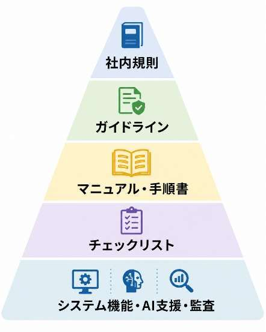

IPA（情報処理推進機構）が2026年11月に公開した[『AI時代の要求管理ハンドブック』](https://www.ipa.go.jp/digital/kaihatsu/youkyu-kanri.html)（Version 1.0.0、全129ページ）を、学習しやすいように教科書風に再構成した連載です。各章に途中の確認問題と、章末のまとめテストを付けています。

:::message
本連載は筆者が個人の学習目的で内容を要約・再構成したもので、IPAが作成・監修したものではありません。図は原典から引用しています。正確な記述は[原典PDF](https://www.ipa.go.jp/digital/kaihatsu/rqr7mi000000f5up-att/req-mgmt-hb.pdf)を参照してください。
:::

**連載一覧**

- [第1部 要求管理の基礎（第1〜4章）](https://zenn.dev/ryoooou/articles/ai-req-mgmt-handbook-part1)
- [第2部 AI時代に要求管理はどう変わるか（第5〜8章）](https://zenn.dev/ryoooou/articles/ai-req-mgmt-handbook-part2)
- [第3部 モデリングとトレーサビリティ（第9〜11章）](https://zenn.dev/ryoooou/articles/ai-req-mgmt-handbook-part3)
- **第4部 ルール・制度・コンプライアンスと要求管理（第12〜14章）← この記事**
- [第5部 AI時代の要求管理プロセスの組織への定着（第15〜16章）](https://zenn.dev/ryoooou/articles/ai-req-mgmt-handbook-part5)

## 第12章　外部要件としての法令・規制・標準

「関連法令を遵守すること」――要件定義書でよく見るこの一文は、実は要件になっていません。この章では、法令・規制・標準・契約などの外部要件を、現場で実行できる具体的な社内要件へ変換する方法を学びます。

:::message
**この章で学ぶこと**

- 第4部で扱う「外部ルール」と「内部ルール」の違いを説明できる
- 代表的な外部要件の種類と、それぞれで確認すべきことを挙げられる
- 「法令を遵守すること」が要件にならない理由を説明できる
- 外部要件を社内要件に変換する方法を理解する

**キーワード**：外部要件、内部ルール、法令、規制、行政ガイドライン、標準、認証基準、契約、社会的要請、義務、禁止、社内要件への変換

**優先して読む人**（原典「表1」より）　◎ 優先：セキュリティ部門、法務・コンプライアンス部門、監査部門、調達部門、行政機関の制度設計担当者／〇 次点：経営層、事業部門、業務改革担当、DX推進部門、IT・情報システム部門、AI開発・利用部門、データ部門
:::

### 12.0 第4部の見取り図：ルールも重要な「要求源」

AI時代の要求管理では、利用者の要望に加え、法令、規制、標準、ガイドライン、契約、社内規則、マニュアルといった**ルール**も重要な要求源です。ルールはシステムやAIが守るべき制約であると同時に、品質・安全性・説明責任・信頼性を支える基盤です。企業にとってのルールは大きく2種類あります。

| 種類 | 例 | 役割 |
|---|---|---|
| 外部から与えられるルール | 法令、規制、行政ガイドライン、業界標準、認証基準、契約条件 | 事業を行ううえで守らなければならない外部要件。コンプライアンス、監査、説明責任に直結 |
| 企業自身が定める内部ルール | 社内規則、業務ガイドライン、マニュアル、手順書、チェックリスト、FAQ、教育資料 | 外部要件を社内業務に落とし込み、従業員が日々適切に判断・行動するための実務上の基盤 |

AI時代には特に**内部ルール**の重要性が高まります。AIが業務を支援するには、社内規則やマニュアルが、AIが参照しやすく、人も理解しやすく、変更管理しやすい形で整っている必要があるからです。第4部では、本章で外部要件を、第13章・第14章で内部ルールを扱います。

### 12.1 外部要件とは何か

**外部要件**とは、企業の外部にある制度、規則、基準、契約などから発生する要件です（ISO/IEC/IEEE 29148でも、法令や標準、契約を要求源や制約として識別し、要求仕様へ反映することが想定されています）。

| 種類 | 例 | 要件定義で確認すべきこと |
|---|---|---|
| 法令 | 個人情報保護、労働、安全、金融、消費者保護等 | 義務、禁止、手続、保存、説明責任 |
| 規制 | 監督官庁の規則、許認可条件 | 報告、記録、監査、審査基準 |
| 行政ガイドライン | AI、データ、セキュリティ等の指針 | 推奨事項、リスク対応、説明事項 |
| 標準 | ISO、JIS、業界標準、技術標準 | 品質、互換性、データ形式、評価方法 |
| 認証基準 | セキュリティ、品質、AI、製品安全等 | 適合性評価、証跡、監査項目 |
| 契約 | 顧客契約、委託契約、SLA | 責任分担、納期、品質、データ利用条件 |
| 社会的要請 | ESG、人権、倫理、安全性 | 説明責任、透明性、リスク対応 |

従来、外部要件は法務やコンプライアンス部門が確認し、システム開発では「法令を遵守すること」「契約条件に従うこと」と抽象的に書かれることが多くありました。これでは開発者やAI担当者は何を実装すればよいか分かりません。AI時代には、外部要件を**業務・データ・システム・AI・運用・監査に落とし込む**ことが求められます。

### 12.2 「法令を遵守すること」では要件にならない

「関連法令を遵守すること」だけでは実装も評価もできません。**どの法令の、どの条項や基準に基づき、どの業務で、どのデータを、どう扱い、どの証跡を残し、どう確認するのか**が分からないからです。

| 抽象的な表現 | 要件として具体化する観点 |
|---|---|
| 個人情報を適切に扱う | どのデータが個人情報か |
| 利用目的を明確にする | どの画面・文書で利用目的を表示するか |
| 目的外利用を防ぐ | アクセス制御、利用ログの活用方法、AIへの入力制限をどうするか |
| 必要な記録を残す | 利用履歴、同意、削除依頼、開示請求など具体的にどれか |
| 安全管理措置を講じる | 権限管理、暗号化、監査ログ、教育などの何を実施するか |

同様に「AI利用に関するガイドラインに従うこと」も不十分で、利用目的、入力データ、出力、禁止用途、人間の関与、評価方法、ログ、監視、インシデント対応に分解する必要があります。

:::message
**ポイント：外部要件を取り込むときの問い**

- どの法令・規制・標準・契約に基づくか
- 求められる**義務**は何か／**禁止**されている行為は何か
- 実施できる**条件**は何か／必要な**手続**は何か
- 保存すべきデータや**証跡**は何か
- 誰が**責任**を持つのか
- どの**業務プロセス**、どの**システム機能**に反映するか
- どのように**評価・監査**するか
- 変更があった場合、どこに**影響**するか
:::

外部要件は法務部門の確認事項にとどめず、**業務要件、データ要件、AI要件、ルール要件、評価要件、運用要件**へ展開します。

#### ✅ 確認問題

**問1**　要件定義書の「個人情報保護法を遵守すること」という記述を改善する方向として最も適切なものはどれですか。

- A. どのデータが個人情報か、どこで利用目的を表示するか、どんなアクセス制御やログが必要かなど、実装・評価できる要件に具体化する
- B. 法務部門に一任し、要件定義書からは削除する
- C. 「個人情報保護法を厳格に遵守すること」と強調する

:::details 答えと解説
**正解：A**

抽象的な遵守文言は実装も評価もできません。義務・禁止・記録・責任などに分解して具体化します。
:::

### 12.3 外部要件を社内要件へ変換する

法令や標準は一般的・抽象的に書かれていることが多く、企業ごとの業務・組織・システム・データ・リスクにそのまま当てはめるには、**社内の文脈に合わせた解釈と具体化**が必要です。外部要件をそのまま現場に渡すのではなく、**社内で実行できる要件に変換**します。

:::message
**具体例：「必要な安全管理措置を講じること」を社内要件に変換する**

- 顧客データへのアクセス権限は職務に応じて付与すること
- 退職者および異動者の権限は月次で確認すること
- 顧客データをAIに入力する場合は、承認済みのAI環境に限定すること
- 顧客データの利用ログを保存すること
- 年1回、データ取扱いに関する教育を実施すること

→ 抽象的な外部要件が、業務ルール、システム要件、データ要件、監査要件、教育要件になりました。
:::

| 外部要件の種別 | 社内要件への展開先 |
|---|---|
| 義務 | 社内規則、業務手順、システム機能 |
| 禁止 | 禁止行為リスト、アクセス制御、チェック機能 |
| 条件 | 承認フロー、判定基準、例外処理 |
| 記録 | ログ、台帳、証跡、保存期間 |
| 説明責任 | 説明文、通知、FAQ、問い合わせ対応 |
| 評価 | チェックリスト、監査項目、テスト |
| 変更 | 改定管理、影響分析、教育更新 |

:::message
**補足：AIによる変換支援**

法令や標準の文書をAIに読み込ませ、要件候補を抽出し、社内規則やチェックリストの案を作ることもできます。ただし**最終的な解釈、リスク判断、社内適用の妥当性は人間が確認**します。
:::

#### ✅ 確認問題

**問1**　外部要件の「記録」に関する義務を社内要件へ展開する先として最も適切なものはどれですか。

- A. 承認フロー
- B. 禁止行為リスト
- C. ログ、台帳、証跡、保存期間

:::details 答えと解説
**正解：C**

記録の義務は、ログや台帳、証跡、保存期間といった要件に展開します。
:::

### 第12章のまとめ

:::message
- ルールは重要な要求源。**外部ルール**（法令・規制・標準・契約など）と**内部ルール**（社内規則・マニュアルなど）がある。
- 外部要件は、法令、規制、行政ガイドライン、標準、認証基準、契約、社会的要請から生じる。
- 「法令を遵守すること」は要件ではない。どの条項に基づき、どの業務・データ・証跡・確認方法で実現するかまで具体化する。
- 外部要件を**義務・禁止・条件・記録・説明責任・評価・変更**に分け、社内規則、手順、システム機能、ログ、FAQ、監査項目などの**社内要件へ変換**する。
- AIで変換を支援できるが、解釈とリスク判断は人間が行う。
:::

### 第12章 まとめテスト

全7問。答えは「答えと解説」を開くと表示されます。

**問1**　第4部でいう「内部ルール」に当たるものはどれですか。

- A. 個人情報保護法
- B. 顧客とのSLA
- C. ISO規格
- D. 社内の業務マニュアル

:::details 答えと解説
**正解：D**

社内規則、ガイドライン、マニュアル、チェックリスト、FAQなどは企業自身が定める内部ルールです。
:::

**問2**　AI時代に内部ルールの重要性が特に高まる理由として最も適切なものはどれですか。

- A. 内部ルールはAIが自動で作成するから
- B. 外部ルールが不要になるから
- C. AIが業務を支援するには、社内規則やマニュアルがAIにも人にも扱いやすく、変更管理しやすい形で整っている必要があるから
- D. 内部ルールは法的拘束力が強いから

:::details 答えと解説
**正解：C**

社内ルールが整備されていれば、問い合わせ対応、業務支援、教育、監査、AI活用が改善します。
:::

**問3**　外部要件の種類と確認すべきことの組み合わせとして正しいものはどれですか。

- A. 契約／データ形式と互換性
- B. 契約／責任分担、納期、品質、データ利用条件
- C. 法令／推奨事項のみ
- D. 標準／許認可条件

:::details 答えと解説
**正解：B**

契約からは責任分担、納期、品質、データ利用条件などの要件が生じます。
:::

**問4**　「関連法令を遵守すること」という記述が要件として不十分な理由として正しいものはどれですか。

- A. どの条項に基づき、どの業務で、どのデータを、どう扱い、どの証跡を残し、どう確認するかが分からず、実装も評価もできないから
- B. 法令は要件定義の対象外だから
- C. 法令は頻繁に変わるから
- D. 文章が短いから

:::details 答えと解説
**正解：A**

抽象的な遵守文言は、開発者やAI担当者が何を実装すべきかを示しません。
:::

**問5**　「AI利用に関するガイドラインに従うこと」を要件として具体化する際の分解先としてハンドブックが挙げていないものはどれですか。

- A. 禁止用途
- B. 人間の関与
- C. AIベンダーの株価
- D. ログと監視

:::details 答えと解説
**正解：C**

利用目的、入力データ、出力、禁止用途、人間の関与、評価方法、ログ、監視、インシデント対応に分解します。
:::

**問6**　外部要件の「禁止」を社内要件へ展開する先として最も適切なものはどれですか。

- A. 改定管理、教育更新
- B. 承認フロー、判定基準
- C. 説明文、通知、FAQ
- D. 禁止行為リスト、アクセス制御、チェック機能

:::details 答えと解説
**正解：D**

禁止事項は、禁止行為のリスト化や、システムでのアクセス制御・チェック機能として実装します。
:::

**問7**　法令や標準から要件候補を抽出する作業でのAIの位置づけとして正しいものはどれですか。

- A. AIの解釈をそのまま社内規則として採用してよい
- B. 法令の解釈にはAIを使ってはならない
- C. 要件候補やチェックリスト案の作成を支援できるが、最終的な解釈・リスク判断・社内適用の妥当性は人間が確認する
- D. AIが作成した案は法務部門の確認を不要にする

:::details 答えと解説
**正解：C**

AIは変換作業を効率化しますが、解釈と判断の責任は人間にあります。
:::

## 第13章　規則・ガイドライン・マニュアルを要求定義に活かす

社内規則やマニュアルは「存在している文書」で終わっていませんか。この章では、社内ルールを種類ごとに整理し、規則・ガイドライン・マニュアルをそれぞれ「要件」として読み解く方法を学びます。

:::message
**この章で学ぶこと**

- 社内規則が「使われる要件」でなければならない理由を説明できる
- 社内文書の種類ごとの役割と、要求定義での位置づけを区別できる
- 社内規則の表現（〜しなければならない、など）を要件種別に対応づけられる
- 抽象的なガイドラインを具体的な判断基準に落とし込める
- マニュアルを業務プロセス要件として扱う観点を説明できる

**キーワード**：社内規則、ガイドライン、マニュアル、チェックリスト、FAQ、テンプレート、社内ルールの階層、義務要件、禁止要件、判断基準、業務プロセス要件

**優先して読む人**（原典「表1」より）　◎ 優先：AI開発・利用部門、法務・コンプライアンス部門、行政機関の制度設計担当者／〇 次点：経営層、事業部門、業務改革担当、DX推進部門、IT・情報システム部門、セキュリティ部門、監査部門、利用者・現場代表者
:::

### 13.1 社内規則は「使われる要件」でなければならない

社内規則、ガイドライン、マニュアルは日々の業務を支える重要な文書ですが、現実には十分に活用されていないことが多くあります。

- マニュアルはあるが、内容が古く、どの業務に適用されるのか分かりにくい
- ガイドラインはあるが、具体的に何をすればよいのかが現場に伝わっていない
- FAQはあるが、正式な規則や手順との対応関係が不明

このような状態では、社内ルールは**「存在している文書」**にとどまり、**「使われる要件」**になっていません。

AI時代には、社内規則やマニュアルをAIやシステムが参照しやすい形で整備することが重要になります。規則が構造化されていれば、社員の問い合わせにAIが**規則名や該当箇所を示しながら**回答できます。マニュアルが業務プロセスやデータ項目と結びついていれば、業務支援AI、RPA、ワークフローシステムと連携しやすくなります。

:::message
**ポイント：社内規則は「要件群」**

社内規則は、単に遵守するための文書ではありません。業務を標準化し、AI活用を進め、教育を効率化し、監査を容易にし、変更に強い組織を作るための**要件群**です。
:::

### 13.2 社内ルールを種類ごとに整理する

種類を区別せずに扱うと、どの文書が何を決めているのか分かりにくくなります。まず役割を整理しましょう。

| 文書の種類 | 主な役割 | 要求定義での位置づけ |
|---|---|---|
| 社内規則 | 守るべき基本ルールを定める | 義務、禁止、権限、責任の根拠 |
| ガイドライン | 判断の考え方や推奨事項を示す | 判断基準、運用方針、リスク対応 |
| マニュアル | 具体的な作業手順を示す | 業務プロセス、操作手順、例外処理 |
| チェックリスト | 確認事項を示す | 評価要件、監査要件、受入条件 |
| FAQ | よくある質問への回答 | 利用者支援、教育、問い合わせ対応 |
| 教育資料 | 理解促進・定着を支援する | 人材育成、運用定着 |
| テンプレート | 文書や申請の標準形を示す | 入力項目、必要データ、証跡 |

社内規則は**上位ルール**、マニュアルは**現場の行動に近い**もの、ガイドラインはその間で判断の考え方や実務上の解釈を示します。チェックリストは実施状況を確認するための要件です。


*図26 社内ルールの階層（出典：IPA「AI時代の要求管理ハンドブック」）*

AIが社員の問い合わせに答える場合も、**上位の規則・ガイドライン・マニュアル・FAQのどれに基づいて回答しているのか**を明確にする必要があります。

#### ✅ 確認問題

**問1**　「判断の考え方や推奨事項を示し、要求定義では判断基準・運用方針・リスク対応の位置づけになる」文書はどれですか。

- A. マニュアル
- B. 社内規則
- C. ガイドライン
- D. テンプレート

:::details 答えと解説
**正解：C**

ガイドラインは社内規則とマニュアルの間に位置し、判断の考え方や実務上の解釈を示します。
:::

### 13.2.1 社内規則を要件として読む

社内規則は、組織内の要件を文書化したものです。規則中の表現は、次のように要件種別に読み替えられます。

| 規則中の表現 | 要件種別 |
|---|---|
| しなければならない | 義務要件 |
| してはならない | 禁止要件 |
| できる | 許可条件 |
| 承認を得る | 承認プロセス要件 |
| 記録する | 証跡・ログ要件 |
| 保存する | データ保存要件 |
| 報告する | 通知・報告要件 |
| 確認する | チェック要件 |
| 定期的に見直す | 評価・改善要件 |
| 責任者を置く | 役割・責任要件 |

:::message
**具体例：「重要情報を外部サービスに入力してはならない」を展開する**

これは単なる禁止文ではありません。要件定義の観点では次のように展開できます。
- 重要情報の定義を明確にすること
- 外部サービスの範囲を明確に定義すること
- AIサービス利用時に入力禁止情報を明示すること
- 入力画面または利用手順で注意喚起すること
- 利用ログを保存すること
- 違反時の報告・対応手順を定めること
- 社員教育を実施すること

→ 業務手順、システム機能、AI利用制限、ログ、教育、監査につながります。
:::

#### ✅ 確認問題

**問1**　社内規則の「〜を記録する」という表現は、どの要件種別に対応しますか。

- A. 証跡・ログ要件
- B. 承認プロセス要件
- C. 義務要件
- D. 評価・改善要件

:::details 答えと解説
**正解：A**

「記録する」は証跡・ログ要件として読み替えます。「保存する」はデータ保存要件です。
:::

### 13.2.2 ガイドラインは判断基準を明確にする

ガイドラインは社内規則ほど厳格な義務ではありませんが、現場が判断するための重要な基準です。特にAIやデータ活用のように技術変化が速く、すべてを詳細な規則で定めにくい領域で役割が大きくなります。

- AIを使ってよい業務、使ってはいけない業務を示す
- 個人情報や機密情報の扱い方を示す
- 生成AIの出力を確認する際の観点を示す
- リスクが高い場合のエスカレーション基準、人間の確認が必要な場面を示す
- 顧客説明や社内承認の考え方、外部サービス利用時の注意点を示す

要求定義に活用するには、**抽象的な方針を具体的な判断基準に落とし込む**ことが重要です。

:::message
**具体例：「生成AIの出力は適切に確認すること」を具体化する**

- 顧客に送付する文書は、担当者が内容を確認してから送信すること
- 法務判断を含む回答は、法務部門または承認者が確認すること
- 数値、日付、固有名詞は原資料と照合すること
- AIが参照した資料を記録すること
- 生成AIの出力を修正した場合は、修正履歴を保存すること
:::

ガイドラインは、**現場の裁量を残しつつ判断の品質をそろえる**ためのものです。AI時代には、ガイドラインをAIが参照できる形にし、判断支援、教育、問い合わせ対応に使えるようにします。

### 13.2.3 マニュアルは業務プロセス要件である

マニュアルは単なる手順書ではなく、**業務プロセス要件**として扱うとよいでしょう。

| マニュアルに含まれる情報 | 要件種別 |
|---|---|
| 作業手順 | 業務プロセス要件 |
| 担当者 | 役割・責任 |
| 入力情報 | データ要件 |
| 出力物 | 成果物要件 |
| 判断基準 | ルール要件 |
| 例外処理 | 例外要件 |
| 承認 | ワークフロー要件 |
| 記録 | 証跡・ログ要件 |
| 注意事項 | リスク・制約 |
| 問い合わせ先 | 運用支援要件 |

マニュアルが構造化されていれば、社員が「この申請は誰の承認が必要か」と聞いたとき、AIが該当箇所を参照して承認者、必要書類、例外条件を答えられます。ワークフローと連携すれば、次に行うべき作業を案内することもできます。

:::message alert
**注意：古いマニュアルをAIに読ませても役に立たない**

マニュアルが古く、部門ごとにばらばらで、規則や実システムと対応していなければ、AIに読み込ませても正しい支援はできません。**AI活用の前提として、マニュアルの整理・構造化・更新管理が必要**です。
:::

マニュアルを要件定義に活用する際の確認点：

- 現在の業務実態と一致しているか
- 上位の社内規則やガイドラインと整合しているか
- 入力データと出力物が明確か／例外処理が記載されているか／判断基準が明確か
- システム機能と対応しているか
- AIが参照してよい情報か
- 変更時に更新される仕組みがあるか

### 第13章のまとめ

:::message
- 社内ルールは「存在している文書」ではなく**「使われる要件」**にする。AIやシステムが参照しやすい形で整備する。
- 文書の種類（規則、ガイドライン、マニュアル、チェックリスト、FAQ、教育資料、テンプレート）ごとに役割と要求定義での位置づけを整理する。階層を意識し、AIの回答根拠も明確にする。
- 社内規則は**表現から要件種別に読み替え**（義務、禁止、許可、承認、記録、保存、報告、確認、見直し、責任）、業務・システム・ログ・教育へ展開する。
- ガイドラインは抽象的な方針を**具体的な判断基準**に落とし込む。
- マニュアルは**業務プロセス要件**。AI活用の前提として、実態との一致、上位規則との整合、更新の仕組みを確認する。
:::

### 第13章 まとめテスト

全8問。答えは「答えと解説」を開くと表示されます。

**問1**　社内ルールが「存在している文書」にとどまっている状態の例として最も適切なものはどれですか。

- A. 規則が構造化され、AIが該当条項を示して回答できる
- B. FAQはあるが、正式な規則や手順との対応関係が不明である
- C. ガイドラインに具体的な判断基準が示されている
- D. マニュアルがワークフローシステムと連携している

:::details 答えと解説
**正解：B**

規則やFAQが業務やシステムとつながっていない状態では、「使われる要件」になっていません。
:::

**問2**　社内ルールの階層についての説明として正しいものはどれですか。

- A. 社内規則は上位ルール、マニュアルは現場の行動に近く、ガイドラインはその間で判断の考え方を示す
- B. マニュアルが最上位で、社内規則はその解説である
- C. FAQが最上位のルールである
- D. すべての文書は同じ階層で区別する必要はない

:::details 答えと解説
**正解：A**

階層を整理することで、どの文書が何を決めているかが明確になり、AIの回答根拠も示しやすくなります。
:::

**問3**　「チェックリスト」の要求定義での位置づけとして正しいものはどれですか。

- A. 業務プロセス、操作手順
- B. 義務、禁止、権限、責任の根拠
- C. 評価要件、監査要件、受入条件
- D. 人材育成、運用定着

:::details 答えと解説
**正解：C**

チェックリストは実施状況を確認するための要件であり、評価・監査・受入条件にあたります。
:::

**問4**　社内規則の「〜できる」という表現が対応する要件種別はどれですか。

- A. 義務要件
- B. 禁止要件
- C. 役割・責任要件
- D. 許可条件

:::details 答えと解説
**正解：D**

「できる」は、一定の条件のもとで行為を許可する許可条件として読み替えます。
:::

**問5**　「重要情報を外部サービスに入力してはならない」という規則を要件として展開した内容として、ハンドブックの例に含まれないものはどれですか。

- A. 外部サービスの利用を全面的に禁止する
- B. 重要情報の定義を明確にする
- C. 利用ログを保存し、違反時の対応手順を定める
- D. AIサービス利用時に入力禁止情報を明示する

:::details 答えと解説
**正解：A**

禁止文を、定義の明確化、注意喚起、ログ、違反時対応、教育などに展開します。外部サービスの全面禁止は求めていません。
:::

**問6**　ガイドラインの役割としてハンドブックの説明に最も近いものはどれですか。

- A. 現場の裁量を完全になくし、すべてを規則で縛る
- B. 現場の裁量を残しつつ、判断の品質をそろえる
- C. 法的拘束力のある義務を定める
- D. 作業手順を一つずつ詳細に定める

:::details 答えと解説
**正解：B**

ガイドラインは、特に変化の速いAIやデータ活用の領域で、現場の判断基準として機能します。
:::

**問7**　マニュアルに含まれる「例外処理」はどの要件種別として扱われますか。

- A. 運用支援要件
- B. 成果物要件
- C. 例外要件
- D. データ要件

:::details 答えと解説
**正解：C**

例外処理が記載されていないと、AIは通常手順しか案内できず、実務と合わない支援になるおそれがあります。
:::

**問8**　AIに社内マニュアルを読ませて業務支援させる前に確認すべきこととしてハンドブックが挙げていないものはどれですか。

- A. 現在の業務実態と一致しているか
- B. 上位の社内規則と整合しているか
- C. マニュアルのページ数が十分に多いか
- D. 変更時に更新される仕組みがあるか

:::details 答えと解説
**正解：C**

古い・ばらばら・実態と合わないマニュアルでは、AIは正しい支援ができません。量ではなく整合性と更新管理が重要です。
:::

## 第14章　社内ルールの構造化と標準形式

社内規則やマニュアルをAIやシステムで活用するには、文書の「構造」をそろえることが近道です。この章では、MarkdownやXMLによる構造化、法令文書の標準Akoma Ntosoの考え方、ReqIFとの接続、そして社内ルールのAI活用を学びます。

:::message
**この章で学ぶこと**

- 文書を構造化する意義と、AIが社内文書を活用するための条件を説明できる
- MarkdownとXMLによる構造化の特徴と使い分けを理解する
- Akoma Ntosoの考え方のうち、社内ルールに応用できる点を挙げられる
- 社内ルールから抽出した要求をReqIFで管理する意義を説明できる
- 社内ルールをAIで活用する場面と、その前提条件を説明できる

**キーワード**：構造化、正本、メタデータ、Markdown、XML、Akoma Ntoso、ReqIF、社内問い合わせ、業務支援、改定履歴

**優先して読む人**（原典「表1」より）　◎ 優先：AI開発・利用部門、データ部門、法務・コンプライアンス部門／〇 次点：経営層、事業部門、業務改革担当、DX推進部門、IT・情報システム部門、開発者、セキュリティ部門、監査部門、行政機関の制度設計担当者、利用者・現場代表者
:::

### 14.1 文書を構造化する意義

すべての文書を完全にデータベース化する必要はありませんが、**目的、適用範囲、用語定義、義務、禁止、承認、例外、責任者、記録、関連文書、改定履歴**を明確にしておくと、AIが検索し、根拠を示し、手順を案内しやすくなります。人にとっても、どこが義務でどこが推奨か、どこが例外でどこが手順かを区別しやすくなり、更新もしやすくなります。

:::message
**ポイント：AIが社内文書を活用するための条件**

- **正本**が明確であること
- 文書ID、版、所管部門が明確であること
- 目的と適用範囲が明確であること
- 義務、禁止、承認、例外が区別されていること
- 関連する規則・ガイドライン・マニュアル・FAQがつながっていること
- 改定履歴が管理されていること
- **AIが参照してよい文書と、いけない文書が区別されていること**
:::

構造化の方法はさまざまで、今後も新しい形式が登場するでしょう。大切なのは特定の形式を採用することではなく、**文書の構造・意味・関連性を明確にし、人とAI・システムの双方が活用できる状態にすること**です。形式は、目的、既存システムとの連携、管理のしやすさで選びます。

### 14.2 Markdownによる軽量な構造化

**Markdown**は、人が読みやすく、Gitなどで版管理しやすいのが特徴です。見出し、箇条書き、表、メタデータ（冒頭のヘッダ部分）を使えば、自然言語の文書のままで一定の構造を持たせられ、AIによる解析や抽出にも役立ちます。

たとえば、生成AIの利用ガイドラインなら次のような形にできます（イメージ）。

```
---
document_id: AI-GUIDE-001
title: 生成AI利用ガイドライン
owner: DX推進部
version: 1.2
related_rules: [情報管理規程, 個人情報取扱規程]
---
# 1. 目的
# 2. 適用範囲
# 3. 禁止事項
- 個人情報を未承認のAIサービスに入力しない
# 4. 確認事項
- 顧客向け文書にAI出力を使うときは担当者が確認する
# 5. 改定履歴
| 版 | 日付 | 変更内容 | 承認者 |
```

:::message
**ポイント：Markdownの利点は「始めやすさ」**

既存の社内文書を一気にXMLへ移行するのは難しくても、見出し・メタデータ・表・関連文書・改定履歴を整えるだけで、AIによる検索や要件抽出の精度は高まります。
:::

### 14.3 XMLによる構造化

**XML**では、義務、禁止、条件、例外、責任者、関連文書などを**タグで明示**できます。記述すべき項目やデータ形式のルールをあらかじめ定め、それに従っているかを**機械的に確認**できるのも強みです。

```
<internalRule id="AI-RULE-001" version="1.2">
  <title>生成AI利用規則</title>
  <scope>業務で生成AIを利用するすべての社員</scope>
  <prohibition id="P-001">
    <text>個人情報を未承認の生成AIサービスに入力してはならない。</text>
    <relatedRequirement>REQ-AI-012</relatedRequirement>
    <evidence>AI利用ログ</evidence>
  </prohibition>
  <obligation id="O-001">
    <text>顧客向け文書にAI出力を使う場合は担当者が確認しなければならない。</text>
    <evidence>レビュー記録</evidence>
  </obligation>
</internalRule>
```

人にはやや扱いにくいものの、文書構造を明確にでき、システムやAIとの連携に向いています。義務・禁止・条件・例外・**証跡（evidence）**・**関連要求（relatedRequirement）**を明示することで、ルールを**要件情報として扱いやすく**なります。

| 形式 | 特徴 | 向いている場面 |
|---|---|---|
| Markdown | 人が読みやすい、版管理しやすい、導入が容易 | 既存文書の軽量な構造化の第一歩 |
| XML | タグで意味を厳密に表せる、ルールに沿っているか機械的に確認できる | システムやAIとの連携、要件情報としての管理 |

#### ✅ 確認問題

**問1**　社内ルールの構造化をこれから始める組織にとって、最初の一歩としてハンドブックが勧める方法に最も近いものはどれですか。

- A. Markdownで見出し・メタデータ・表・関連文書・改定履歴を整える
- B. 全社規則を一括でXMLに移行する
- C. 構造化はせず、PDFで保管する

:::details 答えと解説
**正解：A**

Markdownは導入しやすく、それだけでもAIによる検索や要件抽出の精度が高まります。
:::

### 14.4 Akoma Ntosoの考え方

**Akoma Ntoso**は、法律、議会文書、司法文書などを、条・項・号・定義・参照・メタデータといった構造で記述するための標準的な法令文書モデルです。社内規則を完全準拠させる必要はありませんが、次の考え方は社内ルールの構造化にも役立ちます。

- 文書ID、版、施行日、所管部門などの**メタデータ**を持つ
- 条、項、号などの**階層構造**を明確にする
- 定義、義務、禁止、例外、参照を**区別**する
- 他の文書や条項への**参照を明示**する
- **改定履歴**を管理する
- **機械処理可能**な構造を持たせる

こうした構造があれば、AIが根拠条文、関連規則、例外条件を示しやすくなります。

### 14.5 ReqIFとの接続

社内ルールから抽出した要件など、組織間で交換する可能性がある要求を要求管理ツールで扱う場合は、**ReqIF**との接続を考えるとよいでしょう。MarkdownやXMLで管理している社内規則から、要件、禁止事項、承認条件、ログ要件、監査要件を抽出し、ReqIF形式で要求管理ツールへ連携できます。

| 要求ID | 要求文 | 発生源 | 検証方法 |
|---|---|---|---|
| REQ-AI-… | 生成AIの利用に伴う顧客の個人情報の漏えいを防止したい | 生成AI利用規則 P-001 | 入力制限確認、ログ監査 |
| REQ-AI-… | AIで作成した顧客向け文書の誤りや不適切な内容が顧客に提供されることを防止したい | 生成AI利用規則 P-002 | レビュー記録確認 |

ReqIFを使う意義は、要求を文書から切り出し、**属性や関係を持った管理対象**として扱える点です。要求ID、要求文、発生源、優先度、状態、関連要件、検証方法、変更履歴を標準形式で交換できれば、組織やツールをまたいだ管理が容易になります。複数ベンダーや部門が関わるプロジェクトでは特に有効です。

### 14.6 社内ルールをAIで活用する

| 活用場面 | AIによる支援内容 |
|---|---|
| 社内問い合わせ | 規則名、該当条項、手順を回答する |
| 業務支援 | 次に行う作業、必要書類、承認者を案内する |
| 文書作成 | 規則に沿った申請書、報告書、説明文を作成する |
| 教育 | 新入社員や異動者向けにルールを説明する |
| 監査 | 規則違反の可能性、証跡不足を検出する |
| リスク管理 | 高リスク行為や例外処理を抽出する |
| 変更管理 | 規則改定時の影響範囲を提示する |
| ナレッジ管理 | FAQ、マニュアル、過去事例を整理する |

ただし、AIが社内ルールを効果的に使うには、次の状態が必要です。

1. **正本が明確**：どれが最新で正式か分からなければ、AIは古い・誤った情報で答える。
2. **用語が整理されている**：同じ言葉が部門ごとに違う意味だと、回答が不安定になる。
3. **文書間の関係が明確**：規則・ガイドライン・マニュアル・FAQの対応が分からなければ、根拠を示せない。
4. **例外処理が記載されている**：例外が文書化されていなければ、通常手順だけを答えて実務と合わない支援になる。
5. **利用制限がある**：AIに答えさせてよい範囲、人が確認すべき範囲、専門部署へエスカレーションすべき範囲を決めないと、AIが権限や専門性を超えて判断してしまう。

#### ✅ 確認問題

**問1**　社内問い合わせAIが、改定前の古い規則に基づいて回答してしまった。最も根本的な原因として考えられるのはどれですか。

- A. 正本（最新の正式な文書）が明確に管理されていない
- B. 質問者の聞き方が悪い
- C. AIモデルの性能が低い

:::details 答えと解説
**正解：A**

どの規則が最新で正式かが明確でなければ、AIは古い情報や誤った情報に基づいて回答する可能性があります。
:::

### 第14章のまとめ

:::message
- 社内文書の**構造**（目的、範囲、定義、義務、禁止、承認、例外、責任者、記録、関連文書、改定履歴）をそろえると、AIも人も使いやすくなる。
- AI活用には、**正本の明確化**、ID・版・所管、関連文書のつながり、改定履歴、**参照可否の区別**が必要。
- **Markdown**は始めやすい軽量な構造化、**XML**はタグで意味を厳密に表しシステム連携に向く。形式より、構造・意味・関連性の明確化が大事。
- **Akoma Ntoso**の考え方（メタデータ、階層、定義・義務・禁止・例外の区別、参照、改定履歴）は社内ルールにも応用できる。
- 社内ルールから抽出した要求は**ReqIF**で属性と関係を持つ管理対象にできる。
- AI活用の前提は、正本、用語、文書間の関係、例外処理、**利用制限**の5つ。
:::

### 第14章 まとめテスト

全7問。答えは「答えと解説」を開くと表示されます。

**問1**　AIが社内文書を活用するための条件としてハンドブックが挙げていないものはどれですか。

- A. 正本が明確であること
- B. 義務、禁止、承認、例外が区別されていること
- C. AIが参照してよい文書といけない文書が区別されていること
- D. すべての文書が英語で書かれていること

:::details 答えと解説
**正解：D**

言語は条件として挙げられていません。正本、ID・版・所管、目的・範囲、区別、関連、改定履歴、参照可否が条件です。
:::

**問2**　文書の構造化についてハンドブックの考え方として正しいものはどれですか。

- A. 必ずXMLを採用しなければならない
- B. 特定の形式を採用することよりも、構造・意味・関連性を明確にし、人とAI・システムの双方が活用できる状態にすることが重要
- C. すべての文書を完全にデータベース化する必要がある
- D. 構造化は人にとって読みにくくなるので避けるべきである

:::details 答えと解説
**正解：B**

形式は目的や既存システムとの連携、管理のしやすさで選びます。
:::

**問3**　Markdownによる構造化の特徴として最も適切なものはどれですか。

- A. 要求管理ツール間で要求を交換する国際標準
- B. 人が読みやすく、Gitなどで版管理しやすく、導入が容易
- C. タグで義務や禁止を厳密に表し、スキーマで機械的に検証できる
- D. 法律や議会文書のための国際的な標準モデル

:::details 答えと解説
**正解：B**

選択肢の2つ目はXML、3つ目はAkoma Ntoso、4つ目はReqIFの説明です。
:::

**問4**　XMLで社内規則を構造化する利点として正しいものはどれですか。

- A. AIが参照できなくなるので情報漏えいを防げる
- B. 版管理が不要になる
- C. 義務、禁止、条件、証跡、関連要求などをタグで明示でき、記述ルールに沿っているかを機械的に確認できる
- D. 誰でも直感的に読み書きできる

:::details 答えと解説
**正解：C**

XMLは人にはやや扱いにくいものの、システムやAIとの連携に向いています。
:::

**問5**　Akoma Ntosoの考え方のうち、社内ルールの構造化に応用できるとしてハンドブックが挙げていないものはどれですか。

- A. 定義、義務、禁止、例外、参照を区別する
- B. 改定履歴を管理する
- C. 社内規則を議会で承認する
- D. 文書ID、版、施行日、所管部門などのメタデータを持つ

:::details 答えと解説
**正解：C**

社内規則を完全準拠させる必要はありませんが、メタデータ、階層構造、区別、参照、改定履歴、機械処理可能性の考え方は有効です。
:::

**問6**　社内ルールから抽出した要求をReqIFで管理する意義として最も適切なものはどれですか。

- A. 社内ルールが法的拘束力を持つようになる
- B. AIを使わずに済むようになる
- C. 社内ルールの文章を美しく整形できる
- D. 要求を文書から切り出し、ID・発生源・検証方法・変更履歴などの属性と関係を持つ管理対象として、組織やツールをまたいで扱える

:::details 答えと解説
**正解：D**

要求を属性と関係を持ったデータとして交換できる点にReqIFの意義があります。
:::

**問7**　社内ルールをAIで活用する際、「利用制限」を定めないと起こり得る問題として正しいものはどれですか。

- A. AIが権限や専門性を超えて判断し、不適切な回答や対応を行う可能性がある
- B. 規則の改定ができなくなる
- C. AIの応答速度が遅くなる
- D. 社員がAIを使わなくなる

:::details 答えと解説
**正解：A**

AIに答えさせてよい範囲、人が確認すべき範囲、専門部署へエスカレーションすべき範囲を明確にする必要があります。
:::

---

**参考文献**
独立行政法人情報処理推進機構（IPA）デジタル＆AIシステムズ・デザインセンター『AI時代の要求管理ハンドブック ～経営・現場・開発がともに描く、問いから実現への道筋～』Version 1.0.0, 2026. https://www.ipa.go.jp/digital/kaihatsu/youkyu-kanri.html
